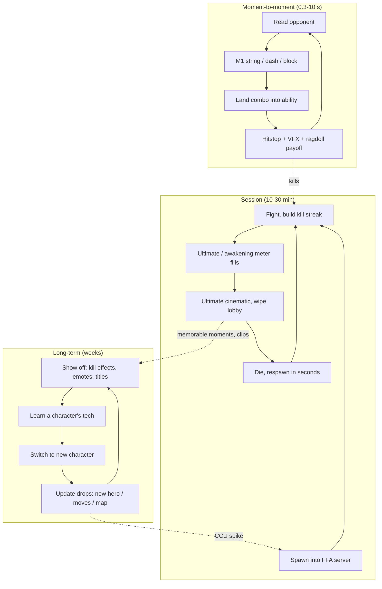

# Battlegrounds Arena Fighter Loop

## TL;DR
- **Loop line:** `spawn -> M1/ability combo -> kill or die -> respawn in seconds -> (master character, wait for next character drop)`. There is **no power progression**: everyone has the same kit, and the ceiling is skill. RoWatcher's 2026 genre analysis contrasts this with Blox Fruits-style RPGs "where wallet or grind time sets your power ceiling."
- What keeps players without progression: **(1) a very satisfying verb** (hitstop, VFX, camera), **(2) mastery and tech** (combo routes, cancels, counters), **(3) social dominance in a free-for-all server**, **(4) an update cadence that adds new characters or moves** and spikes CCU.
- Evidence (as of 2026): TSB trackers report an all-time peak between ~614K and ~1M CCU (a 1M peak on 2026-05-16 per RoWatcher; 613.6K per Profitable), with day-to-day CCU of ~33K–64K in mid-2026. JJS spiked to ~338K after its 2026-03-20 update. RoWatcher says 5–10 anime battlegrounds titles sit in Discover's top 100 in early 2026, with **50+** titles on the platform, so fatigue is real.
- Monetization must be **cosmetic or convenience only**: emotes, kill effects, aura or move skins, private servers, early or alternative character access at most. Selling damage kills the genre's core promise.
- MVP: **1 arena, 2–3 characters with 4 moves + ultimate each, FFA server, no data persistence beyond cosmetics**. It's art-heavy (animation + VFX) but systems-light. This is the vault's main genre; see [[Case Study - The Strongest Battlegrounds and Jujutsu Shenanigans]].

## Why it matters for anime battlegrounds
This *is* the genre. Every other note in this folder is either a mode you can bolt onto it ([[Hybrid Loops for Anime Games]]) or an alternative you might pick instead. The battlegrounds loop is the most **feel-dependent** loop on Roblox: it lives or dies on [[Anime Combat Animation Timing]], [[Hitstop, Hit Reactions and Knockback]] and [[Anime VFX Fundamentals]].

## The three loop layers

## Why it's compelling
| Driver | How battlegrounds deliver it |
|---|---|
| Mastery | Combo routes, dash cancels, block and counter timing, character matchups. Skill is the only progression, so improvement is *felt*. |
| Instant gratification | No onboarding grind. You are at full power in 5 seconds. Death costs about 5 seconds, not 30 minutes of loot. |
| Spectacle | Ultimates and awakenings are anime set pieces ([[Camera Work for Abilities]], [[Impact Frames and Screen Effects]]). They are clip-able on TikTok and YouTube, which drives free user acquisition. |
| Fantasy | "I am (inspired-by) Saitama / Gojo." Character archetypes from shonen are instantly legible. |
| Social status | A server full of people sees you win. Kill feed, streak announcements. |
| Novelty | A new character every few weeks resets the meta and the mastery curve. |

## Flagship examples (dated evidence)
| Game | Loop notes | Stat | Date / source |
|---|---|---|---|
| The Strongest Battlegrounds | OPM-inspired; credited with creating the subgenre | All-time peak 1M (RoWatcher) vs 613.6K (Profitable); ~33K online with a 30-day average of ~49K (RoWatcher); 64.2K CCU (Profitable) | 2026-05-16 peak; snapshots mid-2026 |
| Jujutsu Shenanigans | JJK-inspired; frequent move updates | ~338K peak two days after the 2026-03-20 update | RoWatcher, 2026-03 |
| RIVALS (non-anime control) | Round-based FPS, cosmetic-skin monetization | Peak ~961K–967K CCU; 213K–288K snapshots | Profitable 2026-07-30 / RoWatcher |
| Blade Ball (adjacent) | Arena PvP with spinnable abilities | All-time peak ranges 46K (RoWatcher, 2026-09-20 window) to 149.6K (Rotrends) to 418K+ (Naavik citing RoMonitor, older) | Trackers disagree heavily |

> [!warning] Unverified
> Tracker CCU numbers for TSB disagree by more than 1.5x (613.6K vs 1M "all-time peak"). One July 2026 figure of ~324K CCU looks like an outlier. Treat ranges as ranges. RoWatcher's genre article also names a different studio for TSB than the fan wiki used in the case-study note. Don't cite either studio attribution as fact.

**RIVALS is the key control case.** It shows that a no-progression PvP game can reach ~1M CCU on Roblox with **skins and a weapon roster** as the long-term layer. That is the same model battlegrounds use with characters.

## What keeps players in with no progression
1. **The verb is the reward.** Each hit pays out in feel: hitstop 3–6 frames, shake, sparks, a meaty sound. See [[M1 Combo System Design]].
2. **A readable skill ladder.** New players can mash M1 and land hits. Mid players learn dash-cancel routes. Top players learn counters and tech. Each rung is visible in the kill feed.
3. **Character variety as content.** Each new character is a *new verb set* to master. That is the battlegrounds equivalent of a new world in a simulator.
4. **Ultimate meter as session pacing.** Build meter, then the cinematic payoff. This gives an otherwise flat FFA a mini-arc every 1–3 minutes.
5. **Server culture.** Teaming, rivalry and "1v1 me" spontaneous duels emerge on their own. Emotes, taunts and kill effects fuel it.
6. **Update spikes.** JJS's ~338K spike after an update shows CCU responds strongly to content drops. Plan cadence like a live service: **a new character or a major move rework roughly every 2–6 weeks** (heuristic from observed genre cadence; unverified).
7. **Light meta-progression without power:** kill counts per character, mastery titles, cosmetic unlocks at milestones. Badges give a goal without breaking fairness.

## Monetization patterns that fit
| Pattern | Fit | Notes |
|---|---|---|
| Emotes, taunts | Excellent | Pure expression and social status |
| Kill / finisher effects, aura and move-colour skins | Excellent | High-visibility status; reuse VFX pipeline ([[Scripting and Emitting VFX]]) |
| Private / VIP servers | Excellent | Combo practice, friends-only fights |
| Early access to a new character (time-limited, then free) | OK | Watch for resentment; keep the window short |
| Character unlocks for Robux *or* grind | Risky | Some games do it; ensure every character is reachable F2P |
| Damage / health boosts, paid stat multipliers | **Never** | Destroys the "skill, not currency" promise |
| Spins for random moves (Blade Ball style) | Possible in arena PvP | Triggers paid random items rules; see [[Gacha and Spin Systems on Roblox]] |
| Experience subscriptions | OK | Monthly cosmetic drip, VIP server perks (Roblox supports up to 50 subscriptions per experience) |

> [!warning] Ethical limit
> The audience skews young. Don't sell power in a PvP game, don't run fake scarcity timers on cosmetics, and don't gate core characters behind randomised purchases.

## Retention mechanics
- **Daily mission set** (e.g., "land 3 ultimates with X") rewarding cosmetic currency.
- **Per-character mastery tracks** (kills or damage) unlocking cosmetics and titles.
- **Ranked or duel mode** as an opt-in second loop for mastery players. Example: JJS-style ranked arenas on a simple square field (see case study).
- **Events**: limited-time maps, modifiers ("low gravity," "ultimates only"), seasonal skins.
- **Discord + update log**: the genre's community expects patch notes and teasers.
- **PvE side mode** for players who are losing a lot. See [[Hybrid Loops for Anime Games]] (Survivors-style horde mode).

## Minimum viable scope (small team)
### Step 1: One arena
- One mid-sized map with destructibles. See [[Battleground Arena Map Design]] and [[Destructible Environments and Craters]].
### Step 2: Two or three characters
- Each: 4-hit M1, dash, block, 4 abilities, 1 ultimate/awakening. That is ~15–20 animations and ~10 VFX sets per character.
### Step 3: FFA server + respawn
- Spawn protection 1–2 s, respawn ≤ 5 s, kill feed, ultimate meter.
### Step 4: Cosmetic store + badges
- 3 emotes, 2 kill effects, a VIP server. That's enough to validate spend.
### Step 5: Instrument and update
- Track kills per minute, session length and character pick rate. Ship the next character within 4–6 weeks.

## How to give it a shonen anime skin
- **Archetypes over IP.** "Strongest hero (bald, one punch)," "blindfolded sorcerer," "flame swordsman." These are recognisable silhouettes without licensed names. See [[Shonen Anime Shape Language]].
- **Awakening = the second-half transformation**: hair colour shift, aura, new moveset. Classic shonen beat.
- **Impact frames and speed lines on ultimates.** See [[Impact Frames and Screen Effects]].
- **Japanese set dressing** for arenas. See [[Japanese Anime Set Dressing]].

> [!warning] IP risk
> RoWatcher notes most anime battlegrounds operate "as fan projects under informal publisher tolerance." JJS was temporarily removed on 2025-07-21 (developer attributed it to an external link; restored within hours). Avoid licensed names, logos and direct character likenesses. Use "inspired-by" archetypes.

## Numbers & Settings
| Setting | Value | Why |
|---|---|---|
| Respawn time | ≤ 5 s | Death must be cheap; the loop is "fight again" |
| Spawn protection | 1–2 s | Prevents spawn camping |
| Characters at launch | 2–3 | Minimum to create matchups |
| Moves per character | 4 abilities + ultimate + M1 + dash + block | Genre convention |
| Content cadence | New character every ~2–6 weeks | Matches observed update-driven spikes (heuristic) |
| Server size | 12–20 players | Big enough for chaos, small enough for mobile perf (heuristic) |
| Genre saturation | 50+ titles; 5–10 in Discover top 100 | RoWatcher, early 2026 |

## Checklist
- [ ] Verb is fun with zero goals (5-minute test)
- [ ] Each character has a readable kit and a distinct silhouette
- [ ] Ultimate meter gives a 1–3 min mini-arc
- [ ] No paid power anywhere
- [ ] Cosmetic store + VIP servers live at launch
- [ ] Mastery titles and badges as goals
- [ ] Update roadmap for the next 3 characters
- [ ] IP review: no licensed names or logos

## Common Mistakes
- **Adding stat progression** to "fix retention." It breaks the skill promise and alienates the core.
- **Too many characters at launch**, each shallow. Two deep kits beat eight thin ones.
- **Unreadable VFX spam.** Players can't see telegraphs, so mastery collapses. See [[Anime VFX Fundamentals]].
- **No new-player protection.** Stomped beginners leave in 2 minutes. Add a PvE mode, a training dummy room or a lower-skill server.
- **Slow update cadence** in a 50+ title genre. Players hop to whichever game just dropped a character.
- **Mobile neglect.** Controls and VFX must work on phones ([[Mobile-Aware Stylization]]).

## Related
- [[Case Study - The Strongest Battlegrounds and Jujutsu Shenanigans]]
- [[M1 Combo System Design]]
- [[Anime Combat Animation Timing]]
- [[Anime VFX Fundamentals]]
- [[Hybrid Loops for Anime Games]]
- [[Core Loop Comparison Matrix]]
- [[Core Loop Fundamentals]]
- [[Roadmap]]

## Sources
1. RoWatcher, "Why Anime Battlegrounds Are Taking Over Roblox in 2026": https://rowatcher.com/news/why-anime-battlegrounds-are-taking-over-roblox-in-2026
2. RoWatcher, "Is The Strongest Battlegrounds Dying?" (1M peak 2026-05-16): https://rowatcher.com/games/3808081382/the-strongest-battlegrounds/dying
3. Profitable, The Strongest Battlegrounds (2026-07-30 snapshot): https://profitable.app/roblox/games/the-strongest-battlegrounds
4. RoWatcher, "Jujutsu Shenanigans surges past 338K peak players after Disaster Plants update": https://rowatcher.com/news/jujutsu-shenanigans-surges-past-338k-peak-players-after-disaster-plants-update
5. RoWatcher, "The Strongest Battlegrounds: How One Punch Man Sparked Roblox's Anime Fighter Revolution": https://rowatcher.com/news/the-strongest-battlegrounds-how-one-punch-man-sparked-roblox-s-anime-fighter-revolution
6. RoWatcher, "RIVALS: How Roblox's Top Shooter Built a Nearly Million-Player Empire": https://rowatcher.com/news/rivals-how-roblox-s-top-shooter-built-a-nearly-million-player-empire
7. Profitable, RIVALS (2026-07-30): https://profitable.app/roblox/games/rivals
8. Naavik, "Blade Ball UGC success": https://naavik.co/digest/blade-ball-ugc-success/
9. RoWatcher, "Is Blade Ball Dying?": https://rowatcher.com/games/4777817887/blade-ball/dying
10. Deltia's Gaming, JJS removal update: https://deltiasgaming.com/?p=291826
11. Roblox Creator Hub, Subscriptions: https://create.roblox.com/docs/production/monetization/subscriptions
12. Rotrends, Blade Ball: https://rotrends.com/game/4777817887
