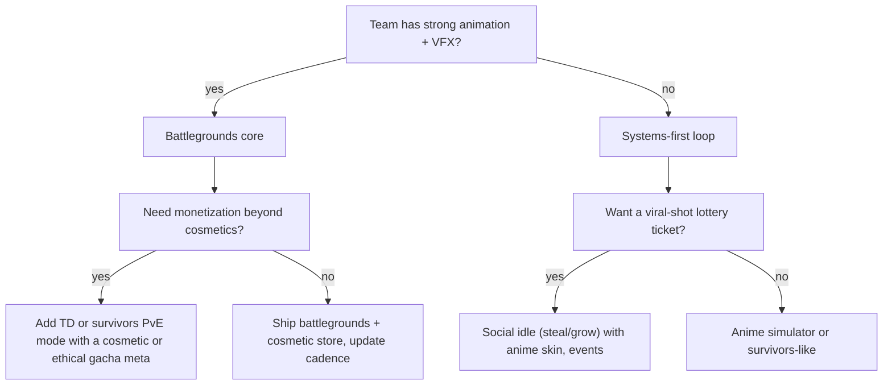

# Core Loop Comparison Matrix

## TL;DR
- One table comparing every loop in this folder on **dev cost, art cost, retention, monetization, competition and anime fit**, plus dated scale evidence.
- **Best fits for a solo or small anime team (judgement):** **(1) Battlegrounds + light cosmetic meta** (the vault's pipeline already targets it; systems-light; proven up to ~0.6M–1M CCU peaks), **(2) Survivors-like PvE horde mode** (proven loop cross-platform, under-served on Roblox, reuses moves and VFX), **(3) Anime TD + ethical gacha** (top monetization; reuses characters; but heavy live-ops and policy load).
- **Highest ceiling but luck-driven:** viral social idle loops (Grow a Garden ~22M, Steal a Brainrot ~25M CCU in 2025). The loops are cheap, but success depends on timing, events and creator coverage.
- **Avoid as a first project:** grind open-world RPGs (content burn) and full extraction (engineering + audience fit).
- Scores are **judgement calls (1–5)** grounded in the evidence in each loop note. Re-score with your own constraints.

## Why it matters for anime battlegrounds
You can't build everything. This matrix tells you which loop to ship first, which to bolt on as a mode ([[Hybrid Loops for Anime Games]]) and which to avoid until the team grows. It follows the method in [[Core Loop Fundamentals]].

## Scoring key
- **Dev cost / art cost**: 5 = cheap, 1 = very expensive (higher is better for small teams)
- **Retention / monetization / anime fit**: 5 = strong
- **Competition**: 5 = open field, 1 = saturated
- **Live-ops load**: 5 = light, 1 = needs constant content

## Matrix

| Loop | Dev cost | Art cost | Retention | Monetization | Competition | Anime fit | Live-ops load | Solo/small-team total (/35) |
|---|---|---|---|---|---|---|---|---|
| [[Battlegrounds Arena Fighter Loop]] | 4 | 2 | 3 | 3 | 2 | 5 | 2 | **21** |
| [[Survivors-Like Horde Loop]] | 3 | 4 | 4 | 3 | 5 | 5 | 3 | **27** |
| [[Tower Defense and Unit Collecting Loop]] | 3 | 3 | 4 | 5 | 2 | 5 | 1 | **23** |
| [[Simulator and Clicker Loop]] | 4 | 4 | 4 | 4 | 1 | 4 | 3 | **24** |
| [[Grind RPG and Anime Open-World Loop]] | 1 | 1 | 4 | 5 | 2 | 5 | 1 | **19** |
| [[Gacha and Spin Systems on Roblox]] (meta-layer) | 4 | 4 | 4 | 5 | 3 | 5 | 3 | **28** *(as an add-on, not standalone)* |
| [[Roguelike and Roguelite Loop]] | 3 | 3 | 4 | 3 | 4 | 4 | 3 | **24** |
| [[Tycoon and Idle Loop]] | 4 | 4 | 3 | 4 | 1 | 2 | 4 | **22** |
| Obby / tower ([[Obby, Tower and Viral Social Loops]]) | 5 | 4 | 2 | 2 | 1 | 2 | 4 | **20** |
| Viral social idle (steal/grow) | 4 | 4 | 3 (decays) | 5 | 2 | 3 | 1 | **22** |
| Extraction / PvPvE ([[Extraction, PvPvE and Horror Co-op Loop]]) | 1 | 2 | 4 | 3 | 4 | 4 | 2 | **20** |
| Horror co-op | 3 | 3 | 3 | 3 | 2 | 3 | 3 | **20** |

> [!tip] Why battlegrounds still ranks first despite a 21
> The raw total penalises battlegrounds for art cost and saturation. But this vault's whole pipeline (characters, animation, VFX, arenas) already pays that art cost, and the survivors-like and TD scores *assume* you reuse those battlegrounds assets. In practice, the best plan is battlegrounds core + one PvE mode. See [[Hybrid Loops for Anime Games]].

> [!warning] Unverified
> These scores are my synthesis, not published data. The "Competition" column comes from tracker browsing and genre articles (e.g., 50+ anime battlegrounds titles per RoWatcher; many anime TDs). It's not a systematic count of clones above 1K CCU, which the market-research method recommends. Do that count before committing.

## Evidence column (dated scale proofs)

| Loop | Best Roblox proof | Cross-platform proof | Decay signal |
|---|---|---|---|
| Battlegrounds | TSB all-time peak 613.6K–1M (2026-05-16); JJS ~338K after 2026-03-20 update | RIVALS (FPS analogue) ~961K–967K peak | 50+ titles; fatigue (RoWatcher 2026) |
| Survivors-like | None found (gap) | VS ~6.6M–7.9M units (est.); Brotato 10M+; Megabonk 117,336 Steam CCU (2025-10-05) | Steam flooded with clones |
| Anime TD | Anime Vanguards 215K–220K+ launch CCU (Sep 2024), ~101K 7-day peak (Mar 2026) | Mobile TD-gacha (Arknights-style) | Anime Defenders ~200K → ~324 CCU (Aug 2026) |
| Simulator | PS99 400K+ launch (Dec 2023); Bee Swarm ~65K daily, ~265K peak | Mobile idle/clicker | Saturated; clones die fast |
| Grind RPG | Blox Fruits ~2.77M record (Dec 2024, disputed); 60B+ visits | MMO/ARPG | Blox Fruits −40.5% 30-day (2026) |
| Gacha/spins | Shindo Life, Type Soul, Jujutsu Infinite (~4K CCU), Blue Lock Rivals 276K peak (2025-09-13) | Genshin-style gacha | Regulatory pressure (UK/Brazil u18) |
| Roguelite | DOORS ~270K peak; Dead Rails 2025 breakout | Hades II ~5.1M Steam units (est., 2026-06) | Steady |
| Tycoon/idle | Restaurant Tycoon 2; sessions 38–45 min | AdVenture Capitalist | Saturated |
| Obby | Tower of Hell 45K–68K peak | Fall Guys-style | Saturated |
| Viral social idle | Steal a Brainrot 25.4M–25.8M (Oct 2025); Grow a Garden 21.3M–22.3M (Jun–Aug 2025) | Fortnite "Steal the Brainrot" 1M peak (UEFN first) | "Is the brainrot trend dying?" (RoWatcher 2026) |
| Extraction | Nascent (Project Delta; Seropian project unannounced) | ARC Raiders ~482K Steam / ~700K cross-platform (Nov 2025) | n/a |
| Horror co-op | 99 Nights 14.2M (2025); Forsaken 138K+; DOORS | Lethal Company / R.E.P.O.-style | Steady with updates |

## Detailed notes per dimension

### Dev cost (systems + engineering)
- **Cheapest:** obby, tycoon, simulator (well-documented patterns, templates).
- **Hardest:** open-world RPG (content), extraction (netcode, AI, economy, wipes), survivors-like at Roblox scale (mob performance; see warning in [[Survivors-Like Horde Loop]]).

### Art cost (for an anime look)
- **Most expensive:** battlegrounds and RPGs, because every character needs ~15–20 animations + VFX sets ([[Anime Combat Animation Timing]], [[Anime VFX Fundamentals]]).
- **Cheapest:** survivors-like (low-poly mobs, reused hero moves), simulator, tycoon.

### Retention
- **Strong long-term:** TD (collection), simulator (rebirth + collection), RPG (long arcs), roguelite (meta + mastery).
- **Mastery-only:** battlegrounds needs update cadence to retain.
- **Spiky:** viral social loops (huge peaks, fast decay).

### Monetization (ethical ceiling)
- **Highest:** TD-gacha, RPG (fruits), viral idle (seeds/eggs), simulator (eggs/passes). Most depend on **paid random items**, so compliance work is required ([[Gacha and Spin Systems on Roblox]]).
- **Moderate:** battlegrounds (cosmetics-only by design), roguelite, extraction.
- Platform context: Roblox creators earned **$1.5B+ via DevEx in 2025** (Roblox Newsroom). The Sep 2025 DevEx raise put 100K Robux at **$380** (was $350).

### Competition
- **Saturated:** simulator, tycoon, obby, anime battlegrounds, anime TD.
- **Open-ish:** survivors-like, extraction, roguelite with anime skin.

### Anime fit
- **Native:** battlegrounds, TD (unit roster), RPG (adventure), survivors (one vs army), gacha (bloodlines).
- **Needs a reframe:** tycoon (dojo), obby (tower of trials), viral idle (cursed relics).

## Decision guide

## Numbers & Settings
| Setting | Value | Why |
|---|---|---|
| Minimum proofs per loop | 3 dated, ≤12 months old | Market-research method |
| Clone count threshold | Count clones with >1K CCU peak | Saturation proxy |
| Re-score cadence | Every quarter | Roblox trends move fast |
| Platform scale | 123M DAU (Q2 2026) | Context |

## Checklist
- [ ] Re-score each column for *your* team's skills
- [ ] Count saturated clones (>1K CCU) for your top 3 loops
- [ ] Pick 1 core loop + max 1 hybrid mode for launch
- [ ] Confirm policy requirements (paid random items) for the chosen monetization

## Common Mistakes
- Picking the loop with the highest *peak* rather than the best *fit*
- Treating viral 20M+ CCU outliers as repeatable
- Ignoring live-ops load: TD and RPG need a constant content treadmill
- Building three loops at launch

## Related
- [[Core Loop Fundamentals]]
- [[Hybrid Loops for Anime Games]]
- [[Battlegrounds Arena Fighter Loop]]
- [[Survivors-Like Horde Loop]]
- [[Tower Defense and Unit Collecting Loop]]
- [[Roadmap]]

## Sources
1. RoWatcher, "Why Anime Battlegrounds Are Taking Over Roblox in 2026": https://rowatcher.com/news/why-anime-battlegrounds-are-taking-over-roblox-in-2026
2. RoWatcher, TSB "Is it dying" page: https://rowatcher.com/games/3808081382/the-strongest-battlegrounds/dying
3. RoWatcher, JJS 338K: https://rowatcher.com/news/jujutsu-shenanigans-surges-past-338k-peak-players-after-disaster-plants-update
4. GamesRadar, Megabonk record: https://www.gamesradar.com/games/roguelike/indie-roguelike-breakout-megabonk-hit-a-new-player-record-over-the-weekend-charting-higher-than-call-of-duty-borderlands-4-and-marvel-rivals
5. Pocket Tactics, Anime Vanguards: https://www.pockettactics.com/anime-vanguards/visits
6. Profitable, Anime Defenders: https://profitable.app/roblox/games/anime-defenders
7. RoWatcher, Pet Simulator / BIG Games: https://rowatcher.com/news/inside-big-games-how-pet-simulator-became-a-100m-roblox-empire
8. RoWatcher, Blox Fruits "Is it dying": https://rowatcher.com/games/994732206/blox-fruits/dying
9. Rotrends, DOORS: https://rotrends.com/game/2440500124/DOORS
10. Wikipedia, Steal a Brainrot: https://en.wikipedia.org/wiki/Steal_a_Brainrot
11. Wikipedia, Grow a Garden: https://en.wikipedia.org/wiki/Grow_a_Garden
12. allthings.how, ARC Raiders Nov 2025: https://allthings.how/arc-raiders-player-count-on-steam-and-consoles-november-2025/
13. Roblox Newsroom, DevEx 2026 ($1.5B+ in 2025): https://about.roblox.com/newsroom/2026/04/roblox-fuels-high-fidelity-games-over-18-players-increases-qualifying-devex-rate-42
14. PocketGamer.biz, DevEx +8.5% (Sep 2025): https://www.pocketgamer.biz/roblox-creators-will-now-earn-85-more-from-developer-exchange
