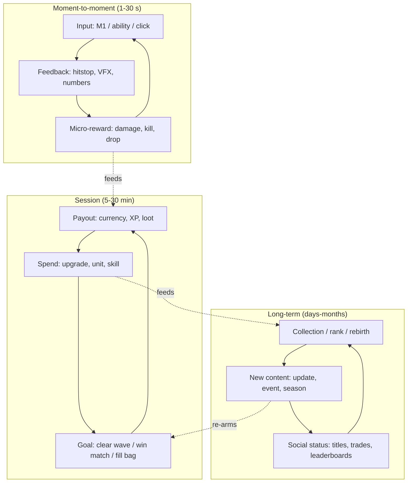

# Core Loop Fundamentals

## TL;DR
- A **core loop** is the repeated cycle of `act -> reward -> invest -> stronger act`. Roblox's own Creator Hub docs split it into three parts: **minute-to-minute interaction**, the **most repeated set of actions**, and a **progression engine**. Without the progression engine, Roblox warns, a game gets "repetitive, boring, and shallow."
- Design in **three nested layers**: moment-to-moment (seconds), session (minutes, one play sitting) and long-term or meta (days to months). A strong game has a satisfying verb at the bottom *and* a reason to come back tomorrow at the top.
- Roblox in 2026 is a **hit-driven, concentrated** market: per Newzoo/RoMonitor, the top title's share of top-10 visits rose from 22% (Q1 2025) to 43% (Q4 2025). Pick a **proven loop** and differentiate with fantasy, feel and update cadence, not with an untested loop.
- **Prototype the verb first** (greybox, no art, 1–2 weeks), then add one session goal, then one long-term hook. Judge each layer with players before adding the next.
- Every loop note in this folder uses the same template: layers diagram, psychology, monetization, retention, flagship evidence, minimum viable scope (MVP), anime skin and pitfalls. Start with [[Core Loop Comparison Matrix]] to choose.

## Why it matters for anime battlegrounds
Battlegrounds games such as The Strongest Battlegrounds (TSB) and Jujutsu Shenanigans (JJS) look like "pure combat" with no loop, but they still have one. The moment-to-moment layer is the M1 combo and ability chain ([[M1 Combo System Design]], [[Anime Combat Animation Timing]]). The session layer is kill streaks and server dominance. The long-term layer is mastering new characters and the next update drop. Knowing *which* layer your game is weak in tells you what to build next. Most failed anime fighters have great VFX ([[Anime VFX Fundamentals]]) and no reason to play a second session.

## The three loop layers

| Layer | Time scale | Question it answers | Battlegrounds example | Simulator example |
|---|---|---|---|---|
| Moment-to-moment | 1–30 s | "Does pressing the button feel good?" | 4-hit M1 into a dash cancel | Click, swing, pop of currency |
| Session | 5–30 min | "What am I trying to do right now?" | Top the kill feed, unlock an ultimate | Fill the backpack, sell, buy a better tool |
| Long-term / meta | days–months | "Why come back tomorrow?" | New character drop, mastering the tech | Rebirth multiplier, pet collection, events |

This three-tier framing appears across the industry: Pete Collier's Game Developer piece argues for short, medium and long-term compulsion loops, and the GDC talk "Fear, Love and Great Big Ideas" focuses on the long-term meta loop. Roblox's own docs use a three-part split (interaction, repeated actions, progression engine), which maps onto the same idea.

> [!tip] Core loop vs compulsion loop
> Game Developer and GameAnalytics both note that the terms get used interchangeably. A useful working distinction: the **core loop** is what the player *does* (the verb); a **compulsion loop** is the *reward schedule* wrapped around it (often variable rewards). Build the verb first. A compulsion loop on a bad verb is a slot machine. That is ethically dubious and churns fast.

## Why loops are compelling (the psychology)
| Driver | What it is | Where it shows up | Design lever |
|---|---|---|---|
| **Competence / mastery** | Getting visibly better at a skill | Battlegrounds, obbies, roguelikes | Readable telegraphs, skill ceiling, combo tech |
| **Progression** | Numbers going up, new areas | Simulators, grind RPGs, tycoons | Clear next goal always on screen |
| **Variable reward** | Unpredictable payout timing or size | Gacha, loot drops, mutations | Rarity tiers, pity, visible odds |
| **Collection / completion** | Filling a set | Pet sims, TD unit rosters | Index or Pokédex UI, set bonuses |
| **Social status** | Others see what you have | Trading, leaderboards, auras | Show-off cosmetics, titles, server announcements |
| **Social play** | Doing it with friends | Co-op horror, raids, boss fights | Party systems, shared rewards |
| **Autonomy / expression** | Your build, your base | Tycoons, gardens, builds | Customisation, multiple viable builds |

## How to evaluate a loop (before you build it)
1. **Write it as one line.** `verb -> reward -> spend -> stronger verb -> reset/rebirth`. If you can't, the loop isn't defined yet.
2. **Name the fantasy.** What does the player get to *be*? ("I'm a cursed-energy sorcerer clearing a domain.")
3. **Find 3 live proofs.** Three Roblox games (or one Roblox plus two cross-platform games) running this loop at scale *within the last 12 months*, each stat dated. See the evidence tables in each loop note.
4. **Count the saturation.** How many clones peak above 1K concurrent users (CCU)? Many clones means the loop is proven but crowded, so you need a twist.
5. **Score feasibility.** Use dev cost, art cost and live-ops burden. See [[Core Loop Comparison Matrix]].
6. **Check monetization fit.** Does the loop naturally create things to buy that don't break fairness? (A boost in a PvE sim is fine; a damage boost in a PvP fighter is poison.)
7. **Check policy.** Random paid rewards trigger Roblox's paid random items rules. See [[Gacha and Spin Systems on Roblox]].

## How to prototype a loop
### Step 1: The verb, greyboxed (1–2 weeks)
- Parts and default rig only. Implement the 1–30 s interaction and **juice** it: hitstop, sound and a cheap particle. See [[Hitstop, Hit Reactions and Knockback]].
- Test: can a friend play for 5 minutes with zero goals and still want to keep pressing buttons? If not, fix the verb before anything else.

### Step 2: One session goal (1 week)
- Add a single objective and payout (waves, a match timer, a backpack cap).
- Test: do players finish a session and say "one more"?

### Step 3: One long-term hook (1 week)
- Add *one* persistence system: a currency to spend between sessions, an unlock track or a rebirth.
- Test: invite the same testers back 24–48 h later. Do they return without being asked?

### Step 4: Instrument it
- Log session length, sessions per user per day and D1/D7 return. (Roblox Creator Dashboard analytics shows retention and session time. Add custom events for loop steps such as "wave 5 reached" or "first rebirth".)

### Step 5: Only then make art
- Art is the most expensive part of an anime game (VFX, animation, characters). Spend it on a loop that already tested well. This matches the [[Roadmap]] order.

> [!example] Dave Cross on loops
> In his GDC Free-to-Play Summit talk "Unwinding," Dave Cross (the original lead designer behind Wooga's hit titles, per the GDC Vault abstract) argues that failed projects often trace back to a fundamental core-loop problem that the team missed or didn't want to admit. PocketGamer.biz coverage quotes him: "this core loop is where you spend 90% of your time."

## Numbers & Settings
| Setting | Starting value | Why |
|---|---|---|
| Moment-to-moment cycle | 1–3 s per action | Keep the hands busy; idle hands mean churn |
| First reward | < 30 s after spawn | First-session drop-off is brutal on Roblox |
| First upgrade or purchase | < 3 min | Teaches the spend step early |
| Session goal length | 5–20 min | Fits phone sessions and kid attention spans (heuristic) |
| Long-term hook visible | In first session | Players must *see* the rebirth or collection before leaving |
| Prototype time per layer | 1–2 weeks | Fail fast; don't polish untested loops |
| Platform scale (context) | 123M DAU, 29B hours in Q2 2026 | The audience is huge but concentrated in a few hits |

> [!warning] Unverified
> The session-length and timing rows above are design heuristics drawn from comparing live games, not published Roblox benchmarks. Tune them with your own Creator Dashboard data.

## Checklist
- [ ] Loop written as one line, with all three layers named
- [ ] Fantasy written as one sentence
- [ ] Three dated live proofs collected (see loop notes)
- [ ] Verb greyboxed and fun for 5 min with no goals
- [ ] One session goal added and tested
- [ ] One long-term hook added and tested for 24–48 h return
- [ ] Analytics events for each loop step
- [ ] Monetization and paid random item compliance checked
- [ ] Art production started only after the above

## Common Mistakes
- **Art-first development**: months on a gorgeous character before knowing whether the loop works.
- **Missing middle layer**: a great verb and a rebirth system with nothing in between, so sessions have no shape.
- **Progression without a verb**: numbers go up but the action is boring (dead "simulators" with no feel).
- **Copying the surface, not the loop**: cloning Blox Fruits' look without its quest-and-boss rhythm.
- **Treating one tracker as truth**: CCU sites disagree, often by 2x. Report ranges.
- **Ignoring policy**: shipping a Robux spin with no odds displayed.

## Related
- [[Core Loop Comparison Matrix]]
- [[Hybrid Loops for Anime Games]]
- [[Battlegrounds Arena Fighter Loop]]
- [[Gacha and Spin Systems on Roblox]]
- [[Anime Combat Animation Timing]]
- [[Anime VFX Fundamentals]]
- [[Roadmap]]

## Sources
1. Roblox Creator Hub, "Core loops" (updated 2026-08-17 per search metadata): https://create.roblox.com/docs/production/game-design/core-loops
2. GameAnalytics, "How to perfect your game's core loop": https://www.gameanalytics.com/blog/how-to-perfect-your-games-core-loop
3. Game Developer, "The compulsion loop explained": https://www.gamedeveloper.com/business/the-compulsion-loop-explained
4. Game Developer, Pete Collier, "Compulsion loops in the short, medium and long term" (2011): https://gamedeveloper.com/design/opinion-compulsion-loops-in-the-short-medium-and-long-term
5. GDC Vault, Dave Cross, "Free to Play Summit: Unwinding": https://gdcvault.com/play/1028883/Free-to-Play-Summit-Unwinding
6. PocketGamer.biz, "Designing core gameplay loops with Crosshatch Games' Dave Cross": https://www.pocketgamer.biz/designing-core-gameplay-loops-with-crosshatch-games-dave-cross
7. GDC Vault, "Fear, Love and Great Big Ideas": https://gdcvault.com/play/1022828/Fear-Love-and-Great-Big
8. GDC Vault, "The Turducken Method of Game Design": https://gdcvault.com/play/1014958/The-Turducken-Method-of-Game
9. GameDevReports / Newzoo, "Top Roblox Games in 2025" (RoMonitor data): https://gamedevreports.substack.com/p/newzoo-top-roblox-games-in-2025
10. Outlook Respawn, Roblox Q2 2026 results (123M DAU, 29B hours): https://respawn.outlookindia.com/gaming/gaming-news/roblox-q2-2026-revenue-soars-36-to-15b-despite-bookings-miss
11. RoWatcher, "Why Anime Battlegrounds Are Taking Over Roblox in 2026": https://rowatcher.com/news/why-anime-battlegrounds-are-taking-over-roblox-in-2026
12. Roblox Creator Hub, Paid random items policy: https://create.roblox.com/docs/production/monetization/paid-random-items
