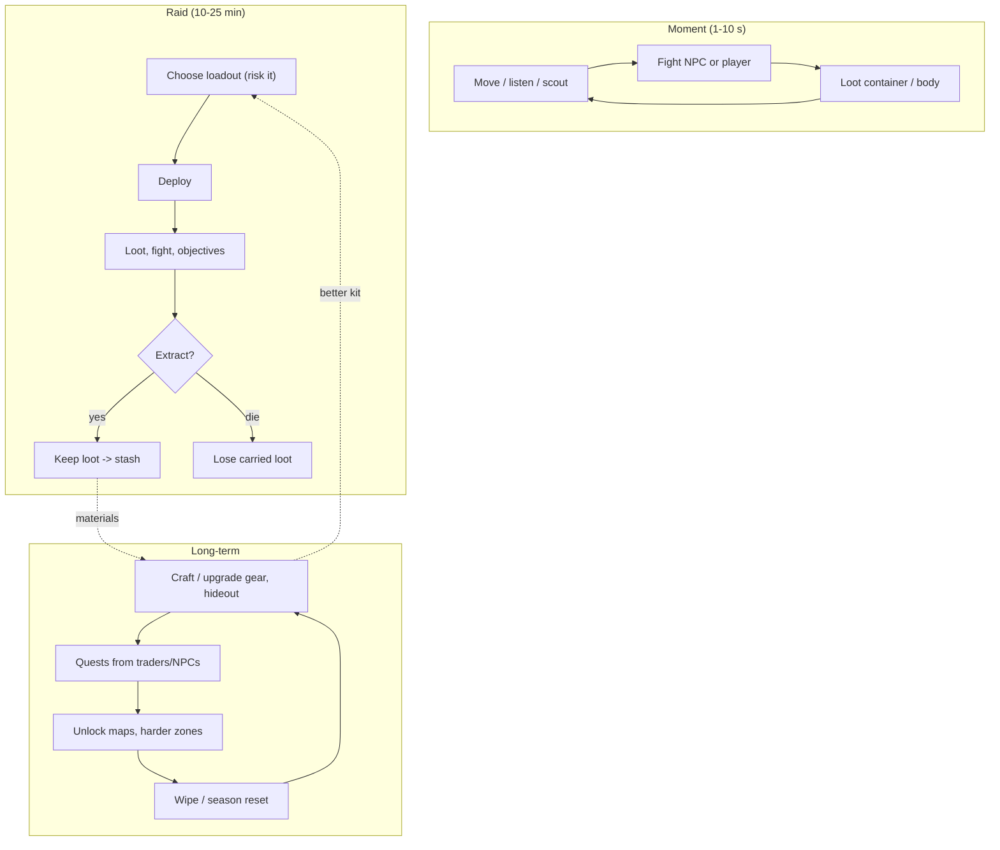
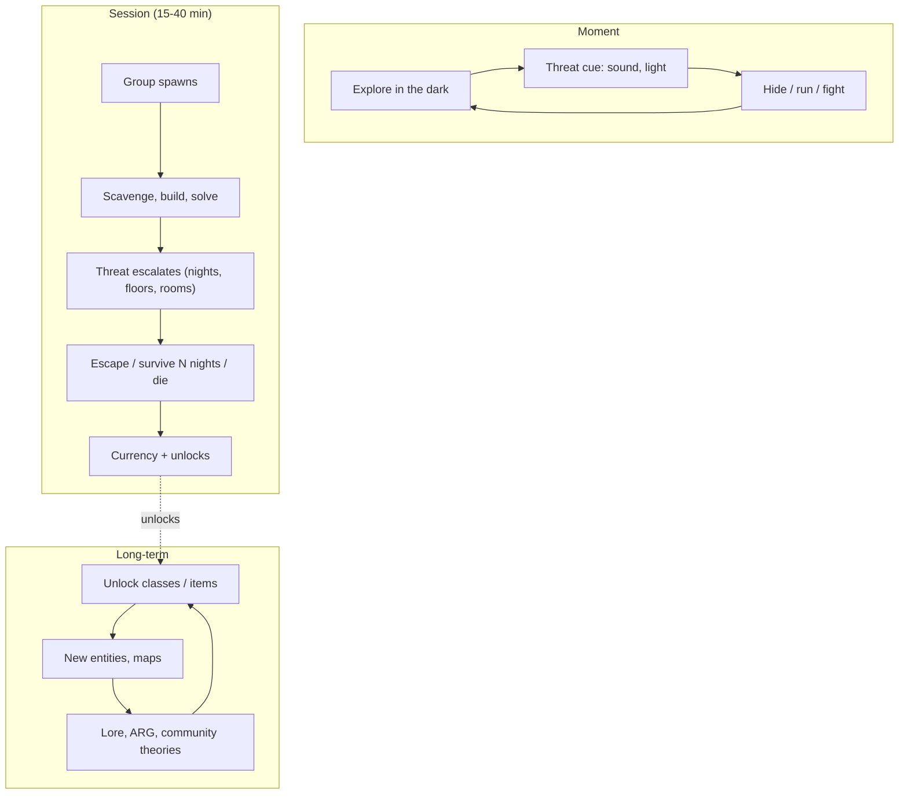

# Extraction, PvPvE and Horror Co-op Loop

## TL;DR
- **Extraction loop:** `prepare loadout -> deploy -> loot under PvE + PvP threat -> extract to keep loot (or die and lose it) -> stash -> upgrade gear -> deploy again`. The **risk of loss** is the engine. Cross-platform proof: **ARC Raiders** (Embark) launched 2025-10-30 and reached **~482K Steam CCU on 2025-11-16** and **~700K cross-platform**, with **2.5M+ copies** reported.
- **Horror co-op / survival loop:** `group up -> survive escalating threat -> scavenge, solve, escape -> unlock/upgrade -> repeat`. On Roblox this is *huge*: **99 Nights in the Forest** peaked at **14.2M CCU** (2025), **Forsaken** (asymmetric horror; RIA 2025 Best Survival) passed **138K** peak, **DOORS** peaked ~270K and **Dead Rails** had a breakout 2025.
- Roblox extraction is **nascent**. Project Delta (tactical extraction), Extermination Order (PvE co-op extraction beta) and an unannounced extraction shooter from Bungie co-founder Alex Seropian (no title as of July 2026) were the only examples found. That's a potential gap, but kids may hate losing loot.
- Psychology: **loss aversion + tension + relief, emergent stories, social bonding through shared fear, clip-ability**.
- Anime fit: **"curse hunting expeditions"** (enter a cursed zone, exorcise and loot, escape before the domain collapses) maps neatly onto JJK/Chainsaw-Man-style fantasies.

## Why it matters for anime battlegrounds
Battlegrounds PvP has no stakes. Extraction adds **stakes** (you carry something worth losing) while keeping skill-based combat at its core. A **PvPvE expedition mode** where players fight NPC curses and each other for relics, then extract, reuses the same movesets with a different session arc.

## Loop A: Extraction / PvPvE

## Loop B: Horror co-op / survival

## Why it's compelling
| Driver | Extraction | Horror co-op |
|---|---|---|
| Tension / relief | Carrying loot to extraction | Hiding from an entity |
| Loss aversion | Losing gear | Dying = round over |
| Emergent stories | Ambushes, betrayals | Friends screaming; clips |
| Social | Squads, truce or betrayal | Shared fear bonds groups |
| Mastery | Map knowledge, fights | Entity patterns |
| Spectacle | — | Jump scares are YouTube/TikTok fuel |

## Flagship examples (dated evidence)
| Game | Type | Stat | Date / source |
|---|---|---|---|
| ARC Raiders (PC/console) | PvPvE extraction | 264,673 Steam peak day 1; ~482K Steam peak 2025-11-16; ~700K cross-platform weekend; 2.5M+ sold | Notebookcheck, Wccftech, allthings.how (Nov 2025) |
| 99 Nights in the Forest | Co-op survival (survive 99 nights, scavenge, defend) | 14.2M CCU peak | PC Gamer / Wikipedia list (2025) |
| Forsaken | Asymmetric horror (killer vs survivors) | Launched late Dec 2024; 138K+ documented peak; surged past 86K after the v4.0.0 update (Mar 18, likely 2026); RIA 2025 Best Survival Experience | RoWatcher |
| DOORS | Co-op roguelite horror | ~269.8K all-time peak (Rotrends) | 2026 snapshot |
| Dead Rails | Co-op run/loot survival | 79K (RoWatcher, 2025-11-28) to "200K+" (GameAnalytics) peak claims | 2025 |
| Project Delta | Roblox tactical extraction (metro hub, loot, extract) | No player data found | Earnaldo (promo site; low authority) |
| Alex Seropian project | Roblox extraction shooter (18+) | Unannounced title as of early Jul 2026 | games.gg |

> [!warning] Unverified
> ARC Raiders sources differ slightly on launch-week peaks (441K vs 462K). Roblox extraction player counts weren't found. Forsaken's year for the March update is inferred from context.

## Roblox-specific design considerations
- **Loss tolerance of a young audience**: full loot loss may churn 8–12-year-olds. Consider a **secure container / insured slot**, partial loss or a **PvE-only extraction mode** (Extermination Order is a PvE co-op extraction).
- **18+ content and DevEx**: Roblox raised the DevEx rate 42% for spend from **US players 18+** in eligible games starting 2026-06-08. Mature-leaning extraction or horror aimed at adults may benefit, but it requires appropriate content maturity labels.
- **Performance**: large maps + AI + PvP is demanding; use small maps (Roblox servers are smaller than PC extraction lobbies).

## Monetization patterns that fit
| Pattern | Notes |
|---|---|
| Cosmetics (skins, weapon VFX, emotes) | Safe |
| Stash space / hideout upgrades | Convenience; fine |
| Secure-container size | Borderline pay-to-win; keep small |
| Season pass | Wipe/season structure suits it |
| Classes / entity skins (horror) | Forsaken-style character skins |
| Revives (horror co-op) | Common; cap and exclude from leaderboards |
| Selling gear that enters PvP raids | **Avoid**: pure pay-to-win |

## Retention mechanics
- **Seasonal wipes** (fresh economy; everyone restarts together)
- **Trader quests / contracts**
- **New entities and maps** (horror)
- **Lore and community theories** (DOORS, Forsaken communities)
- **Squad invites**

## Minimum viable scope (small team)
### Extraction-lite (5–7 weeks)
- 1 small map (instanced, 8–16 players), 3 NPC enemy types, 20 loot items, 2 extraction points, stash + 3 crafting upgrades, partial-loss rule.
### Horror co-op (4–6 weeks)
- 1 procedural or semi-procedural map, 1–2 entities with clear audio cues, 4-player lobby, revive rule, unlock currency. **Audio and lighting are the art budget** ([[Lighting for Anime Maps]]).

## How to give it a shonen anime skin
- **Curse-hunting expeditions**: enter a "cursed zone," exorcise curses (PvE), grab cursed fingers/relics (loot), escape before the barrier closes; rival sorcerers (PvP).
- **Devil-hunter contracts** (Chainsaw-Man-like): bounties on devils, extract with the contract proof.
- **Demon-night survival** (Demon Slayer-like): survive until sunrise; demons fear light, so lanterns are the core resource (99 Nights structure + anime).
- **Asymmetric**: one player is the "special-grade curse" vs a team of students (Forsaken structure).
- Combat feel from [[M1 Combo System Design]] still matters: fights must be short and decisive.

## Numbers & Settings
| Setting | Starting value | Why |
|---|---|---|
| Raid length | 10–20 min | Shorter than PC extraction (heuristic) |
| Lobby size | 8–16 | Roblox server/perf (heuristic) |
| Loss rule | Lose 50–100% of carried loot; secure slot 1–4 items | Tune for audience |
| Extraction points | 2–3 per map, some conditional | Creates routing decisions |
| Horror party size | 1–4 | DOORS / Forsaken convention |
| Survival goal | N nights / floors | 99 Nights / DOORS structure |

## Checklist
- [ ] Loss rule tested with target-age players
- [ ] PvE-only option
- [ ] Clear audio cues for every threat
- [ ] Extraction timers and countdown UI
- [ ] No purchasable gear that enters PvP
- [ ] Content maturity label set correctly for horror

## Common Mistakes
- **Full-loss hardcore rules for kids**: churn.
- **Huge maps on small servers**: empty, boring raids.
- **Horror without readable cues**: unfair deaths feel cheap.
- **Gear-for-Robux in PvP raids.**
- **No wipe/season plan**: the economy inflates and new players can't compete.

## Related
- [[Roguelike and Roguelite Loop]]
- [[Battlegrounds Arena Fighter Loop]]
- [[Obby, Tower and Viral Social Loops]]
- [[Hybrid Loops for Anime Games]]
- [[Core Loop Comparison Matrix]]

## Sources
1. Notebookcheck, ARC Raiders 250K+ Steam peak: https://www.notebookcheck.net/Arc-Raiders-maintains-strong-post-launch-numbers-with-a-peak-of-over-250-000-concurrent-players-on-Steam.1152880.0.html
2. Wccftech, ARC Raiders hits 700K concurrent players: https://wccftech.com/arc-raiders-continues-strong-launch-hits-700k-concurrent-players/amp/
3. allthings.how, ARC Raiders player count Nov 2025: https://allthings.how/arc-raiders-player-count-on-steam-and-consoles-november-2025/
4. Mein-MMO, ARC Raiders 200K+ first day: https://mein-mmo.de/en/arc-raiders-attracted-over-200000-players-simultaneously-on-the-first-day-effortlessly-reaching-the-top-5-on-steam,1534628
5. PC Gamer, 99 Nights in the Forest 14.2M peak: https://www.pcgamer.com/games/survival-crafting/with-a-peak-player-count-of-14-2-million-99-nights-in-the-forest-has-an-audience-other-multiplayer-games-would-kill-for-to-find-these-behemoth-playerbases-you-need-to-be-on-a-platform-like-roblox/
6. Wikipedia, List of Roblox games: https://en.wikipedia.org/wiki/List_of_Roblox_games
7. RoWatcher, "Forsaken's Floral Update Drives the Survival Horror Hit Past 86K Players": https://rowatcher.com/news/forsaken-s-floral-update-drives-the-survival-horror-hit-past-86k-players
8. Rotrends, DOORS: https://rotrends.com/game/2440500124/DOORS
9. GameAnalytics, "Dead Rails and the Hit Makers Formula": https://www.gameanalytics.com/blog/dead-rails-and-the-hit-makers-formula
10. RoWatcher, Dead Rails: https://rowatcher.com/games/7018190066/dead-rails/dying
11. Earnaldo, Project Delta (promotional site; low authority): https://earnaldo.com/blog/project-delta
12. Roblox, Extermination Order: Rising Fire (BETA): https://www.roblox.com/games/15872884517
13. games.gg, Bungie co-founder extraction shooter on Roblox: https://games.gg/news/bungie-cofounder-extraction-shooter-roblox/
14. Roblox Newsroom, DevEx +42% for qualifying 18+ US spend (Apr 2026): https://about.roblox.com/newsroom/2026/04/roblox-fuels-high-fidelity-games-over-18-players-increases-qualifying-devex-rate-42
