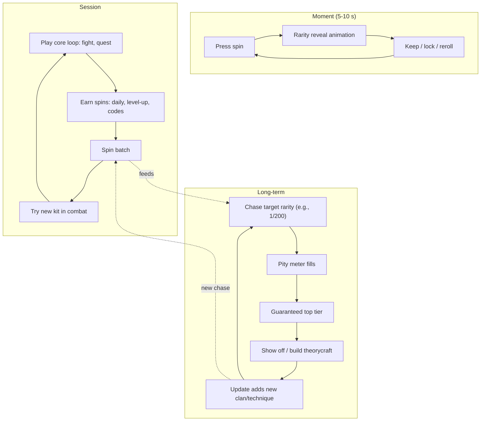

# Gacha and Spin Systems on Roblox

## TL;DR
- **"Spins"** are the dominant anime-RPG monetization layer on Roblox. Players reroll a **clan / race / bloodline / innate technique** that sets their power kit: **Shindo Life** bloodlines (e.g., 1/120 to 1/250 per spin per guides), **Type Soul** clans (one guide reports ~96% Common / 3% Legendary / 1% Mythical), **Jujutsu Infinite** innates (with a pity meter) and **Blade Ball** ability wheels.
- **It's a meta-loop, not a core loop.** `earn/buy spins -> roll -> keep or reroll -> play with the new kit -> want a better roll`. It sits on top of a combat or RPG loop.
- **Roblox policy (Creator Hub, updated 2026-08 per metadata):** anything random bought with **Robux or with currency bought with Robux** is a *paid random item*. You must **show every outcome and its exact odds before purchase**. Odds boosters must be explained and odds must **update live** while boosts are active. Results **cannot be traded or sold for Robux or real money**. You must use **PolicyService** (`ArePaidRandomItemsRestricted`) to block access where restricted.
- **Regional restrictions:** UK users under 18 and Brazil users under 18 are blocked from paid random items. Experiences that declare paid random items without the PolicyService check are auto-blocked for those users (DevForum and Roblox Help). Plan a **direct-purchase fallback**.
- Ethical design: **pity counters, generous free spins (codes, dailies, levelling), no wipe-on-reroll surprises, no paid power in ranked PvP**.

## Why it matters for anime battlegrounds
Shonen worldbuilding is built on **inherited power**: clans, bloodlines, kekkei genkai, cursed techniques, races (Soul Reaper / Hollow / Quincy). Spins turn that lore into a system. In a pure battlegrounds game, though, spins conflict with the "skill not currency" promise ([[Battlegrounds Arena Fighter Loop]]). Use them for **cosmetics or sidegrades**, or in PvE/RPG modes, not for ranked power.

## The loop



## Why it's compelling (and why it's risky)
| Driver | Upside | Risk |
|---|---|---|
| Variable ratio reward | Highly engaging; every spin could be "the one" | Same mechanism as gambling; younger players are vulnerable |
| Identity | "I'm a Uchiha-type clan" is personal | Low rolls feel like being born weak |
| Social status | Rare roll is visible in combat | Envy-driven spending |
| Theorycraft | Tier lists, YouTube, community | Meta shifts devalue purchases |
| Free spins | Codes create hype and re-engagement | Inflation if too generous |

## Flagship examples (dated evidence)
| Game | System | Details | Source |
|---|---|---|---|
| Shindo Life | Bloodline spins | Per-bloodline odds such as 1/120 (Minakaze), 1/160, 1/200 (Sengoku), 1/250 (Bankai Akuma); 500+ free spins typically available via codes; spin storage cap 500 without pass; Robux spin packs (prices vary by source: e.g., 15 spins = 120 R$) | BloxMeta / ProGameGuides, 2026 |
| Type Soul | Clan & race rerolls | ~96% Common (no buffs), 3% Legendary, 1% Mythical (secondary source); rerolls via Robux, codes, trading, AFK world; race change via a ticket that wipes progress | allthings.how, Pocket Tactics |
| Jujutsu Infinite | Innate technique spins | 60 free spins/day from dailies (per guide), AFK chamber; ~10 spins for 49 R$; Special Grade pity meter; ~4K CCU | Beebom / Sportskeeda, 2026 |
| Blade Ball | Ability/sword wheel | Spins from codes; abilities also buyable with coins | allthings.how / Softwaretestinghelp |
| Blue Lock Rivals | Style rarity (7 tiers per one blog) | All-time peak ~276K (2025-09-13, RoWatcher) | RoWatcher |

> [!warning] Unverified
> Odds and prices come from guide sites and change with patches. Type Soul's 96/3/1 split is from a single secondary article. Verify in-game before using any as a benchmark.

## Roblox paid random items: compliance checklist
| Rule (Creator Hub) | Implementation |
|---|---|
| Applies to purchases with Robux *or* currency bought with Robux, including **indirect** purchases | If spins can be bought at all, the spin is a paid random item, even when you roll with "free" spins |
| Show **all possible outcomes** and **real numerical odds** before purchase | Odds panel on the spin screen; list every clan/tier |
| Shared odds can be stated once ("Odds for each item listed below: X%") | Group by rarity tier |
| Odds-boosting items must be explained before purchase and **odds must update dynamically** while active | Live odds panel reflecting luck boosts |
| Results **cannot be traded/sold for Robux, real currency or anything of value** | Disable Robux-value trading of rolled items |
| Use **PolicyService**; honour `ArePaidRandomItemsRestricted` | If restricted: remove feature, offer direct-purchase shop, or show error |
| UK & Brazil under-18 restrictions | Undeclared/non-compliant experiences auto-blocked for those users |

> [!tip] Community interpretation
> A DevForum thread argues that a spinner that can produce *nothing* (a losing outcome) crosses into gambling, which is banned. That is a forum reading, not official text. Still, **always award an item on every spin**.

```lua
-- Sketch: gate paid spins with PolicyService (server-side)
local PolicyService = game:GetService("PolicyService")

local function canBuyPaidRandom(player)
    local ok, policy = pcall(PolicyService.GetPolicyInfoForPlayerAsync, PolicyService, player)
    if not ok then return false end -- fail closed
    return not policy.ArePaidRandomItemsRestricted
end
```

## Ethical design patterns
1. **Pity**: guaranteed top tier within N spins, with a visible counter (Jujutsu Infinite-style).
2. **Lock/keep**: let players lock a roll before rerolling another slot (bloodline slots) so they never lose a great roll by accident.
3. **Generous free spins**: daily quests, level milestones, codes. Shindo-style "500+ free spins via codes" keeps F2P viable.
4. **No progress wipes hidden behind rerolls**: Type Soul's race ticket wipes progress, so warn loudly.
5. **Sidegrades, not straight upgrades**: clans change playstyle more than raw power.
6. **Direct purchase alternative** for restricted regions (and as an honest option everywhere).
7. **Spend caps / parental-friendly UX**: no countdown pressure, no near-miss animations.

## Retention mechanics
- New clan/technique per update creates a fresh chase
- Limited-time boosted banners (use sparingly)
- Code drops on social channels
- Collection log of rolled clans

## Minimum viable scope
### Step 1: Data model
- Clan/technique table with rarity, weights and display odds generated **from the same table** (never hardcode the UI separately).
### Step 2: Server-side roll + pity
- Secure RNG on the server; persist the pity counter with DataStore.
### Step 3: Spin UI
- Rarity reveal with impact frames ([[Impact Frames and Screen Effects]]); odds panel always one tap away.
### Step 4: PolicyService gating + fallback shop
### Step 5: Free spin sources (daily, level-up, codes)

## How to give it a shonen anime skin
- **Clans / bloodlines** with family crests and signature eye or hair VFX
- **Races / factions** (shinigami-like, hollow-like, quincy-like archetypes)
- **Cursed techniques / quirks** as innate movesets
- Reveal animation = "awakening" cutscene with aura colours by rarity ([[Anime VFX Fundamentals]])

## Numbers & Settings
| Setting | Starting value | Why |
|---|---|---|
| Top-tier odds | ~0.5–1% (display exact) | Comparable to genre examples (1/120–1/250) |
| Pity | 100–250 spins | Keep it within reach of free spins over a few weeks (heuristic) |
| Free spins / day | 10–60 | Jujutsu Infinite guide cites 60/day |
| Odds display | Exact %, all items | Policy |
| Server-side RNG | Always | Anti-exploit |

## Checklist
- [ ] Odds generated from the same weight table as the roll
- [ ] Every spin awards something
- [ ] PolicyService check; fail closed
- [ ] Direct-purchase fallback for restricted users
- [ ] Rolled items not tradable for Robux value
- [ ] Pity counter visible and persisted
- [ ] Luck boosts update the odds display live
- [ ] Warning dialog before any progress-wiping reroll

## Common Mistakes
- Displayed odds that don't match the actual weights (policy violation and trust collapse)
- Client-side RNG (exploitable)
- Forgetting that "free" spins are still paid random items if spins are purchasable
- Selling ranked PvP power through spins
- Rerolls that silently overwrite a rare roll

## Related
- [[Tower Defense and Unit Collecting Loop]]
- [[Grind RPG and Anime Open-World Loop]]
- [[Simulator and Clicker Loop]]
- [[Battlegrounds Arena Fighter Loop]]
- [[Core Loop Comparison Matrix]]

## Sources
1. Roblox Creator Hub, Paid random items policy guidelines: https://create.roblox.com/docs/production/monetization/paid-random-items
2. Roblox Creator Hub, Randomized virtual items policy: https://create.roblox.com/docs/production/monetization/randomized-virtual-items-policy
3. Roblox DevForum, Update on paid random items restriction for UK users under 18: https://devforum.roblox.com/t/update-on-paid-random-items-restriction-for-uk-users-under-18/3072183
4. Roblox Help, Brazil Digital ECA updates: https://en.help.roblox.com/hc/cs/articles/48706630819476-Brazil-Digital-ECA-Updates
5. Roblox DevForum, Guidelines around users paying for random virtual items: https://devforum.roblox.com/t/guidelines-around-users-paying-for-random-virtual-items/307189
6. Roblox DevForum, "The Definition of Gambling on Roblox": https://devforum.roblox.com/t/the-definition-of-gambling-on-roblox/1287336/5
7. BloxMeta, Shindo Life bloodline guide (2026): https://bloxmeta.gg/games/shindo-life/guides/bloodline-guide
8. ProGameGuides, Minakaze bloodline: https://progameguides.com/roblox/how-to-get-the-minakaze-bloodline-in-roblox-shindo-life/
9. allthings.how, Type Soul clans and rerolls: https://allthings.how/type-soul-clans-every-clan-rarity-and-how-to-reroll/
10. Pocket Tactics, Type Soul clans guide: https://www.pockettactics.com/type-soul-clans
11. Beebom, How to get spins in Jujutsu Infinite: https://beebom.com/how-get-spins-jujutsu-infinite
12. Sportskeeda, How to get spins in Jujutsu Infinite: https://sportskeeda.com/roblox-news/how-get-spins-jujutsu-infinite
13. RoWatcher, Blue Lock: Rivals: https://rowatcher.com/games/6325068386/sendou-blue-lock-rivals/dying
14. Roblox Creator Hub, PolicyService reference: https://create.roblox.com/docs/reference/engine/classes/PolicyService
