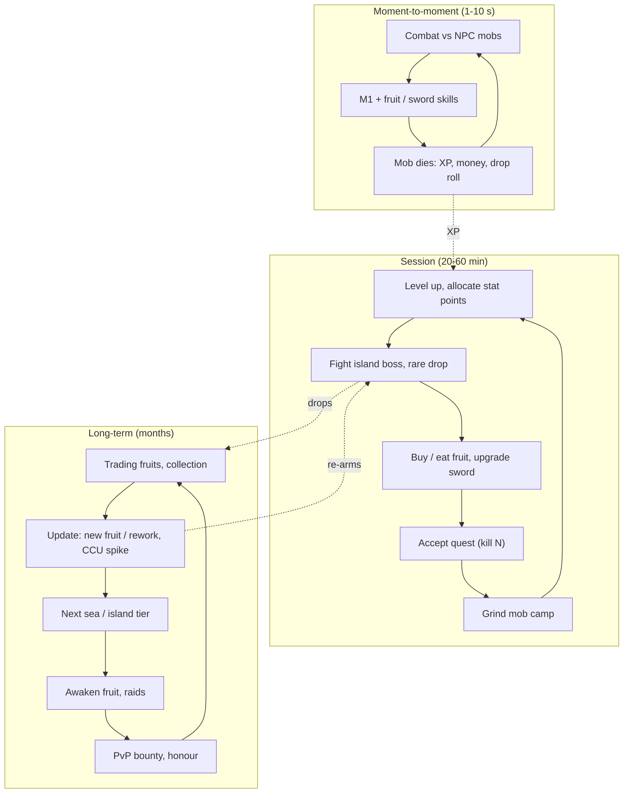

# Grind RPG and Anime Open-World Loop

## TL;DR
- **Loop line:** `take quest -> kill NPC mobs -> XP + money -> level up / allocate stats -> stronger fruit/weapon/style -> next island -> bosses for rare drops -> raids / PvP / bounty`. This is the **Blox Fruits / Grand Piece Online (GPO) / King Legacy** model: One Piece-inspired open seas, "devil fruits" as rare powers.
- **Blox Fruits** is the genre king. It was published 2019-01-16 by Gamer Robot Inc, RoWatcher's timeline says it passed **60B visits in 2026**, and it held Roblox's all-time CCU record (~2.77M, Dec 2024 Dragon rework, per one source) until Grow a Garden broke it in 2025. Mid-2026 snapshots: **116K–255K CCU** (Profitable, 2026-07-30: 255.5K), with a −40.5% 30-day change on RoWatcher, so it is **declining from its peak**.
- **GPO** peaked at ~67K (2026-01-03, RoWatcher). **King Legacy** peaked at ~72K (2026-03-22) and has ~4B visits. These are update-spike games: CCU swings hard around drops.
- Psychology: **long progression arc (community-cited max level ~2,550 in Blox Fruits, unverified; 675 in GPO per RoWatcher), rare-drop chase (fruits), exploration, boss raids, PvP bounty status, trading**.
- Monetization: **permanent fruits for Robux (e.g., Permanent Dragon 5,000 R$ after a price change per the Blox Fruits wiki), 2x XP/money passes, fruit storage, gamepasses**. It's the most *content-expensive* loop: many islands, NPCs and bosses.

## Why it matters for anime battlegrounds
Grind RPGs are where shonen *adventure* lives: islands, crews, bosses, power-ups. RoWatcher frames battlegrounds as the reaction *against* this model ("skill, not currency"). Knowing why players love and leave grind RPGs tells you which pieces (bosses, rare powers, exploration) to borrow without importing pay-to-win.

## The three loop layers

## Why it's compelling
| Driver | Implementation |
|---|---|
| Long progression | Hundreds or thousands of levels across "seas" |
| Rare-power chase | Fruits spawn randomly in the world, drop from bosses or sell in rotating stock |
| Exploration | Islands, secrets, hidden NPCs |
| Fantasy | Pirate/ninja/shinigami adventure; eat a fruit and *become* fire |
| Social | Crews, boss raids, bounty hunting, trading economy |
| Update spikes | Fruit reworks drive giant CCU surges (the Dragon rework example) |

## Flagship examples (dated evidence)
| Game | Stat | Date / source |
|---|---|---|
| Blox Fruits (Gamer Robot Inc) | Published 2019-01-16; ~60B+ visits (RoWatcher timeline, 2026); ~2.77M CCU record at Dec 2024 Dragon rework (one source; another claims 3.7M in 2023, inconsistent); 255.5K CCU / 469.8K peak in window (Profitable, 2026-07-30); 116K online, 30-day avg 203K, −40.5% 30-day (RoWatcher, undated 2026) | Mixed |
| Blox Fruits revenue | Profitable model ~$503M lifetime; RoWatcher ~$1.83M/month (58% confidence) | Third-party models |
| Grand Piece Online | Peak ~67K (2026-01-03); 13K online, +58.2% 30-day at snapshot; max level 675 | RoWatcher 2026 |
| King Legacy | Peak ~72K (2026-03-22, RoWatcher) vs 61.1K tracked peak (Profitable, 2026-07-17); ~4B visits; declining (−26.6% 30-day) | 2026 |

> [!warning] Unverified
> Blox Fruits' all-time peak is contested (2.77M vs 3.7M vs RoWatcher's 1.7M). Revenue figures differ by an order of magnitude between models. Don't quote any single number as fact.

## Monetization patterns that fit
| Pattern | Notes |
|---|---|
| Permanent power purchase (fruit) | Lucrative; it *is* pay-for-power in a game with PvP. Mitigate with PvP opt-in zones and skill-based counters |
| 2x XP / 2x money / 2x drop passes | Staple |
| Fruit storage / notifier passes | Convenience; the "fruit notifier" type pass is controversial (it shows rare spawns) |
| Random fruit gacha for in-game currency | If the currency can be bought with Robux, it's a **paid random item**: odds required |
| Cosmetics (titles, auras) | Underused in the genre; good opportunity |
| Private servers | Grind-friendly; huge in this genre |

> [!warning] Ethical limits
> Selling the best PvP power for a 5,000 R$ (~$50+ retail) one-time purchase to a young audience is the genre's biggest criticism. If you copy the loop, make paid powers **sidegrades or cosmetic variants**, and keep PvP opt-in.

## Retention mechanics
- **Level cap raises** and new seas
- **Fruit reworks** (old powers get new moves) re-engage veterans
- **Raids and awakening** systems as mid/late-game goals
- **Rotating fruit stock** (check back every few hours), a classic appointment mechanic
- **Bounty/honour** PvP leaderboards
- **Trading** economy (needs anti-scam UI)

## Minimum viable scope (small team)
This is the **most content-expensive loop** in the folder. A small-team MVP has to be ruthless:
### Step 1: One island hub + 3 mob camps + 1 boss (weeks 1–3)
### Step 2: Quest NPC, XP curve to level 100, stat allocation (week 3)
### Step 3: 5 "powers" (fruits/styles) with 3–4 moves each (weeks 4–6)
- Reuse your battlegrounds move pipeline: [[M1 Combo System Design]], [[Anime VFX Fundamentals]].
### Step 4: Rare power drop from boss + world spawn (week 6)
### Step 5: Second island, private servers, 2x passes (weeks 7–8)

> [!tip] Scope hack
> Instead of an open world, ship an **"island-hopping" instance model**: each island is a separate place or instanced zone loaded on demand. That cuts streaming and perf risk and lets you add islands as updates.

## How to give it a shonen anime skin
It already *is* shonen (One Piece / Naruto / Bleach DNA). Differentiation ideas:
- **A non-pirate setting**: cursed-energy schools, demon-hunting corps or hero academies. The same loop wears a different fantasy.
- **Powers as "techniques" or "quirks"** with awakening transformations.
- **Boss = arc villain** with phased telegraphs ([[Anime Combat Animation Timing]]).

> [!warning] IP risk
> "Devil fruit," "Haki" and similar terms and names are One Piece IP. Most Roblox games rename (e.g., "Blox Fruits"). Use your own vocabulary.

## Numbers & Settings
| Setting | Starting value | Why |
|---|---|---|
| Level cap (MVP) | 100, raise per update | Leave headroom for updates |
| Time per level early | 1–3 min | Fast early levels hook (heuristic) |
| Powers at launch | 5 (1 legendary) | Enough for a chase |
| Boss respawn | 10–20 min | Creates server gatherings (heuristic) |
| Genre benchmarks | Blox Fruits max level ~2,550; GPO 675 | Shows long-tail scope |

> [!warning] Unverified
> The Blox Fruits max level of 2,550 is commonly cited by the community and wasn't directly confirmed in the sources gathered here. The GPO 675 figure is from RoWatcher.

## Checklist
- [ ] Instanced islands rather than one giant map
- [ ] XP curve spreadsheet (time to level for each band)
- [ ] Paid powers are sidegrades or cosmetic variants
- [ ] PvP opt-in
- [ ] Rare drop odds shown if purchasable
- [ ] Private servers sold
- [ ] Update plan: a new island every ~4–8 weeks

## Common Mistakes
- **Underestimating content burn**: players clear a hand-built island in hours.
- **Pay-for-power in PvP**: drives away the competitive audience to battlegrounds games.
- **Giant single map**: mobile memory blow-ups.
- **Grind with bad combat feel**: hours of mashing on soulless mobs.
- **No end-game**: players hit the cap and leave until the next update.

## Related
- [[Battlegrounds Arena Fighter Loop]]
- [[Gacha and Spin Systems on Roblox]]
- [[Simulator and Clicker Loop]]
- [[M1 Combo System Design]]
- [[Hybrid Loops for Anime Games]]
- [[Core Loop Comparison Matrix]]

## Sources
1. RoWatcher, "The Blox Fruits Timeline: From 2019 Launch to 60 Billion Visits in 2026": https://rowatcher.com/news/the-blox-fruits-timeline-from-2019-launch-to-60-billion-visits-in-2026
2. Profitable, Blox Fruits (2026-07-30): https://profitable.app/roblox/games/blox-fruits
3. RoWatcher, "Is Blox Fruits Dying?": https://rowatcher.com/games/994732206/blox-fruits/dying
4. The Spike, "Roblox new player record": https://www.thespike.gg/roblox/beginner-guides/roblox-new-player-record
5. Blox Fruits Wiki, Permanent Blox Fruits: https://blox-fruits.fandom.com/wiki/Permanent_Blox_Fruits
6. RoWatcher, "Is Grand Piece Online Dying?": https://rowatcher.com/games/648454481/halloween-pt-1-grand-piece-online/dying
7. RoWatcher, "Is King Legacy Dying?": https://rowatcher.com/games/1451439645/king-legacy/dying
8. Profitable, King Legacy (2026-07-17): https://profitable.app/roblox/games/king-legacy
9. RoWatcher, "Why Anime Battlegrounds Are Taking Over Roblox in 2026": https://rowatcher.com/news/why-anime-battlegrounds-are-taking-over-roblox-in-2026
10. Roblox Creator Hub, Paid random items policy: https://create.roblox.com/docs/production/monetization/paid-random-items
11. Wikipedia, Grow a Garden (record history): https://en.wikipedia.org/wiki/Grow_a_Garden
