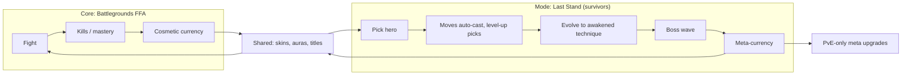
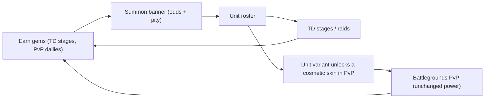
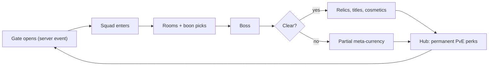
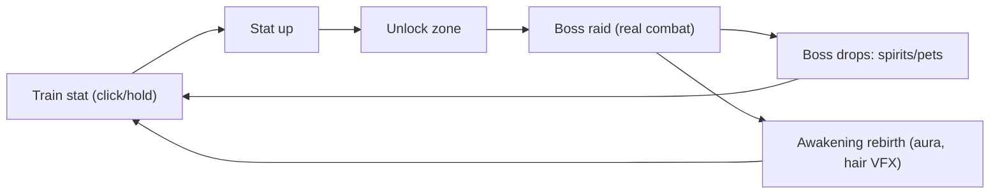
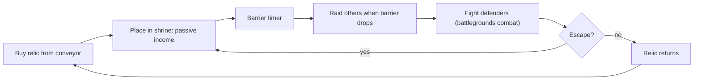

# Hybrid Loops for Anime Games

## TL;DR
- Roblox hits are rarely a pure genre. Grow a Garden = idle + real-time growth + events. Steal a Brainrot = tycoon + PvP theft. Anime Vanguards = TD + gacha + dungeons. GameAnalytics' Dead Rails analysis credits **"familiar gameplay with fresh twists."**
- **Rule:** one **proven core loop** + **one** twist borrowed from another proven loop, sharing the same assets. Never two cores at launch.
- **Top pitches for this vault (reuse the battlegrounds pipeline):**
  1. **Battlegrounds + Survivors horde mode**: PvP arena plus a PvE "hold the line" mode using the same movesets. *Best overall fit.*
  2. **TD + ethical gacha with your fighter roster**: monetizes characters without selling PvP power.
  3. **Battlegrounds + roguelite "Gate Raids"**: co-op dungeon runs with boons that modify existing moves.
  4. **Anime simulator + boss raids**: training-arc numbers with real combat feel at zone bosses.
  5. **Steal-a-relic social idle + battlegrounds combat**: theft resolved by actual fights.
- Each pitch below has a loop diagram, the asset-reuse case, monetization, MVP scope and risks.

## Why it matters for anime battlegrounds
Pure battlegrounds has three structural weaknesses: **no progression, new players get stomped, cosmetic-only revenue** (see [[Battlegrounds Arena Fighter Loop]]). Each hybrid below patches one or more of those *without* breaking the skill-based PvP core. The art you already make ([[Anime Combat Animation Timing]], [[Anime VFX Fundamentals]]) is the shared currency between modes.

## Hybrid design rules
1. **One core, one twist.** Launch with the core; add the twist as a mode once the core retains.
2. **Asset reuse ≥ 70%.** The twist mode should reuse characters, moves and VFX. If it needs a new art pipeline, it's a new game.
3. **Separate economies for PvP fairness.** PvE progression can grant cosmetics, titles or PvE-only power, never PvP stats.
4. **Shared identity.** Unlocks in either mode show up in the other (skins, titles, auras).
5. **Policy first.** Any random paid reward goes through [[Gacha and Spin Systems on Roblox]] compliance.

---

## Pitch 1: "Last Stand" — Battlegrounds + Survivors-like horde mode
**One line:** PvP arena as the core. A co-op PvE mode where 1–4 players hold a shrine against waves of curses; your moves auto-level and evolve during the run.

- **Why it works:** survivors-likes are a proven loop (VS ~6.6M–7.9M est. units; Brotato 10M+; Megabonk 117K Steam CCU, Oct 2025). No breakout Roblox survivors-like was found (as of 2026-10). It fixes new-player stomping and gives non-PvP players a home.
- **Asset reuse:** the hero kit becomes weapon archetypes (M1 → basic auto-attack; ability 1 → orbit; ability 2 → projectile; ultimate → evolution). Mobs are cheap low-poly.
- **Monetization:** cosmetic skins (shared), 2x meta-currency pass, character unlocks (also earnable), season pass.
- **MVP add-on scope:** 3–4 weeks on top of a working battlegrounds core: 1 map, 3 mob types, 1 boss, 12 upgrades, 2 evolutions, meta shop.
- **Risks:** mob performance on mobile (no Humanoids; client-rendered swarms); VFX readability with hundreds of enemies.

## Pitch 2: "Vanguard Roster" — TD + ethical gacha, using fighter characters
**One line:** the same heroes from your battlegrounds game become collectible TD units; summoning grants **PvE units and cosmetic variants**, never PvP power.

- **Why it works:** Anime Vanguards hit 215K–220K+ CCU at launch (Sep 2024) and was reported as Roblox's top earner within ~10 days. TD-gacha is the best-monetizing anime loop.
- **Asset reuse:** character models + ability VFX as unit attacks. New work: enemies, paths, summon UI.
- **Monetization:** gems (paid random items: odds, pity, PolicyService, direct-purchase fallback), unit slots, 2x speed, battle pass.
- **MVP add-on:** 4–5 weeks: 1 world, 5 stages, 12 units, 1 banner.
- **Risks:** heavy live-ops (Anime Defenders decayed from ~200K to hundreds of CCU); regulatory pressure on paid random items (UK/Brazil under-18 already restricted); IP risk with recognisable characters.

## Pitch 3: "Gate Raids" — Battlegrounds + roguelite co-op dungeons
**One line:** Solo Leveling-style gates open on a timer; squads dive into procedurally assembled rooms, pick boons that **modify existing moves** ("dash leaves lightning") and fight an arc-villain boss.

- **Why it works:** roguelites are proven on Roblox (DOORS ~270K peak; Dead Rails 2025). Boons create content through *combinations*, not new animations. Timed gate events borrow the **synchronous event** pull of Grow a Garden's admin events.
- **MVP add-on:** 4–5 weeks: 10 room chunks, 15 boons, 1 boss, hub.
- **Risks:** boss design quality ([[Anime Combat Animation Timing]] for telegraphs); balancing boons with PvP moves (keep the mode separate).

## Pitch 4: "Training Arc" — Anime simulator + real-combat boss raids
**One line:** simulator stat training (strength/chakra/sword) at themed spots, with **zone bosses fought using a real battlegrounds-quality kit**. Rebirth = Awakening (visual transformation).

- **Why it works:** the simulator is a proven Roblox loop (PS99 400K+ launch; Bee Swarm ~265K peak), and anime simulators existed in 2020–2026. Most clones have **no combat feel**; real hitstop and VFX are the twist.
- **Monetization:** 2x training pass, extra spirit slots, eggs (odds), subscriptions.
- **MVP:** 5–6 weeks standalone.
- **Risks:** saturated genre; inflation; pay-to-skip pressure.

## Pitch 5: "Steal a Cursed Relic" — Social idle + battlegrounds combat
**One line:** collect cursed relics that generate cursed energy in your shrine; raid others when their barrier drops. **Theft is contested with real fights**: defenders can intercept a thief with their moveset.

- **Why it works:** Steal a Brainrot's idle + theft loop reached ~25.4M–25.8M CCU (Oct 2025), and a Fortnite clone hit 1M (UEFN first). Brainrot memes are fading (RoWatcher 2026), so a **fresh anime fantasy over a proven loop** is the classic market-research recommendation.
- **Asset reuse:** battlegrounds combat + simple relic models. New work: plots, conveyor, barrier, events.
- **Monetization:** relic purchases (odds if random), barrier time (careful: protection-for-pay), server-wide event triggers, cosmetics.
- **MVP:** 5–6 weeks.
- **Risks:** viral loops are lottery tickets; theft distress for young players (offline protection); copycat speed.

---

## Pitch comparison
| Pitch | Core | Twist | Fixes | Add-on effort | Monetization | Risk |
|---|---|---|---|---|---|---|
| 1. Last Stand | Battlegrounds | Survivors PvE | New-player stomping, progression | 3–4 wks | Medium | Mob perf |
| 2. Vanguard Roster | Battlegrounds | TD + gacha | Revenue | 4–5 wks | High | Live-ops, policy |
| 3. Gate Raids | Battlegrounds | Roguelite co-op | Progression, social | 4–5 wks | Medium | Boss quality |
| 4. Training Arc | Simulator | Real combat bosses | Feel (vs clones) | 5–6 wks (standalone) | High | Saturation |
| 5. Steal a Cursed Relic | Social idle | Battlegrounds combat | Stakes, virality | 5–6 wks (standalone) | High | Luck, decay |

> [!warning] Unverified
> Effort estimates assume a working battlegrounds core (characters, moves, VFX) and a 1–3 person team using AI-assisted scripting. They are planning guesses, not measured data.

## Checklist
- [ ] Core loop retains on its own before adding a mode
- [ ] Twist mode reuses ≥70% of assets
- [ ] PvP power is isolated from PvE progression
- [ ] Shared cosmetic identity across modes
- [ ] Paid random items compliance for any gacha
- [ ] One hybrid at a time; measure before the next

## Common Mistakes
- Launching with three modes, each half-finished
- Letting PvE power leak into PvP
- A twist mode that needs a whole new art style
- Copying the twist's *meme* (brainrot) instead of its *mechanic* (theft + events)
- Ignoring mobile performance in horde or raid modes

## Related
- [[Core Loop Comparison Matrix]]
- [[Battlegrounds Arena Fighter Loop]]
- [[Survivors-Like Horde Loop]]
- [[Tower Defense and Unit Collecting Loop]]
- [[Roguelike and Roguelite Loop]]
- [[Obby, Tower and Viral Social Loops]]
- [[Anime Combat Animation Timing]]
- [[Anime VFX Fundamentals]]
- [[Roadmap]]

## Sources
1. GameAnalytics, "Dead Rails and the Hit Makers Formula": https://www.gameanalytics.com/blog/dead-rails-and-the-hit-makers-formula
2. GamesRadar, Megabonk record: https://www.gamesradar.com/games/roguelike/indie-roguelike-breakout-megabonk-hit-a-new-player-record-over-the-weekend-charting-higher-than-call-of-duty-borderlands-4-and-marvel-rivals
3. Wikipedia, Brotato: https://en.wikipedia.org/wiki/Brotato
4. SteamPulse, Vampire Survivors estimate: https://steampulse.org/game/1794680
5. Beebom, Anime Vanguards top earner: https://beebom.com/anime-vanguards-surpasses-blox-fruits-top-earning-roblox-game
6. Profitable, Anime Defenders: https://profitable.app/roblox/games/anime-defenders
7. Rotrends, DOORS: https://rotrends.com/game/2440500124/DOORS
8. RoWatcher, Pet Simulator / BIG Games: https://rowatcher.com/news/inside-big-games-how-pet-simulator-became-a-100m-roblox-empire
9. Wikipedia, Steal a Brainrot: https://en.wikipedia.org/wiki/Steal_a_Brainrot
10. PCGamesN, Fortnite "Steal the Brainrot" 1M: https://www.pcgamesn.com/fortnite/creative-steal-the-brainrot-roblox-clone-1-million-players
11. RoWatcher, "Is the Brainrot Trend Dying?": https://rowatcher.com/news/is-the-brainrot-trend-dying-what-ccu-data-from-three-top-games-reveals
12. Roblox Creator Hub, Paid random items policy: https://create.roblox.com/docs/production/monetization/paid-random-items
