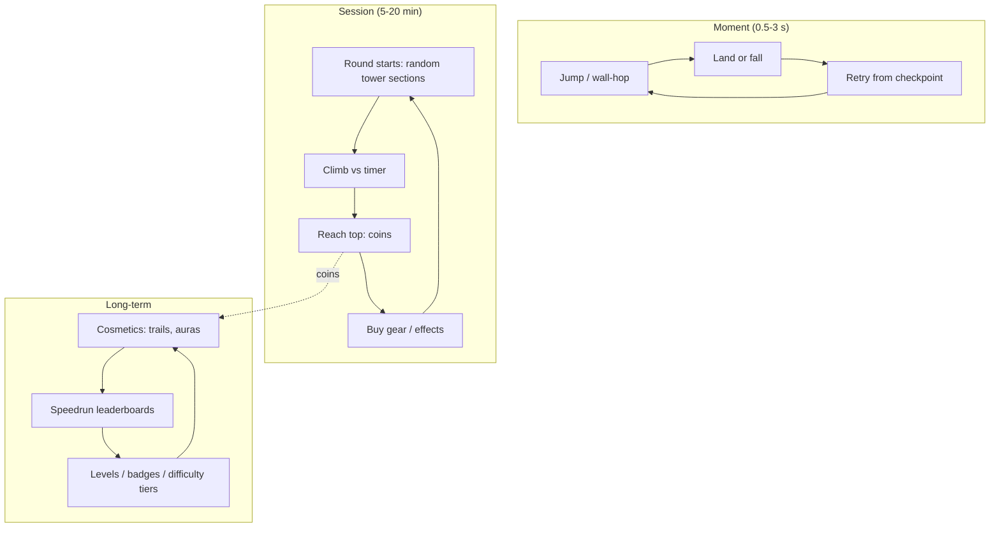
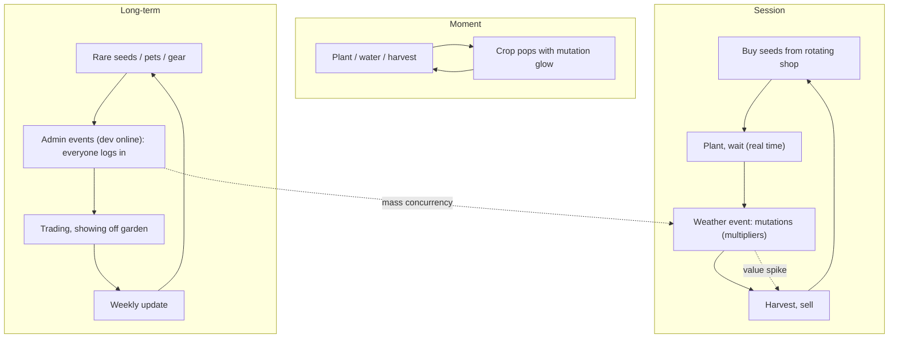
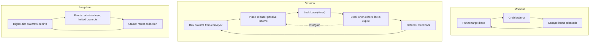

# Obby, Tower and Viral Social Loops

## TL;DR
- **Obby / tower climb loop:** `jump -> fall -> retry -> checkpoint -> reach top -> (round resets, new tower)`. **Tower of Hell** (round-based tower; 8 sections against a timer) peaked at ~45K (RoWatcher, Aug 2025) to ~68K (Rotrends). Obbies are cheap to build, skill-driven and very saturated.
- **2025's breakout pattern: viral social idle loops.** **Grow a Garden** (plant → real-time growth → harvest → sell; weather mutations; admin events) hit **~21.3M CCU on 2025-06-21** and **~22.3M on 2025-08-23**. **Steal a Brainrot** (buy brainrots from a conveyor → passive income → **steal from other bases**; base lock timer) hit **~25.4M–25.8M CCU in Oct 2025**. During their Aug 2025 "admin war," Roblox hit a platform record of **~47.4M CCU**. **99 Nights in the Forest** (co-op survival) peaked at **14.2M**.
- **The formula:** a *trivially simple* idle/tycoon loop + **other players as content** (theft, trading, envy, showing off) + **live admin events** that make everyone log in at once + meme fantasy + codes and creator coverage.
- **Decay risk is high.** RoWatcher (2026) asks "Is the brainrot trend dying?" Mid-2026 snapshots put Steal a Brainrot around ~215K CCU (undated). The fantasy was a meme wave; the **loop** (idle + steal + events) is what transfers.
- Anime fit: the *loop* transfers well ("Steal a Cursed Object," "Grow a Spirit Garden," "Raise a Shadow Army"). Avoid copying brainrot meme IP, and focus on **social theft + events**.

## Why it matters for anime battlegrounds
These loops prove **players themselves are the best content on Roblox**: stealing, defending and showing off. Battlegrounds already has the social chaos. A "steal and defend" meta layer (raid other players' shrines for relics) could add persistent stakes to battlegrounds combat. See [[Hybrid Loops for Anime Games]].

## Loop A: Obby / tower climb

| Driver | Detail |
|---|---|
| Mastery | Pure platforming skill; every clear is earned |
| Rage + relief | Failure tension makes clears satisfying and streamable |
| Social | Watching others fall; racing friends |
| Monetization | Skips (controversial), gear (speed coil, gravity), trails/effects, VIP servers |

## Loop B: Grow a Garden (real-time collect-and-grow)

- **Origins (GamesBeat, Jandel interview):** Splitting Point's Janzen "Jandel" Madsen partnered with the anonymous 16-year-old creator when it had ~500 CCU and 10K–20K DAU. They reached ~100K CCU within two weeks and **1M CCU in about a month**.
- **Revenue:** Calcalist reported ~$12M from virtual items in May 2025 alone. That is a third-party report; per another source, Jandel declined to share figures. **Unverified.**
- **Key twists:** real-time growth (appointment loop), **weather mutations** (variable multipliers), **admin-triggered events** like the "Jandel Storm" (the developer being online is an event), a rotating seed shop and pets.

## Loop C: Steal a Brainrot (idle + heist)

- **Developer:** BRAZILIAN SPYDER group (founder Sammy leads development) per a fan wiki. **Lock:** hold E at the Lock Base pad. Durations vary by patch (reported 60 s base, +10 s per rebirth or VIP).
- **The twist that matters:** *loss is possible*. Your collection can be stolen, which creates urgency, revenge, defence and constant social friction. It's the inverse of a safe idle game.
- **Cross-platform proof:** a Fortnite Creative clone ("Steal the Brainrot") was reported as the first UEFN map to hit **1M peak players** (PCGamesN), so the loop travels between platforms.

## Why these loops went viral
| Factor | Evidence / mechanism |
|---|---|
| Simple loop, instant clarity | Plant/harvest; buy/steal. Understood in seconds |
| Players as content | Theft, trading, envy; every server is a drama |
| Synchronous events | Admin events and the "admin war" concentrated millions at once (47.4M platform record, Aug 2025) |
| Appointment loops | Real-time growth, rotating shops, lock timers |
| Meme fantasy | Italian brainrot (TikTok meme wave); gardening (cosy) |
| Creator coverage | Clip-able moments (stealing, rare mutations) |
| Platform algorithm | GameAnalytics on Dead Rails: hits blend familiar gameplay + twist, amplified by influencers and Roblox's algorithm |
| Concentration | Newzoo/RoMonitor: by end of 2025, 3 games accounted for >70% of top-10 visits |

## Flagship evidence (dated)
| Game | Stat | Date / source |
|---|---|---|
| Grow a Garden | 5M → 7.3M → 8.9M → 16.4M → 21.3M CCU (2025-06-21); 22.3M (2025-08-23) | PocketGamer.biz, Calcalist, Wikipedia |
| Steal a Brainrot | 5M (Jul 2025), 20M (Aug 2025), 24M (2025-09-13), 25.4M–25.8M (Oct 2025) | Wikipedia, Beebom, PocketGamer.biz |
| Roblox platform | 47.4M CCU record (2025-08-23) | PocketGamer.biz, GamesRadar |
| 99 Nights in the Forest | 14.2M CCU peak (2025) | PC Gamer, Wikipedia list |
| Tower of Hell | 45K (Aug 2025, RoWatcher) to 68.1K (Rotrends) peak | Trackers |
| Fortnite "Steal the Brainrot" | First UEFN map to 1M peak players | PCGamesN |

> [!warning] Unverified
> Grow a Garden's August peak is reported as 21.3M, 22M or 22.3M depending on the outlet. Steal a Brainrot's peak is 25.4M (Wikipedia) vs 25.8M (Beebom). The ~215K "current" figure for Steal a Brainrot is undated.

## Monetization patterns that fit
| Pattern | Notes |
|---|---|
| Seed/egg/brainrot purchases with Robux | If random, **paid random items** apply (odds, PolicyService). See [[Gacha and Spin Systems on Roblox]] |
| Base lock extensions / VIP lock time | Popular; careful: selling *protection from theft* is borderline pay-to-win |
| Growth speed-ups, sprinklers, weather "totems" | Convenience; disclose effects |
| Server-wide purchasable events | Social spending (everyone benefits); strong in GaG-style games |
| Obby skips | Common; undermines the achievement. Prefer cosmetic trails |
| Private servers | Safe farming |

> [!warning] Ethical limits
> Theft loops can produce real distress in young players (crying-kid memes are part of Steal a Brainrot's folklore, per press coverage). Mitigations: offline protection, recoverable losses, no paid "insurance" that preys on fear, and clear rules about what can be stolen.

## Retention mechanics
- Admin / scheduled events (concentrated login spikes)
- Rotating shops (check every few minutes or hours)
- Offline growth (return to harvest)
- Revenge loop (steal back)
- Weekly updates with new seeds or brainrots
- Codes and creator partnerships

## Minimum viable scope (small team)
### Obby: 2–3 weeks
- 20–40 hand-built sections, random tower assembly, timer, coins, trail shop.
### Steal-style social idle: 4–6 weeks
- Plots, purchasable income units on a conveyor, base lock timer, carry-and-run theft with a slow carry speed, rebirth, a scheduled event system.
### Grow-style: 4–6 weeks
- Plot grid, seed shop rotation, real-time growth with DataStore timestamps, weather events with multipliers, sell pad.

## How to give it an anime skin
- **"Steal a Cursed Object"**: collect cursed relics that generate cursed energy; raid sorcerer shrines; base lock = barrier technique.
- **"Grow a Spirit Garden"**: grow spirit fruits that mutate under moon/storm events; harvest for power (or cosmetics).
- **"Raise a Shadow Army"**: idle summoning with raids on other players' armies.
- **Tower climb**: "Climb the Tower of Trials" (a God of High School / Tower-of-God-style vertical gauntlet) with anime parkour (wall-runs, air-dashes).
- **Admin events as story beats**: the developer appears as an arc villain and triggers a server-wide raid.

> [!tip] Theme as a swappable skin
> The game-market-research method recommends treating the theme as a swappable skin over a proven loop. Brainrot faded fast, so the loop + an anime skin hedges against meme decay.

## Numbers & Settings
| Setting | Starting value | Why |
|---|---|---|
| Base lock (steal loop) | ~60 s, +10 s per rebirth (reported) | Mirrors Steal a Brainrot patch-dependent values |
| Carry speed while stealing | 50–70% of run speed | Makes escape a chase (heuristic) |
| Rotating shop refresh | 5 min | Appointment loop (heuristic) |
| Real-time growth | 1 min – 24 h by rarity | Spread return times (heuristic) |
| Obby sections per tower | 8 (Tower of Hell model) | Proven round length |

## Checklist
- [ ] Loop explainable in 5 seconds
- [ ] Other players affect your progress (theft, trade, envy)
- [ ] Scheduled/admin event system
- [ ] Offline protection and recoverable losses
- [ ] Odds shown for any random purchases
- [ ] Theme is a skin; the loop survives a reskin

## Common Mistakes
- **Copying the meme, not the loop.** Brainrot clones flooded Roblox; most died.
- **Theft without counterplay**: rage-quit.
- **No events**: the viral hits lived on synchronous spectacle.
- **Server-trusting timers**: real-time growth must use server timestamps.
- **Ignoring decay**: plan the second content wave before the first peaks.

## Related
- [[Tycoon and Idle Loop]]
- [[Simulator and Clicker Loop]]
- [[Extraction, PvPvE and Horror Co-op Loop]]
- [[Hybrid Loops for Anime Games]]
- [[Core Loop Comparison Matrix]]

## Sources
1. Wikipedia, Grow a Garden: https://en.wikipedia.org/wiki/Grow_a_Garden
2. PocketGamer.biz, "Grow a Garden hits industry record 21.3m": https://www.pocketgamer.biz/robloxs-grow-a-garden-hits-industry-record-213m-concurrent-users-surpassing-pubg-fortnite-and-more
3. Calcalist, Grow a Garden: https://www.calcalistech.com/ctechnews/article/dj4lxef8r
4. GamesBeat, "How Grow a Garden took off on Roblox | Janzen 'Jandel' Madsen interview": https://gamesbeat.com/janzen-madsen-interview/
5. Wikipedia, Steal a Brainrot: https://en.wikipedia.org/wiki/Steal_a_Brainrot
6. Beebom, "Steal a Brainrot delivered a 2025 masterclass in player engagement": https://beebom.com/robloxs-steal-a-brainrot-delivered-a-2025-masterclass-in-player-engagement-and-gave-uefn-a-second-wind/
7. PocketGamer.biz, "Roblox's peak CCU hits record 47.4m": https://www.pocketgamer.biz/robloxs-peak-concurrent-user-count-hits-record-474m-as-steal-a-brainrot-and-grow-a-garden-compete
8. PocketGamer.biz, "Steal a Brainrot becomes first game to surpass 25m": https://www.pocketgamer.biz/robloxs-steal-a-brainrot-becomes-first-game-to-surpass-25m-concurrent-players
9. RoWatcher, "Is the Brainrot Trend Dying?": https://rowatcher.com/news/is-the-brainrot-trend-dying-what-ccu-data-from-three-top-games-reveals
10. Bloxinformer, Steal a Brainrot wiki: https://bloxinformer.com/wikis/steal-a-brainrot/
11. allthings.how, Steal a Brainrot stealing, events and rebirths: https://allthings.how/steal-a-brainrot-roblox-efficient-stealing-events-and-rebirths
12. PCGamesN, Fortnite "Steal the Brainrot" 1M players: https://www.pcgamesn.com/fortnite/creative-steal-the-brainrot-roblox-clone-1-million-players
13. PC Gamer, 99 Nights in the Forest 14.2M peak: https://www.pcgamer.com/games/survival-crafting/with-a-peak-player-count-of-14-2-million-99-nights-in-the-forest-has-an-audience-other-multiplayer-games-would-kill-for-to-find-these-behemoth-playerbases-you-need-to-be-on-a-platform-like-roblox/
14. RoWatcher, Tower of Hell: https://rowatcher.com/games/703124385/tower-of-hell
15. Obby Wiki, Tower of Hell: https://obbywiki.com/wiki/Tower_of_Hell
16. GameDevReports / Newzoo, "Top Roblox Games in 2025": https://gamedevreports.substack.com/p/newzoo-top-roblox-games-in-2025
17. GeekChamp, "What is Steal a Brainrot? Inside Roblox's viral 'crying kid' game" (low-authority; headline only): https://geekchamp.com/?p=217753
18. GameAnalytics, "Dead Rails and the Hit Makers Formula": https://www.gameanalytics.com/blog/dead-rails-and-the-hit-makers-formula
