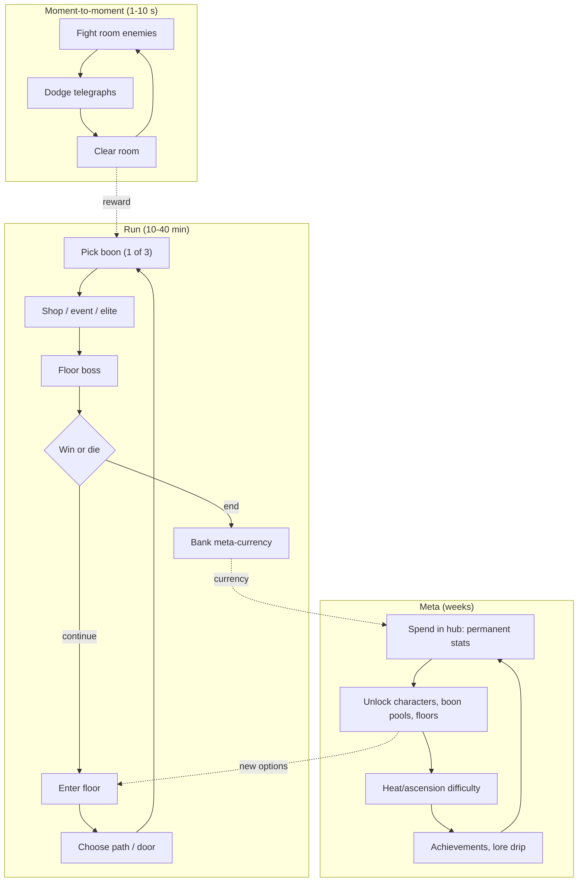

# Roguelike and Roguelite Loop

## TL;DR
- **Loop line:** `start run -> procedural rooms/encounters -> pick boons/upgrades -> boss -> die or win -> keep meta-currency -> unlock permanent upgrades/characters -> start a stronger, different run`. A **roguelike** wipes everything; a **roguelite** keeps meta-progression. On Roblox, roguelites dominate.
- Proven at scale on Roblox: **DOORS** (LSPLASH; a co-op roguelite horror escape; all-time peak ~270K per Rotrends; ~7.4–7.6B visits by mid-2026). **Deepwoken** applies permadeath + wipe + carry-over ("Echoes," the Hippocampal Pool for items) to an RPG.
- Cross-platform proof: **Hades II** is estimated at ~5.1M Steam units (Raijin, 2026-06-14, third-party), and survivors-likes (see [[Survivors-Like Horde Loop]]) are a roguelite subgenre.
- Psychology: **novelty every run (procedural variety), mastery (you get better, not just stronger), "one more run" short sessions, build expression, low cost of failure.**
- Anime fit: **"dungeon dive" / "domain" / "trial" arcs** (Solo Leveling gates, Hunter exam, cursed domains). It's a strong PvE mode for a battlegrounds roster.

## Why it matters for anime battlegrounds
A roguelite mode gives battlegrounds characters a **PvE progression wrapper** without touching PvP balance. Roguelite boons can modify existing moves ("Your dash leaves fire"), so content comes from *combinations* rather than new animations. That's cheap content for an animation-heavy team.

## The three loop layers

## Why it's compelling
| Driver | Implementation |
|---|---|
| Novelty | Procedural layouts, random boons, so no two runs are the same |
| Mastery | Players improve at reading enemies; meta stats help but don't replace skill |
| Low failure cost | Death returns you to the hub with currency, not empty-handed |
| Build expression | Synergy hunting ("broken builds") fuels YouTube and community |
| Short sessions | A run fits a commute or a break |
| Co-op (Roblox advantage) | DOORS-style party runs; shared screams make clips |

## Flagship examples (dated evidence)
| Game | Twist | Stat | Date / source |
|---|---|---|---|
| DOORS (LSPLASH) | Co-op roguelite horror; procedural rooms, entity encounters | All-time peak ~269.8K (Rotrends); ~7K–12K avg CCU and 16.3K peak window (Profitable, 2026-07-15); 7.4–7.6B visits | 2026 |
| Deepwoken | Permadeath RPG; wipe → "Fragments of Self," spend Echoes; Hippocampal Pool carries items; Robux last-chance revive at a statue (per Destructoid/wiki) | Player counts not gathered | Destructoid, Deepwoken Wiki |
| Dead Rails (RCM Games) | Train run across a hostile desert; one-life co-op run with loot | Peak claims range 79K (RoWatcher, 2025-11-28) to 200K+ / "600K one weekend" (GameAnalytics, unverified); 1M fans by 2025-03-31 | 2025 |
| Hades II (PC) | Narrative roguelite | ~5.1M Steam units, ~$100M gross (Raijin estimate, 2026-06-14); 2M+ during early access (Alinea) | Third-party |

> [!warning] Unverified
> Dead Rails' peak varies massively between sources. GameAnalytics' article (2025-04-01) attributes its success to "familiar gameplay with fresh twists boosted by influencers, distribution, and the platform's algorithm." Only that summary was readable.

## Monetization patterns that fit
| Pattern | Notes |
|---|---|
| Character unlocks | Each character changes run strategy |
| Meta-currency boosts (2x) | Speeds progression; doesn't change in-run skill |
| Revives (Robux) | Common on Roblox (DOORS-style revives, Deepwoken statue). Exclude revived runs from leaderboards |
| Cosmetics, hub decoration | Low-risk |
| Run modifiers / boosters bought pre-run | OK in PvE; disclose clearly |
| Random boon packs for Robux | Avoid; paid random items + fairness |

> [!warning] Ethical limit
> Selling revives *during* a tense death moment exploits loss aversion. If you sell revives, cap them per run, make them earnable too, and never interrupt with a full-screen purchase prompt before the "you died" screen.

## Retention mechanics
- **Meta-unlock trees** (always a next unlock)
- **Ascension / heat levels** for mastery players
- **Daily seeded run + leaderboard**
- **New floor / boss / boon pool per update**
- **Lore drip** (each run reveals a bit; DOORS' entity lore drives a huge fan community)
- **Co-op invites** (friends pull friends)

## Minimum viable scope (small team)
### Step 1: Room-based combat with 3 enemy types (week 1–2)
### Step 2: Room graph generator (5–8 rooms/floor) from hand-made room chunks (week 2)
- Hand-built chunks + random arrangement is far cheaper than true procedural generation.
### Step 3: 15–20 boons modifying existing moves (week 3)
### Step 4: 1 boss + hub + meta-currency + 6 permanent upgrades (week 4)
### Step 5: 2–4 player co-op + revive rules + analytics (week 5)

## How to give it a shonen anime skin
- **Gates / dungeons** (Solo Leveling-style rank-E-to-S gates)
- **Domain trials**: a cursed domain with a boss at its core
- **Exams**: Hunter/Chunin-exam floors with themed rules
- **Boons = "techniques learned from masters"** (each master NPC offers a themed boon pool: flame, lightning, shadow)
- **Boss = arc villain** with phase transitions and a cinematic finisher ([[Camera Work for Abilities]])

## Numbers & Settings
| Setting | Starting value | Why |
|---|---|---|
| Run length | 15–30 min | Session-friendly (heuristic) |
| Rooms per floor | 5–8 | Enough choice without sprawl |
| Boon choices | 3 per pick, ~1 pick per room | Genre convention (Hades-style) |
| Boon pool at launch | 15–20 | Enough to create synergies |
| Meta upgrades | 6–10 | First-week goals |
| Co-op size | 1–4 | DOORS-style parties |

## Checklist
- [ ] Hand-built room chunks + random assembly
- [ ] Boons modify existing moves (cheap content)
- [ ] Meta-currency paid on every death
- [ ] Revive policy defined; leaderboard excludes revives
- [ ] Co-op party join
- [ ] Daily seed

## Common Mistakes
- **Pure roguelike (full wipe) for a young audience**: too punishing; churn. Deepwoken's hardcore niche is the exception.
- **Too much meta power**, so skill stops mattering and runs become a grind.
- **Procedural generation without hand-tuned chunks**: bland, unreadable rooms.
- **No synergies**: boons as flat +10% stats are boring.
- **Monetized revives with aggressive prompts.**

## Related
- [[Survivors-Like Horde Loop]]
- [[Extraction, PvPvE and Horror Co-op Loop]]
- [[Hybrid Loops for Anime Games]]
- [[Core Loop Comparison Matrix]]
- [[Core Loop Fundamentals]]

## Sources
1. Rotrends, DOORS: https://rotrends.com/game/2440500124/DOORS
2. Profitable, DOORS (2026-07-15): https://profitable.app/roblox/games/doors
3. Pocket Tactics, "Roblox game Doors finds a way to three billion visits": https://www.pockettactics.com/roblox/doors-visits
4. Endsights, "Horror Game Design on Roblox: Doors, Pressure, Apeirophobia": https://endsights.com/horror-game-design
5. Destructoid, "What happens when you die in Deepwoken": https://www.destructoid.com/what-happens-when-you-die-in-deepwoken/
6. Deepwoken Wiki, Fragments of Self: https://deepwoken.fandom.com/wiki/Fragments_of_Self
7. GameAnalytics, "Dead Rails and the Hit Makers Formula" (2025-04-01): https://www.gameanalytics.com/blog/dead-rails-and-the-hit-makers-formula
8. RoWatcher, "Is Dead Rails Dying?": https://rowatcher.com/games/7018190066/dead-rails/dying
9. Gameranx, Dead Rails hits 1 million (2025-03-31): https://gameranx.com/updates/id/533597/article/roblox-dead-rails-hits-million-mark-with-players
10. Raijin, Hades II sales estimate: https://raijin.gg/app/1145350/Hades_II/sales-revenue
11. WN Hub, Hades II 2M+ early access (Alinea): https://wnhub.io/news/analytics/item-48907
