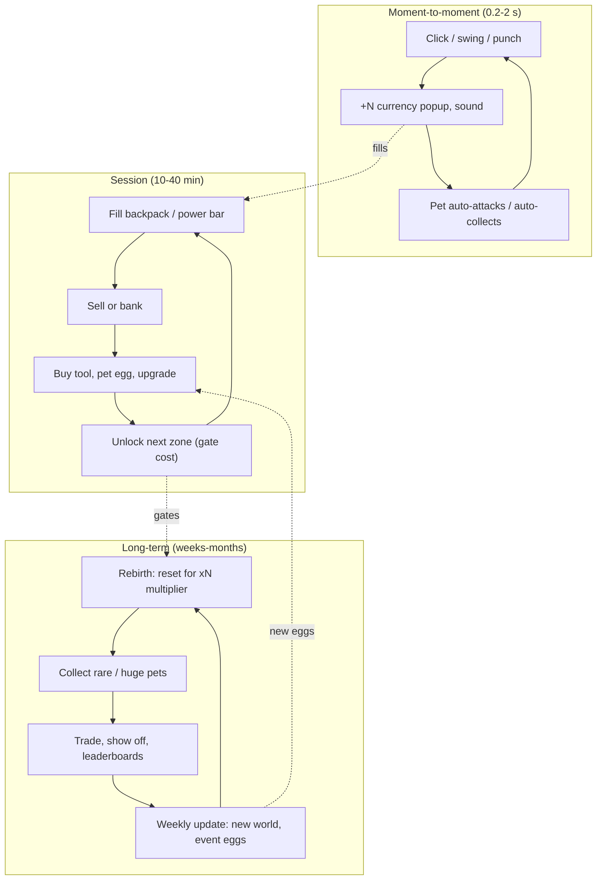

# Simulator and Clicker Loop

## TL;DR
- **Loop line:** `click/swing -> collect currency -> sell or bank -> buy better tool/pet -> new zone -> rebirth (reset for multiplier)`. This is Roblox's signature genre: **Pet Simulator**, **Bee Swarm Simulator**, **Anime Fighting Simulator**, and the 2025 descendants (Grow a Garden-style collect-and-grow games; see [[Obby, Tower and Viral Social Loops]]).
- Psychology: **constant numeric progression + collection (pets/units) + variable rewards (eggs/hatches) + social show-off (rare pets, trading)**.
- Evidence (as of 2026): **Pet Simulator 99** peaked at **400K+** CCU at its Dec 2023 launch and holds ~45K–47K CCU in mid-2026. BIG Games is estimated at **$100M+** lifetime revenue (third-party estimate). **Bee Swarm Simulator** (solo dev Onett, ~7 years live) holds ~64K–66K daily CCU, spikes to ~145K during Beesmas and has an all-time peak of ~265K.
- Monetization fits naturally: **2x currency/luck passes, extra pet slots, auto-collect, egg hatches (paid random items: odds required)**. PS99 is described by RoWatcher as "Roblox's most aggressive monetization machine." That's a cautionary benchmark, not a target.
- MVP: **1 verb, 3 zones, 1 currency, 10–15 pets/units, 1 rebirth**. It's systems-light and the art can be low-poly. The anime skin is "training to get stronger" (stat training: punch, endurance, chakra), which maps to shonen training arcs.

## Why it matters for anime battlegrounds
The anime-simulator lineage (Anime Fighting Simulator, Anime Fighters Simulator) proved that **shonen "training arc" fantasy + simulator numbers** works on Roblox. For a battlegrounds team, a simulator layer is the cheapest way to add **long-term progression** *outside* the PvP arena (e.g., cosmetics or aura levels) without breaking PvP fairness. See [[Hybrid Loops for Anime Games]].

## The three loop layers

## Why it's compelling
| Driver | Simulator implementation |
|---|---|
| Progression | Numbers grow exponentially; a new zone every ~10–20 min early |
| Variable reward | Egg hatches with rarity tiers ("Huge," "Shiny," "Rainbow" variants) |
| Collection | Pet index, set completion |
| Social status | Rare pets follow you around, so status is visible to the whole server; trading economies |
| Low skill floor | Kids 8–12 can play it one-handed on mobile |
| Idle comfort | Auto-farm and AFK reward zones keep the session alive passively |

## Flagship examples (dated evidence)
| Game | Twist | Stat | Date / source |
|---|---|---|---|
| Pet Simulator 99 (BIG Games) | Pets as both damage and collection; heavy events | Peak 400K+ at launch (Dec 2023); ~45K–47K CCU snapshots; est. ~$534K/month revenue (RoWatcher model, 78% confidence) | RoWatcher, 2026 |
| BIG Games (studio) | Three games over 1B visits | Est. $100M+ lifetime revenue | RoWatcher, 2026 (third-party estimate) |
| Bee Swarm Simulator (Onett) | Field-based collection, deep quest lines, seasonal Beesmas | ~64K–66K daily CCU; Beesmas spikes 145K–147K; all-time peak ~265K (Rotrends 264.5K); ~4.27B visits | RoWatcher / Rotrends, 2025-12 to 2026 |
| Anime Fighting Simulator (2026 re-release) | Anime stat training (strength/chakra/sword) | All-time peak ~37K (2026-07-11); published 2026-06-13 | RoWatcher, 2026 |

> [!warning] Unverified
> Revenue figures are third-party *models* based on visits, not disclosed earnings. The "Anime Fighting Simulator" tracker entries may refer to a 2026 re-release rather than the original 2020-era hit. Verify the place ID before citing.

> [!example] Single-dev longevity
> RoWatcher's profile of Bee Swarm Simulator presents it as a seven-year, essentially one-developer game. It shows that a simulator with *deep* systems (quests, field strategy) can outlive shallow clones. The community's main complaint is slow update cadence, and RoWatcher says players called Beesmas 2025 quests grindy.

## Monetization patterns that fit
| Pattern | Notes |
|---|---|
| 2x currency / 2x luck game passes | Genre staple; permanent passes feel fair |
| Extra pet equip slots / storage | Clean, non-random |
| Auto-collect / auto-hatch / auto-rebirth | Convenience; popular with AFK players |
| Egg hatches for Robux | **Paid random item**: must display all outcomes and odds; restricted for under-18s in some regions (UK, Brazil) via PolicyService. See [[Gacha and Spin Systems on Roblox]] |
| Luck boosts (timed) | Must show dynamically updated odds while active (Roblox policy) |
| Experience subscriptions | Daily currency drip + VIP perks |
| Limited-time event pets | Effective but drives FOMO; use moderately |

> [!warning] Ethical limits
> Simulators can easily slide into "pay to skip the game." Rules of thumb: (1) every pet in the index is obtainable F2P, (2) show odds everywhere, even for free eggs, (3) no "almost got it" fake near-miss animations, (4) no deceptive pricing (e.g., 999 R$ bundles framed as discounts with no reference price).

## Retention mechanics
- **Rebirth / prestige**: the reset that makes the next run faster (see the prestige math in [[Tycoon and Idle Loop]]).
- **Zone gates** with visible costs: always a next target on screen.
- **Daily rewards and streaks**, **AFK zones** (free currency while idle; also inflates CCU).
- **Weekly world/egg updates**: PS99's model is a constant event stream.
- **Trading** creates an economy and long-term goals (but needs anti-scam UI and duplication-bug vigilance).
- **Codes** released on social channels: a cheap re-engagement lever widely used across the genre.

## Minimum viable scope (small team)
### Step 1: Verb + currency (week 1)
- One clickable/hold action, a currency popup, a sell pad.
### Step 2: Three zones (week 2)
- Each zone has a gate cost about 10x the previous, a new enemy or resource skin and a new egg.
### Step 3: 10–15 pets with 4 rarities (week 3)
- Pets multiply output; equip limit 3–4.
### Step 4: Rebirth (week 4)
- Reset currency and zones; grant a permanent +X% multiplier.
### Step 5: Monetization + analytics (week 5)
- 2x pass, extra slot pass, egg odds UI; track time to first rebirth.

## How to give it a shonen anime skin
- **Training arc**: stats like Strength / Durability / Chakra / Sword, each trained at themed spots (waterfall, gravity room, boulder). That is the Anime Fighting Simulator model.
- **Pets → "summons" or "spirits" / "shadow soldiers"** (Solo-Leveling-style shadow army; Arise Crossover-type games used this theme in 2025).
- **Zones → arcs/islands** (village → exam arena → cursed city).
- **Rebirth → "Awakening" or "Limit Break"**: hair turns gold, aura colour changes. That's highly visible social status and reuses battlegrounds VFX ([[Anime VFX Fundamentals]]).
- **Bosses at zone ends** with one telegraphed special move gives a taste of combat feel.

## Numbers & Settings
| Setting | Starting value | Why |
|---|---|---|
| Gate cost growth | ~10x per zone | Standard exponential feel; tune with playtests |
| Rebirth multiplier | +25–100% per rebirth (or sqrt-scaled) | See prestige math in [[Tycoon and Idle Loop]] |
| First rebirth | 20–40 min | Long enough to feel earned, early enough to hook D1 (heuristic) |
| Pet equip slots | 3–4 base, +1–2 via pass | Leaves room to monetise |
| Rarity tiers | 4–6 (Common→Mythic/Secret) | Genre convention |
| Odds display | Every egg, every rarity | Roblox policy for paid random items |

## Checklist
- [ ] Verb has juice (sound, popup, shake) even though it's a click
- [ ] Next goal always on screen (gate cost bar)
- [ ] Rebirth unlocked and *visible* in first session
- [ ] Odds UI on every egg; PolicyService check for paid eggs
- [ ] Every pet obtainable without Robux
- [ ] Weekly content plan (new zone or egg)
- [ ] Anti-exploit: server-authoritative currency and hatching

## Common Mistakes
- **Infinite clones with no twist.** The simulator market is saturated; there must be a hook (fields, mutations, stealing, combat).
- **Client-side currency** gets exploited within days.
- **Inflation spiral.** Numbers become meaningless (1e30) without readable formatting or prestige layering.
- **Pay-to-skip design**: making the free path miserable to sell passes. Kids notice, and parents complain.
- **No combat feel.** Anime simulators with zero hit feedback feel like spreadsheets.
- **Trading without safeguards**: scams and dupes destroy economies.

## Related
- [[Tycoon and Idle Loop]]
- [[Gacha and Spin Systems on Roblox]]
- [[Obby, Tower and Viral Social Loops]]
- [[Grind RPG and Anime Open-World Loop]]
- [[Hybrid Loops for Anime Games]]
- [[Core Loop Comparison Matrix]]
- [[Core Loop Fundamentals]]

## Sources
1. RoWatcher, "Inside BIG Games: How Pet Simulator Became a $100M Roblox Empire": https://rowatcher.com/news/inside-big-games-how-pet-simulator-became-a-100m-roblox-empire
2. RoWatcher, "Pet Simulator 99: Inside Roblox's Most Aggressive Monetization Machine": https://rowatcher.com/news/pet-simulator-99-inside-roblox-s-most-aggressive-monetization-machine
3. RoWatcher, Pet Simulator 99 game page: https://rowatcher.com/games/3317771874
4. RoWatcher, "Onett's Seven-Year Marathon: How One Dev Keeps Bee Swarm Simulator's 65K Players Coming Back": https://rowatcher.com/news/onett-s-seven-year-marathon-how-one-dev-keeps-bee-swarm-simulator-s-65k-players-coming-back
5. Rotrends, Bee Swarm Simulator: https://rotrends.com/game/601130232
6. RoWatcher, "Is Anime Fighting Simulator Dying?": https://rowatcher.com/games/10321202755/anime-fighting-simulator/dying
7. Roblox Creator Hub, Paid random items policy: https://create.roblox.com/docs/production/monetization/paid-random-items
8. Roblox DevForum, Paid random items restriction for UK users under 18: https://devforum.roblox.com/t/update-on-paid-random-items-restriction-for-uk-users-under-18/3072183
9. Roblox Help, Brazil Digital ECA updates: https://en.help.roblox.com/hc/cs/articles/48706630819476-Brazil-Digital-ECA-Updates
10. Game Developer, "The Math of Idle Games, Part III" (prestige): https://www.gamedeveloper.com/design/the-math-of-idle-games-part-iii
11. Roblox Creator Hub, Subscriptions: https://create.roblox.com/docs/production/monetization/subscriptions
