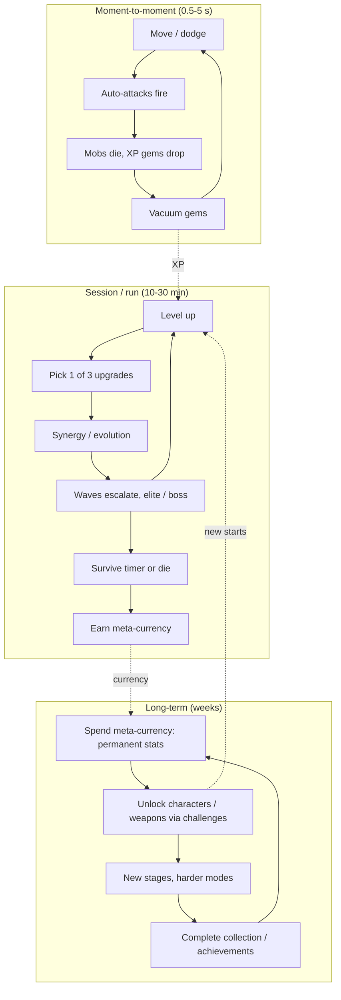

# Survivors-Like Horde Loop

## TL;DR
- **Loop line:** `move (attacks are automatic) -> kill hordes -> pick up XP gems -> level up -> choose 1 of 3 upgrades -> build snowballs -> survive the timer or boss -> meta-currency -> permanent unlocks`. This is the genre also called **Vampire Survivors-like, bullet heaven, horde survivor or reverse bullet hell**. Steam reportedly added "Bullet Heaven" as its own genre tag in May 2026 (seen only in a search summary; unverified).
- It's one of the most **proven indie loops of 2022–2026**. Vampire Survivors is estimated at ~6.6M–7.9M Steam units (third-party). **Brotato** passed 10M copies by 2025 per Wikipedia. **Halls of Torment** (5-person studio) passed 1M on Steam by Oct 2024. **Megabonk** (marketed as made by one developer) sold 1M in ~2 weeks and peaked at **117,336 CCU on Steam on 2025-10-05**.
- On Roblox the genre is **under-served**. Searches turned up no breakout Roblox survivors-like, only a UK Games Fund-backed "Roblox-first" project ("Roblox Survivor"/Rogue Rage). That's an opportunity *or* a sign of a platform fit problem (camera, mobile density, multiplayer performance).
- Psychology: **power fantasy escalation** (weak → screen-clearing god in 20 min), **build-crafting choices every ~30 s**, **variable upgrade offers**, **short runs** + **meta-progression**.
- For anime: it's a near-perfect fit. "One hero vs. an army" is the shonen climax, and evolved weapons map to "awakened" techniques. Best used as a **PvE mode inside a battlegrounds game** ([[Hybrid Loops for Anime Games]]).

## Why it matters for anime battlegrounds
Battlegrounds games have a new-player problem: getting stomped in PvP. A survivors-style horde mode reuses the **same characters, moves and VFX** in a PvE context where everyone feels powerful. Moves become auto-cast "weapons" that level and evolve, and enemies are cheap low-poly mobs. It's the highest-leverage hybrid in this folder.

## The three loop layers

## Why it's compelling
| Driver | Implementation |
|---|---|
| Power fantasy | Start weak; end each run clearing thousands of enemies per minute |
| Frequent meaningful choice | A level-up roughly every 15–60 s early; 1 of 3 picks |
| Variable rewards | Random upgrade offers and chests → every run differs |
| Discovery | Hidden evolutions and unlock conditions drive community wikis |
| Low input complexity | Movement only, so it's ideal for mobile and casual players |
| Short runs | ~30 min cap (VS's classic stage length) fits a session |
| Fair pricing | VS creator Luca Galante has said he wanted to escape mobile gambling-game work (PC Gamer). The genre's identity is *anti-predatory*. |

## Flagship examples (dated evidence)
| Game | Twist | Stat | Date / source |
|---|---|---|---|
| Vampire Survivors (poncle) | Genre origin; built on Phaser with default and free assets | ~6.6M (Raijin) to ~7.9M (SteamPulse/VG Insights) Steam units | Third-party estimates, 2026 |
| Brotato (Blobfish) | Arena, wave-shop, 1 potato, 6 weapons | 10M+ copies by 2025 | Wikipedia |
| Halls of Torment (Chasing Carrots, 5 people) | Diablo-style retro look | 1M+ Steam copies | Oct 2024 (TweakTown, Game*Spark) |
| Megabonk (solo dev, per press) | 3D, movement tech, wacky physics | 1M copies in ~2 weeks; peak 117,336 CCU (SteamDB) | 2025-10-03 / 2025-10-05 |
| Vampire Crawlers (poncle spin-off) | Turn-based twist | 1M+ in first week | April 2026 |
| Roblox examples | — | No breakout found | Searched 2026-10 |

> [!warning] Unverified
> Vampire Survivors sales are third-party estimates (VG Insights / Raijin); poncle hasn't published an official total in the sources found. Megabonk's "one developer" claim comes from press coverage, not a developer statement I could read directly.

> [!example] Scope lesson
> Game Developer reports Vampire Survivors began on the open-source Phaser HTML5 engine using default engine assets and free sprite packs. Galante has also said the game was inspired by the mobile title *Magic Survival*. The loop carried the game, not the art.

## Monetization patterns that fit (Roblox F2P adaptation)
Premium PC games sell once. On Roblox you need F2P equivalents:
| Pattern | Fit | Notes |
|---|---|---|
| Character unlocks (Robux or grind) | Good | Each character = a different starting weapon/move |
| Cosmetic skins / auras / weapon VFX recolours | Good | Reuse VFX |
| Meta-currency boost pass (2x) | OK | Speeds permanent upgrades; doesn't change run skill |
| Revive once per run (Robux) | Risky | Common in mobile; feels pay-to-win on leaderboards. Exclude revived runs from boards |
| Extra reroll/banish per run | OK if also earnable | Mirrors VS's own reroll mechanic |
| Paid random upgrade chests | Avoid | Policy burden; undermines run fairness |
| Season / battle pass of cosmetics | Good | Clear goals across weeks |

## Retention mechanics
- **Meta-progression shop** (permanent +% stats) means every failed run still pays.
- **Unlock-by-challenge** ("survive 10 min with X," "kill 5,000 with Y") keeps a list of goals.
- **Hidden evolutions / secrets** fuel wikis and YouTube.
- **Daily seeded run with leaderboard**: same seed for everyone, a social comparison.
- **Co-op runs (2–4 players)**: Roblox-native social advantage over single-player PC titles.
- **New stage + boss each update**.

## Minimum viable scope (small team)
### Step 1: Movement + one auto-weapon + one mob (week 1)
- Server-authoritative mobs are expensive. Use a **client-simulated mob swarm** with server-validated damage, or keep counts modest.
### Step 2: XP gems, level-up UI, 8 upgrades (week 2)
- 4 weapons, 4 passives; 3-choice level-up screen.
### Step 3: 15-min stage with 3 wave tiers + 1 boss (week 3)
### Step 4: Meta-currency + 6 permanent upgrades + 2 unlockable characters (week 4)
### Step 5: Co-op, leaderboards, mobile performance pass (weeks 5–6)

> [!warning] Roblox technical risk
> Hundreds of enemies with Humanoids will crush performance. Use **anchored parts or bones with CFrame interpolation**, no Humanoids, pooled instances, simple collision (distance checks) and **client-side rendering of mobs** with a lightweight server sim. Test on low-end phones early. This is the main reason the genre may be rare on Roblox. Treat it as an engineering spike before committing.

## How to give it a shonen anime skin
- **Hero vs. army** framing: the protagonist holds the line against a demon or curse horde (classic final-arc imagery).
- **Weapons = techniques**: "Flame Breathing Form 1" orbit slash, "Rasengan-style" sphere projectile, "Domain" aura field. **Evolutions = awakened forms** (two maxed techniques fuse into an ultimate).
- **XP gems = cursed energy / chakra orbs.**
- **Boss every 5 min = arc villain** with a cinematic intro ([[Camera Work for Abilities]]).
- **Screen-filling VFX** are the payoff, but keep enemy telegraphs readable ([[Anime VFX Fundamentals]]).

## Numbers & Settings
| Setting | Starting value | Why |
|---|---|---|
| Run length | 15–20 min (Roblox) vs 30 min (VS classic) | Shorter for mobile/kid sessions (heuristic) |
| Level-up frequency | Every 15–30 s early, ~60 s late | Frequent choices = engagement |
| Upgrade choices | 3 per level, 1 reroll | Genre convention |
| Weapon slots | 4–6 | Keeps builds readable |
| On-screen enemies (Roblox) | Target 150–300, profile on low-end mobile | Engine limit; test, don't assume |
| Meta upgrades | 6–10 at MVP | Enough to feel progression |

## Checklist
- [ ] Performance spike: 200+ mobs at 60 FPS desktop / 30 FPS mobile
- [ ] Level-up screen with 3 choices + reroll
- [ ] At least 2 evolutions/synergies discoverable
- [ ] Meta-currency so failed runs still pay out
- [ ] Co-op party join
- [ ] Leaderboards exclude paid revives
- [ ] Anime techniques mapped to weapon archetypes (orbit, projectile, aura, beam, summon)

## Common Mistakes
- **Using Humanoid NPCs** for swarms.
- **Too many upgrade options early**: choice paralysis; start with 8–12.
- **No late-game spectacle**: the genre's payoff is the screen-clearing endgame.
- **Unreadable danger**: VFX so dense you can't see the bullets (the bullet-heaven trap).
- **Selling power in a leaderboard mode.**
- **Skipping meta-progression**, so death feels like pure loss and churn follows.

## Related
- [[Roguelike and Roguelite Loop]]
- [[Hybrid Loops for Anime Games]]
- [[Battlegrounds Arena Fighter Loop]]
- [[Anime VFX Fundamentals]]
- [[Core Loop Comparison Matrix]]
- [[Core Loop Fundamentals]]

## Sources
1. Wikipedia, "Vampire Survivors–like": https://en.wikipedia.org/wiki/Vampire_Survivors%E2%80%93like
2. Game Developer, "Vampire Survivors development sounds like an open source-fueled fever dream": https://gamedeveloper.com/design/vampire-survivors-development-sounds-like-an-open-source-fueled-fever-dream
3. PC Gamer, "Vampire Survivors saved its creator from working on mobile gambling games": https://pcgamer.com/vampire-survivors-saved-its-creator-from-working-on-mobile-gambling-games
4. SteamPulse, Vampire Survivors (VG Insights estimate): https://steampulse.org/game/1794680
5. Raijin, Vampire Survivors estimate: https://raijin.gg/app/1794680/Vampire_Survivors
6. Wikipedia, Brotato: https://en.wikipedia.org/wiki/Brotato
7. TweakTown, "Halls of Torment breaks 1 million sales": https://www.tweaktown.com/news/107495/vampire-survivors-like-halls-of-torment-breaks-1-million-sales-coming-to-playstation-and-xbox/index.html
8. GamesRadar, Megabonk new player record (117,336 peak): https://www.gamesradar.com/games/roguelike/indie-roguelike-breakout-megabonk-hit-a-new-player-record-over-the-weekend-charting-higher-than-call-of-duty-borderlands-4-and-marvel-rivals
9. Game World Observer, Megabonk 1M copies (2025-10-03): https://gameworldobserver.com/2025/10/03/megabonk-is-a-new-indie-hit-on-steam-the-games-sales-have-surpassed-one-million-copies
10. ItemLevel, Megabonk "made by just one guy": https://itemlevel.net/megabonk-bonks-its-way-past-borderlands-4-call-of-duty-with-110000-players-and-its-made-by-just-one-guy
11. Niche Gamer, Vampire Crawlers 1M in a week: https://nichegamer.com/vampire-crawlers-sells-over-1-million-copies-within-1-week/
12. UK Games Fund, "Roblox Survivor (working title)": https://www.ukgamesfund.com/funded-project/roblox-survivor-working-title/
13. Pocket Tactics, Vampire Survivors interview: https://www.pockettactics.com/vampire-survivors/interview
