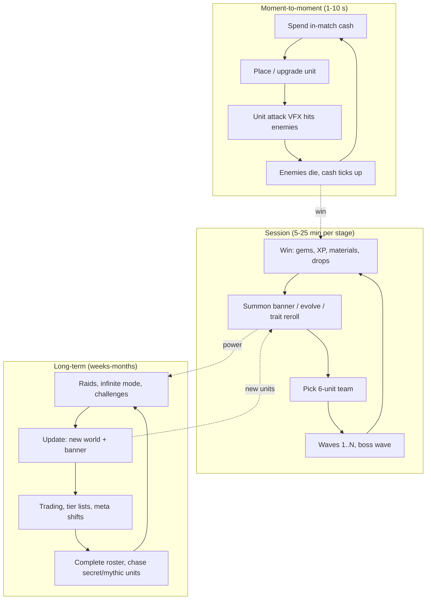

# Tower Defense and Unit Collecting Loop

## TL;DR
- **Loop line:** `summon units (gacha) -> place on path -> upgrade during waves -> clear stage/raid -> earn gems + materials -> summon/evolve units -> harder content`. Anime TD on Roblox is **TD + gacha + collection**, not classic TD alone.
- It's one of Roblox's **highest-earning anime loops**. **Anime Vanguards** launched 2024-09-08, hit **215K–220K+ CCU** within days (Pocket Tactics, Beebom; RoWatcher reports 340K, unverified) and was reported as **overtaking Blox Fruits as top-earning Roblox game within ~10 days** (Beebom, 2024). In March 2026 it still showed a ~101K 7-day peak around Update 11.5.
- Other proofs: **Anime Defenders** (launched 2024-04-05; peak ~202K per RoWatcher; decayed to ~324 CCU by Aug 2026, which shows the **fast-decay risk**). **Anime Last Stand** (~157K peak per Rotrends; launched Feb 2024). **All Star Tower Defense** (2020; ~7.9B visits; peak ~29.8K per Profitable, though older peaks were likely higher). **SpongeBob Tower Defense** hit 113K+ CCU in Dec 2025.
- Psychology: **collection + gacha variable reward + strategic placement mastery + co-op raids + power growth**.
- Monetization: **summon currency (paid random items, so odds and PolicyService are mandatory), unit-slot passes, 2x speed, battle pass**. It's the most monetizable anime loop, and the most ethically fraught.
- MVP: **1 map, 10–15 units, 3 rarities, 1 summon banner, 20 waves + 1 boss**. The art cost is mostly *unit models + attack VFX*, and you can reuse battlegrounds characters.

## Why it matters for anime battlegrounds
TD lets you **monetize a character roster** that a battlegrounds game can't sell as power. The same "inspired-by" heroes become collectible units whose attacks reuse your ability VFX. Several Roblox anime studios run both a fighter and a TD. See [[Hybrid Loops for Anime Games]].

## The three loop layers

## Why it's compelling
| Driver | Implementation |
|---|---|
| Collection | 100+ units, recognisable anime archetypes; an index fills up |
| Variable reward | Summon banners with Mythic / Secret odds; trait rerolls |
| Strategy / mastery | Placement, range, unit synergy, wave knowledge |
| Power growth | Evolutions, levels, traits → old content becomes easy |
| Social | Co-op stages and raids (often 4 players), trading, tier lists on YouTube |
| Low dexterity requirement | Accessible on mobile; idle-friendly (auto-skip, 2x/3x speed) |

## Flagship examples (dated evidence)
| Game | Stat | Date / source |
|---|---|---|
| Anime Vanguards | Launch 2024-09-08; 215K–220K+ CCU in first days (Pocket Tactics, Beebom); RoWatcher article cites 340,167 (unverified); reported top-earning Roblox game within ~10 days | 2024-09 |
| Anime Vanguards, Update 11.5 "Moonless" (4 Bleach-inspired units, dungeon, level editor) | 7-day peak ~101K, 30-day peak ~104K; later ~55K–58K CCU snapshots | 2026-03-22 onward (RoWatcher) |
| Anime Defenders | Launch 2024-04-05; peak ~202K (RoWatcher, Sep 2024) vs 380.5K (Rotrends, undated); ~324 CCU late Aug 2026 | Profitable / RoWatcher |
| Anime Last Stand | ~157K peak, 1.1B visits; launched Feb 2024 | Rotrends (undated) |
| All Star Tower Defense | Published 2020-05-07; ~7.9B visits; Profitable all-time peak 29.8K; ~1.5K CCU on 2026-10-13; est. ~$63.3M lifetime revenue (model) | Profitable 2026-10 |
| SpongeBob Tower Defense (licensed) | 113K+ CCU, #12 overall | Dec 2025 (gam3s.gg) |
| Tower Defense Simulator (non-gacha classic) | 23.3K CCU, 31.2K peak (summer event listing) | Profitable 2026-07-07 |

> [!warning] Unverified
> CCU peaks disagree across trackers by up to ~2x (Anime Defenders: 202K vs 380.5K). Revenue numbers are visit-based models. The "top-earning" claim is press-reported from late 2024. By Dec 2025 a top-grossing list named The Forge, RIVALS, Steal a Brainrot, Blox Fruits and Adopt Me, not Anime Vanguards.

> [!tip] What the decay curves say
> Anime Defenders went from ~200K to a few hundred CCU in about two years, while Anime Vanguards held ~55K–100K into 2026. The difference observers point to is **update cadence and content depth** (worlds, dungeons, raids, level editor), not launch hype. Plan a 12-month content calendar before launch.

## Monetization patterns that fit
| Pattern | Notes |
|---|---|
| Premium summon currency (gems) | Core revenue; **paid random items**: list every unit + exact odds; respect `ArePaidRandomItemsRestricted` (UK/Brazil under-18) via PolicyService |
| Pity system | Strongly recommended for fairness; show the pity counter |
| Trait / stat rerolls | Also random. The same policy applies when bought with Robux or Robux-bought currency |
| Unit storage / team slot passes | Non-random; clean |
| 2x/3x game speed, auto-skip | Convenience |
| Battle / season pass | Clear goals; includes summon currency |
| Direct-purchase shop for some units | Good compliance fallback for restricted regions |

> [!warning] Ethical limits
> TD-gacha is where Roblox's younger audience is most exposed to loot-box dynamics. Minimums: visible odds and pity, all units obtainable F2P (even if slowly), no "limited, never returning" pressure on a 10-year-old, and no fake near-miss animations. Note: Roblox Q2 2026 bookings missed internal targets partly due to lower per-hour spend among younger US/Canada users, per earnings coverage. Don't build a business that depends on squeezing kids.

## Retention mechanics
- **Daily / weekly challenges** with rotating modifiers
- **Infinite mode** with leaderboards
- **Raids** (co-op, weekly) with exclusive drops
- **New world + banner per major update** (Anime Vanguards' numbered updates every few weeks)
- **Trading** (units, items) creates long-term economy goals
- **Codes** on update days

## Minimum viable scope (small team)
### Step 1: Path, enemies, placement (week 1)
- Waypoint path, enemy pooling, place/upgrade/sell UI, in-match cash.
### Step 2: 10–15 units, 3 rarities, 3 attack archetypes (weeks 2–3)
- Single-target, AoE, slow/support. Reuse character models and ability VFX from your fighter.
### Step 3: Summon banner with odds UI + pity (week 3)
### Step 4: 1 world: 5 stages + boss + infinite mode (week 4)
### Step 5: Co-op 4-player lobby, codes, analytics (week 5)

## How to give it a shonen anime skin
- **Units = inspired-by heroes** with signature moves as attacks (beam, slash, domain AoE). Evolutions = "awakened" forms.
- **Worlds = arcs** (village, cursed city, soul society-like realm); bosses = arc villains.
- **Summon animation** with impact frames and rarity colour reveal ([[Impact Frames and Screen Effects]]).
- **Traits = "bloodlines" / "cursed techniques"**.

> [!warning] IP risk
> Anime TD games lean heavily on recognisable characters with renamed labels. Licensed TDs (SpongeBob) show brands *are* entering. Expect enforcement risk to rise. Keep designs archetypal.

## Numbers & Settings
| Setting | Starting value | Why |
|---|---|---|
| Team size | 6 units | Genre convention |
| Rarities | 4–6 (Rare → Secret) | Convention; long tail for chase |
| Mythic/Secret odds | Display exactly; e.g., 0.5–1% (design choice) | Must be shown by policy |
| Pity | Guaranteed top-tier by N pulls (e.g., 100) | Fairness; widely expected |
| Stage length | 5–15 min, 2x speed option | Mobile sessions |
| Co-op size | Up to 4 | Convention |

## Checklist
- [ ] Odds for every banner, reroll and box; PolicyService gating
- [ ] Pity counter visible
- [ ] All units obtainable F2P
- [ ] 3 attack archetypes, readable VFX
- [ ] Enemy pooling; no Humanoids for mobs
- [ ] Co-op lobby
- [ ] 12-month update calendar drafted

## Common Mistakes
- **Launch-and-coast**: Anime Defenders-style decay.
- **Power creep that invalidates last month's purchases**: causes community backlash.
- **Odds not shown or wrong**: policy violation, removal risk.
- **Mob performance**: Humanoid-based enemies tank FPS.
- **Unit bloat**: 50 shallow units with no role difference.

## Related
- [[Gacha and Spin Systems on Roblox]]
- [[Hybrid Loops for Anime Games]]
- [[Simulator and Clicker Loop]]
- [[Anime VFX Fundamentals]]
- [[Core Loop Comparison Matrix]]
- [[Core Loop Fundamentals]]

## Sources
1. Pocket Tactics, "Anime Vanguards is outperforming Roblox award winner Dress to Impress": https://www.pockettactics.com/anime-vanguards/visits
2. Beebom, "Anime Vanguards Surpasses Blox Fruits to Become Top Earning Roblox Game": https://beebom.com/anime-vanguards-surpasses-blox-fruits-top-earning-roblox-game
3. RoWatcher, "Anime Vanguards Update 11.5: How This Tower Defense Game Holds 55K Players": https://rowatcher.com/news/anime-vanguards-update-11-5-how-this-tower-defense-game-holds-55k-players
4. RoWatcher, Anime Vanguards game page: https://rowatcher.com/games/5578556129
5. RoWatcher, Anime Defenders: https://rowatcher.com/games/5836869368/anime-defenders
6. Profitable, Anime Defenders: https://profitable.app/roblox/games/anime-defenders
7. Rotrends, Anime Last Stand: https://rotrends.com/game/4509896324/UPD-x4-Anime-Last-Stand
8. Profitable, All Star Tower Defense: https://profitable.app/roblox/games/all-star-tower-defense
9. gam3s.gg, "SpongeBob Tower Defense on Roblox Hits 113k+ CCU": https://gam3s.gg/news/spongebob-tower-defense-on-roblox-hits-113k-ccu
10. Profitable, Summer Tower Defense Simulator: https://profitable.app/roblox/games/summer-tower-defense-simulator
11. games.gg, "Roblox Top Games and Trends December 2025": https://games.gg/news/roblox-top-games-and-trends-december-2025/
12. Roblox Creator Hub, Paid random items policy: https://create.roblox.com/docs/production/monetization/paid-random-items
13. Outlook Respawn, Roblox Q2 2026 results: https://respawn.outlookindia.com/gaming/gaming-news/roblox-q2-2026-revenue-soars-36-to-15b-despite-bookings-miss
