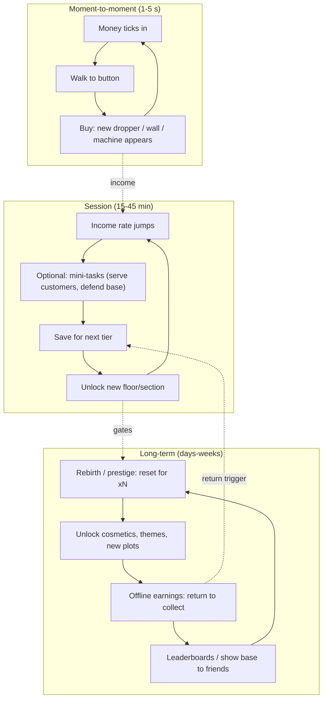

# Tycoon and Idle Loop

## TL;DR
- **Loop line (tycoon):** `claim plot -> droppers make money -> conveyor -> collector -> buy next button/upgrade -> base grows -> rebirth for multiplier`. **Idle/incremental:** `generators produce -> buy more generators/multipliers -> wait/return -> prestige reset for a permanent multiplier`.
- One of Roblox's **founding genres**. A RoWatcher feature calls it "the genre that built Roblox and still hasn't peaked." One March 2026 chart source groups tycoons like **Restaurant Tycoon 2** with **38–45 min sessions** (players leave them running). The 2025 mega-hits **Steal a Brainrot** (25M+ CCU) and **Grow a Garden** (21–22M CCU) are tycoon/idle loops with a **social twist**. See [[Obby, Tower and Viral Social Loops]].
- Math reference: Anthony Pecorella's (AdVenture Capitalist) **"Math of Idle Games"** series on Game Developer. Prestige popularised by Cookie Clicker; prestige currency often scales with the **square root of lifetime earnings**, so resetting at the same point yields nothing new.
- Psychology: **visible growth (your base literally gets bigger), compounding numbers, autonomy (layout), return-to-collect appointment loops, low skill floor**.
- Anime fit: weaker *combat* fit, but strong as a **"build your dojo / academy / hideout"** meta-layer.

## Why it matters for anime battlegrounds
Tycoon/idle loops are the cheapest way to give a combat game **between-session progression that doesn't touch PvP balance**: a dojo that passively generates cosmetic currency, trains NPC students or unlocks emotes. They are also the backbone of the 2025 viral loops, so understanding the economy math is essential.

## The three loop layers



## Why it's compelling
| Driver | Implementation |
|---|---|
| Visible progress | Each purchase spawns a physical object; the base grows around you |
| Compounding | Exponential income curves feel powerful |
| Autonomy | Layout and decoration choices |
| Appointment | Offline earnings and timers bring players back |
| Low skill floor | Walk + click; very accessible |
| Social | Neighbouring plots let players compare and show off; 2025 hits added *theft and defence* |

## Flagship examples (dated evidence)
| Game | Twist | Stat | Date / source |
|---|---|---|---|
| Steal a Brainrot | Idle income from collected "brainrots" + stealing other players' | ~25.4M–25.8M CCU peak (Oct 2025) | Wikipedia / Beebom / PocketGamer.biz |
| Grow a Garden | Plant → grow (real time) → harvest → sell; weather mutations | ~21.3M (2025-06-21) to ~22.3M (2025-08-23) CCU | Wikipedia / Calcalist / PocketGamer.biz |
| Restaurant Tycoon 2 | Serve customers, design restaurant | Listed among top simulation games; sessions grouped at 38–45 min | 2025 guide; ejaw.net chart source (Mar 2026) |
| AdVenture Capitalist (mobile/PC idle) | Generator + manager + angel prestige | Design reference for idle math | Game Developer series |

> [!warning] Unverified
> One source claims tycoons hold the second-largest share of average concurrent players on Roblox after obbies. It's a low-authority outlet, so treat it as anecdotal. The DevForum Creator Spotlight on Ultraw's food tycoon is a good primary read but wasn't fetched for numbers.

## Prestige math (from "The Math of Idle Games")
- **Generator cost** grows geometrically: `cost_n = base * rate^n` (rate often ~1.07–1.15).
- **Production** grows linearly per generator, plus multipliers at milestones, so progress happens in "staircase" tiers. Pecorella notes sub-prestige milestone loops roughly multiply earnings by ~5x each time.
- **Prestige currency** commonly ∝ `sqrt(lifetime_earnings)`. Because it's based on the *max* earned, resetting at the same point gives no extra currency, which pushes players further each run.
- **First prestige should come early** (common practitioner advice) so players learn the reset is good.

```lua
-- Prestige currency sketch (sqrt-scaled, Cookie Clicker / AdCap-style)
local function prestigeGain(lifetimeEarned, alreadyClaimed)
    local total = math.floor(math.sqrt(lifetimeEarned / 1e6)) -- tune divisor
    return math.max(0, total - alreadyClaimed)
end
```

## Monetization patterns that fit
| Pattern | Notes |
|---|---|
| 2x money pass | "Cornerstone" of tycoon monetization per guides |
| Auto-collect / auto-buy | Convenience |
| Offline earnings extension | Appointment-friendly |
| Exclusive droppers/decorations | Cosmetic + small income |
| Rebirth skip / boost | Use carefully; it can hollow out the loop |
| Experience subscription | Daily cash drip + VIP plot theme |

> [!warning] Ethical limit
> Idle games can monetise *impatience* indefinitely. Avoid timers designed purely to be skipped for Robux, and keep offline earnings meaningful for F2P.

## Retention mechanics
- **Offline earnings** (return to collect)
- **Rebirth tiers** with visible unlocks (new floors, themes)
- **Daily rewards** and **limited events** (themed droppers)
- **Social plots**: visit, rate, or (2025 twist) raid
- **Leaderboards** for total earned or rebirths

## Minimum viable scope (small team)
### Step 1: Plot claim + dropper/conveyor/collector (week 1)
### Step 2: 30–50 purchase buttons across 3 floors (week 2)
### Step 3: Rebirth with sqrt prestige + 5 permanent perks (week 3)
### Step 4: One active mini-task (defend base vs NPC wave, or serve customers) (week 4)
### Step 5: Offline earnings, 2x pass, analytics (week 5)

> [!tip] Make it active
> Pure tycoons are passive. The 2025 hits added **active verbs** (stealing, defending, harvesting during weather events). For an anime game, the active verb is combat: defend your dojo from waves with your moveset.

## How to give it a shonen anime skin
- **Dojo / hidden village / hero academy tycoon**: buildings unlock trainees that generate "training points."
- **Ramen shop tycoon** (slice-of-life anime staple).
- **Prestige = "Next generation"**: your student becomes master, with a legacy multiplier.
- **Defend your base from a demon raid** using battlegrounds moves (hybrid; see [[Hybrid Loops for Anime Games]]).

## Numbers & Settings
| Setting | Starting value | Why |
|---|---|---|
| Cost growth rate | 1.07–1.15 per purchase | Idle-math convention (Pecorella series) |
| Milestone multiplier | x2–x5 at generator counts 25/50/100 | "Staircase" pacing |
| First rebirth | 15–30 min | Teach the reset early (heuristic) |
| Prestige formula | sqrt(lifetime / k) | Standard; forces deeper runs |
| Offline earnings cap | 2–8 h | Encourages daily returns (heuristic) |
| Session benchmark | 38–45 min (tycoons, Mar 2026 chart source) | Long AFK-friendly sessions |

## Checklist
- [ ] Every purchase spawns something visible
- [ ] Prestige formula spreadsheet-tested
- [ ] Number formatting (K, M, B, T, then letters)
- [ ] At least one active verb
- [ ] Offline earnings
- [ ] Server-authoritative economy

## Common Mistakes
- **Fully passive loop**: nothing to *do*.
- **Linear costs**: no tension.
- **Prestige too late**: players quit before discovering it.
- **Client-trusted money**: exploited immediately.
- **Clone of a clone**: tycoon is saturated; the 2025 winners won on a social twist, not the dropper.

## Related
- [[Obby, Tower and Viral Social Loops]]
- [[Simulator and Clicker Loop]]
- [[Hybrid Loops for Anime Games]]
- [[Core Loop Comparison Matrix]]
- [[Core Loop Fundamentals]]

## Sources
1. Game Developer, "The Math of Idle Games, Part I": https://www.gamedeveloper.com/design/the-math-of-idle-games-part-i
2. Game Developer, "The Math of Idle Games, Part III": https://www.gamedeveloper.com/design/the-math-of-idle-games-part-iii
3. RoWatcher, "Tycoon Games: The Genre That Built Roblox and Still Hasn't Peaked": https://rowatcher.com/news/tycoon-games-the-genre-that-built-roblox-and-still-hasn-t-peaked
4. Roblox DevForum, "Creator Spotlight: How Ultraw's Love for Food Became a Trending Tycoon": https://devforum.roblox.com/t/creator-spotlight-how-ultraw%E2%80%99s-love-for-food-became-a-trending-tycoon/3840933
5. ejaw.net, Roblox charts Q1 2026: https://ejaw.net/roblox-charts
6. creation.dev, "How to make a tycoon game": https://www.creation.dev/blog/how-to-make-a-tycoon-game
7. Wikipedia, Steal a Brainrot: https://en.wikipedia.org/wiki/Steal_a_Brainrot
8. Wikipedia, Grow a Garden: https://en.wikipedia.org/wiki/Grow_a_Garden
9. PocketGamer.biz, "Steal a Brainrot becomes first game to surpass 25m concurrent players": https://www.pocketgamer.biz/robloxs-steal-a-brainrot-becomes-first-game-to-surpass-25m-concurrent-players
10. Roblox Creator Hub, Subscriptions: https://create.roblox.com/docs/production/monetization/subscriptions
