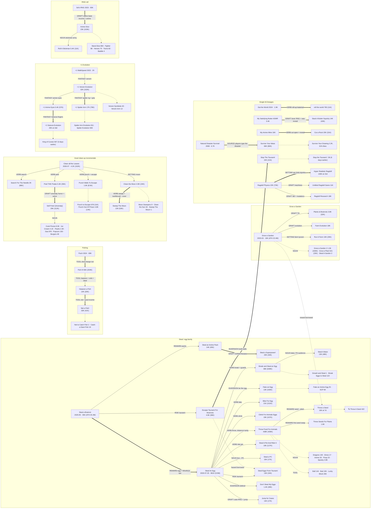

# Mutation Playbook

How 2025–2026 Roblox hits were made by taking a proven loop and changing one part of it, traced from originator to children with live CCU and RoWatcher peaks. Companion to [[Idea Judgement Rules]], [[Live Pattern Report 2026-10-31]] and [[Growth Curves and Timing]]. Raw data: `08 - Market Research/Data/mutation-lineages-2026-11-14.json`.

**Success markers (vault standard):** ≥1K live CCU = it worked, ≥10K = a hit. "Peak" means the RoWatcher daily peak (2nd-highest sample of the UTC day). "7-day peak" means the best trailing 7-day median of daily peaks, which strips one-day admin-event spikes.

## TL;DR
- **A copy is not a mutation.** 50 games repeated a change a sibling had already made (same title, same verb, same fantasy). Their median is **76 CCU**: 10% reached 1K and **0 of 50** are at 10K. The 110 distinct mutations have a median of **4.2K**: 72% are at 1K and 34% at 10K. Search-rank bias inflates both groups, so compare them with each other and don't read either as real odds.
- **Ranked by 10K rate (types with n ≥ 3):** GRAFT 67% · INVERSION 67% · REWARD 50% · TOOL 43% · SETTING 40% · FANTASY 33% · VERB 30% · NOUN 10% · COPY 0%. VERB swaps are the most reliable at 1K (81%, n=27) and produced the single biggest child (Throw Food For Animals, 438K). NOUN-only swaps work only on a platform-scale parent: 3 of 11 Steal-template noun swaps are at 10K (Steal a PC, Steal A Balut, Steal A Scooter), and 0 of 14 noun swaps on the younger Throw Food and voxel/Anomaly parents are at 10K now.
- **The children that BEAT their parent** (16 of the 99 mutations whose parent had itself peaked at 10K or more). The biggest of them each add **a new moment you watch happen**: a stranger types "nuke" and it lands (Survive Your Ideas), a leg breaks and the dummy crawls (Hyper Realistic Ragdoll), the wave hits your sand wall (Stop The Tsunami), a net full of fish (Net a Fish), your avatar turns into Sukuna (+1 Sukuna). A swap that only changes the pipe, such as a new travel verb or a new noun, almost never beats its parent: VERB 3 of 26, NOUN 1 of 31.
- **Keep the engine; it is table stakes, not the edge.** Base income, offline earnings and a train stat show up in winners and flops at the same rate (45% vs 38% mention base income). What separates them is **like % (median 94 vs 80.5)** and the new moment.
- **Timing depends on the parent's size.** On a small fast wave (+1 Evolution, ragdoll, Moon, net fishing, Anomaly), winners launched **−13 to +14 days around the day the parent crossed 10K**, so the window lasts about 2 weeks. A platform-scale parent (Steal An Egg, 2.5M sustained) kept producing 10K mutations up to **parent age 97 days**. Evergreen genres (fishing, disaster survival, ragdoll sandbox, RNG) have no window at all: Survive Your Ideas mutated an 18-year-old game.
- **Same-idea races go to the better build, not the earlier one.** When two games shipped the same idea within 10 days, before either broke out, **the later one won 7 of 7 times**: Climb for Eggs! (52) vs Climb For Animals Eggs (19K), Stop the Tsunami🌊 (36) vs Stop The Tsunami! (22K), Steal A Superpower (5) vs Steal a Superpower! (20K), King of Curses (567) vs +1 Sukuna (20K), Throw Seeds For Plants (1.6K) and 🪐 Throw A Seed (422) vs Throw a Seed (16.4K), and Punch Walls To Escape (1.6K) vs Punch Out Of Prison (4.8K). **Once a winner has broken out, it keeps the idea:** 1 of 24 later copies is at 1K and none at 10K.

> [!example] The one-line recipe
> Take a parent that is **≥10K and rising**. Keep its reward stream and base-income engine. Change **one headline part** that creates a **new clip-able moment**, and back it with **one supporting change** (a tool ladder, a risk, a reveal). Ship it **within about 14 days of the parent's 10K day** on a small wave, or **by about parent day 90** on a platform-#1 wave. Never ship the second copy of someone else's mutation.

## 1. Lineage graph
Numbers are live CCU at 2026-11-14 08:21 UTC, with the RoWatcher daily peak in brackets. Thick arrows mark a child that beat its parent. Dotted arrows lead to copies (median 76 CCU).

## 2. Lineage table (all 171 nodes)
Columns:
- **Role:** `mutation` means the first distinct version of a change. `copy` means a game that repeats a sibling's change.
- **Type:** the primary mutation type, followed by any supporting types.
- **RW daily peak:** the RoWatcher peak since 2026-07-01. For 2025 games, the press all-time high is given in brackets.
- **Parent age at launch:** days from the parent's creation date to the child's.
- **Beat parent?:** "yes" if the child's CCU now, or its 7-day peak, is higher than the parent's. A "yes" over a dead origin (+1 WalkSpeed at 29 CCU, Ragdoll Engine at 277) is trivial.
- **Not tracked:** RoWatcher has no history for the game, so only its live CCU is known.

#### L1 Steal

| Node | id | Created | Role | Type | CCU 11-14 | RW daily peak | 7-day peak | Parent age at launch | Beat parent? | What changed |
|---|---|---|---|---|---|---|---|---|---|---|
| [💀] Steal a Brainrot | 7709344486 | 2025-05-16 | origin | ORIGIN | 35K | 1.24M (2025 ATH 25.40M) | 341K | — | — | Origin: buy brainrots off a conveyor, they earn cash on your base, steal other players' brainrots |
| [🌊] Escape Tsunami For Brainrots! | 9363735110 | 2025-12-15 | mutation | RISK+SOURCE | 4.9K | 36K | 11K | 213d | no | Threat = a TSUNAMI that sweeps the map, not other players; grab brainrots laid out along a run |
| Steal An Egg | 10563114921 | 2026-07-25 | mutation | REWARD+SOURCE+GRAFT-train | 961K | 9.88M | 2.49M | 435d | **yes** | Brainrot -> EGG that hatches into a random pet (hatch reveal); steal from NPC pets instead of a shop conveyor; treadmill speed added |
| Steal an Anime Pack | 10701622575 | 2026-08-14 | mutation | REWARD+GRAFT-rng | 14K | 45K | 27K | 455d | no | Brainrot -> anime card PACKS you steal and open |
| Steal An Anime Egg | 10757498504 | 2026-08-23 | mutation | NOUN | 1.6K | 15K | 7.0K | 29d | no | Steal an ANIME egg |
| Steal an Egg for Squishy Dumplings! | 10758397570 | 2026-08-24 | mutation | NOUN | 2.1K | 12K | 7.3K | 30d | no | Steal an egg for SQUISHY DUMPLINGS |
| [🕸️] Swing For Eggs | 10763764817 | 2026-08-27 | mutation | VERB | 991 | 51K | 25K | 33d | no | SWING (web) for eggs |
| 🎃 Dig For Eggs | 10765013362 | 2026-09-03 | mutation | VERB | 2.6K | 29K | 10K | 40d | no | DIG for eggs |
| Break and Steal an Egg | 10765288803 | 2026-09-05 | mutation | VERB+RISK | 86K | 648K | 228K | 42d | no | Adds BREAK (pickaxe the egg open) before the steal, and NPC guards to escape |
| Climb For Animals Eggs🥚 | 10765490774 | 2026-09-06 | mutation | VERB+SOURCE | 19K | 167K | 64K | 43d | no | CLIMB up biomes to find eggs instead of stealing them; offline income + rebirth |
| Steal A Dinosaur Egg | 10765430489 | 2026-09-06 | mutation | NOUN | 40 | 545 | 412 | 43d | no | Steal a DINOSAUR egg |
| Bike For Egg! | 10766620257 | 2026-09-15 | mutation | VERB | 21K | 151K | 61K | 52d | no | Movement verb in the title (BIKE); description is the Steal An Egg template word for word |
| Throw Food For Animals | 10766972131 | 2026-09-18 | mutation | VERB+REWARD+SOURCE | 438K | 436K | 333K | 55d | no | THROW food as far as you can; distance decides which animals come to you (no stealing); pull-ups for Throw Power |
| Steal a Car Egg | 10767483594 | 2026-09-21 | mutation | NOUN | 191 | 2.1K | 2.1K | 58d | no | Steal a CAR egg |
| Don't Steal My Eggs! | 10767566226 | 2026-09-22 | mutation | INVERSION | 1.4K | 28K | 15K | 59d | no | DEFEND: catch thieves to protect your eggs |
| Run For Eggs | 10767735339 | 2026-09-23 | mutation | VERB | 6.3K | 15K | 8.6K | 60d | no | RUN for eggs |
| Ride An Egg | 10767808614 | 2026-09-24 | mutation | VERB+RISK | 10K | 38K | 23K | 61d | no | RIDE an egg outward, run back while animals chase; further = more luck |
| Lift Rock For Eggs | 10768316438 | 2026-09-27 | mutation | VERB | 842 | 27K | 25K | 64d | no | LIFT ROCK for eggs |
| Push Rock For Eggs! | 10768531905 | 2026-09-29 | mutation | VERB | 10 | not tracked | — | 66d | no | PUSH ROCK for eggs |
| Steal a Wild Horse | 10768532216 | 2026-09-29 | mutation | NOUN | 5.0K | 13K | 7.9K | 66d | no | Steal a WILD HORSE |
| Ride Mobs For Eggs | 10768838846 | 2026-10-01 | mutation | VERB | 5.8K | 6.5K | 5.6K | 68d | no | RIDE MOBS for eggs |
| Jump For Eggs | 10768858305 | 2026-10-01 | mutation | VERB | 1.7K | 5.7K | 4.9K | 68d | no | JUMP for eggs |
| [🧪] Fake an Egg | 10769384180 | 2026-10-04 | mutation | INVERSION+SOCIAL | 13K | 165K | 55K | 71d | no | You PLAY AS the egg: get bought by a player, then steal their best pet (deception) |
| [🌊] Steal Eggs From Tsunami! | 10769341404 | 2026-10-04 | mutation | RISK | 13K | 24K | 14K | 71d | no | Steal An Egg template + the Escape Tsunami hazard (steal eggs from the tsunami path) |
| [🏁] Steal A Pet And Ride It! | 10769315427 | 2026-10-04 | mutation | VERB+REWARD | 19K | 127K | 44K | 71d | no | Steal a cage from a sleeping boss, then RIDE the pet (the reward becomes your speed) |
| Hide to Steal Eggs | 10769562933 | 2026-10-06 | mutation | VERB+SOCIAL | 3.1K | 16K | 14K | 73d | no | HIDE inside eggs to sneak onto plots (stealth gate on the steal) |
| [👽] Steal a PC | 10769563057 | 2026-10-06 | mutation | NOUN+SOURCE | 15K | 17K | 14K | 73d | no | Egg -> mystery BOX stolen from zone guardians, unbox a PC; 30 zones |
| Steal A Plane | 10769672145 | 2026-10-06 | mutation | NOUN | 2.0K | not tracked | — | 73d | no | Steal a PLANE |
| Steal a Vault | 10769813235 | 2026-10-08 | mutation | NOUN | 141 | not tracked | — | 75d | no | Steal a VAULT |
| Steal A Dumpling | 10770229689 | 2026-10-10 | mutation | NOUN | 7.3K | 7.4K | 4.9K | 77d | no | Steal a DUMPLING (squishy) |
| [⚡] Steal a Superpower! | 10770228857 | 2026-10-10 | mutation | GRAFT+REWARD | 20K | 43K | 20K | 57d | **yes** | Packs of SUPERPOWERS + zone fights and Dominus bosses (combat graft); cards earn on base |
| Steal A Balut | 10771643321 | 2026-10-18 | mutation | NOUN | 13K | 48K | 32K | 43d | no | Break and Steal template; egg -> BALUT (Filipino duck egg), ducks; Philippines audience |
| Split Rock for Eggs | 10771878493 | 2026-10-19 | mutation | VERB | 3.3K | not tracked | — | 86d | no | SPLIT ROCK for eggs |
| [🛴] Steal A Scooter | 10771966586 | 2026-10-19 | mutation | NOUN | 10K | 10K | 9.9K | 86d | no | Steal a SCOOTER |
| Cut Grass for Eggs | 10772010278 | 2026-10-20 | mutation | VERB | 746 | excluded | 0 | 87d | no | CUT GRASS for eggs |
| Chop Trees For Eggs | 10772285730 | 2026-10-21 | mutation | VERB | 1.3K | not tracked | — | 88d | no | CHOP TREES for eggs |
| [❄️] Be Flash For Eggs | 10773033667 | 2026-10-25 | mutation | VERB+THEME | 6.9K | 19K | 19K | 92d | no | BE FLASH (super-speed run) for eggs |
| [⛳] Golf a Lucky Egg | 10774553097 | 2026-11-03 | mutation | VERB+REWARD | 3.8K | 4.4K | 2.4K | 46d | no | GOLF a lucky egg (launch-for-distance like Throw Food, golf swing) |
| [UPD🎃] Climb for Eggs! | 10764888929 | 2026-09-02 | copy | VERB | 52 | 7.5K | 3.3K | -4d | no | Climb for Eggs (same verb) |
| [🎣FISHING] Break Eggs to Steal Pets! | 10766841770 | 2026-09-17 | copy | VERB | 122 | 8.4K | 5.0K | 12d | no | Break Eggs to Steal Pets |
| Don't Steal the Eggs! | 10768488635 | 2026-09-28 | copy | INVERSION | 336 | not tracked | — | 6d | no | Same defend flip, 6 days later |
| Steal A Superpower | 10769568123 | 2026-10-06 | copy | NOUN | 5 | not tracked | — | 53d | no | Steal A Superpower (earlier same-title noun swap, no combat) |
| [🎃] Smash and Steal an Egg | 10770572138 | 2026-10-12 | copy | VERB | 1 | excluded | 0 | 37d | no | SMASH and Steal an Egg (Break and Steal synonym) |
| Fake an Egg for SCP Monster | 10771556757 | 2026-10-17 | copy | NOUN | 84 | 253 | 209 | 13d | no | Fake an Egg for SCP Monster |
| [UPD] Bike For Animals Eggs🥚 | 10772054574 | 2026-10-20 | copy | VERB | 69 | not tracked | — | 35d | no | Bike For Animals Eggs (Bike + Climb title mash) |
| ⛩️Fake an Anime Egg! | 10772430292 | 2026-10-22 | copy | NOUN | 25 | 11 | 11 | 18d | no | Fake an ANIME Egg |
| Motorcycle For Egg! | 10774508720 | 2026-11-03 | copy | VERB | 95 | not tracked | — | 49d | no | MOTORCYCLE for egg (Bike For Egg copy) |

#### L1b Throw

| Node | id | Created | Role | Type | CCU 11-14 | RW daily peak | 7-day peak | Parent age at launch | Beat parent? | What changed |
|---|---|---|---|---|---|---|---|---|---|---|
| [🌱] Throw Seeds For Plants | 10773667261 | 2026-10-29 | mutation | REWARD+GRAFT-garden | 1.6K | 1.9K | 1.8K | 41d | no | Throw SEEDS for plants (first seed swap, 9 days before Throw a Seed) |
| Throw Food For Spooky Animals | 10773663140 | 2026-10-29 | mutation | NOUN+THEME | 2.8K | 3.6K | 620 | 41d | no | SPOOKY animals (Halloween skin) |
| Throw Key for Cars | 10773711031 | 2026-10-29 | mutation | REWARD | 2.4K | 2.4K | 481 | 41d | no | Throw a KEY for CARS |
| Throw Food For Dragons | 10773865420 | 2026-10-30 | mutation | NOUN | 140 | not tracked | — | 42d | no | Throw food for DRAGONS |
| Throw Food For Dinos | 10773830892 | 2026-10-30 | mutation | NOUN | 17 | 89 | 89 | 42d | no | Throw food for DINOS |
| Carry Food For Animals | 10773802256 | 2026-10-30 | mutation | VERB | 2.2K | not tracked | — | 42d | no | CARRY food for animals |
| Throw Ball For Animals | 10773794575 | 2026-10-30 | mutation | TOOL | 144 | 167 | 125 | 42d | no | Throw a BALL for animals |
| [UPD] Throw Poop For Flies | 10774262592 | 2026-11-01 | mutation | NOUN | 23 | 17 | 17 | 44d | no | Throw POOP for FLIES |
| Throw Food for Pets [CO-OP] | 10774283890 | 2026-11-02 | mutation | SOCIAL | 22 | 40 | 40 | 45d | no | Throw food for pets [CO-OP] |
| Throw Food For Anime! | 10774460899 | 2026-11-03 | mutation | NOUN | 33 | not tracked | — | 46d | no | Throw food for ANIME |
| Throw a Rod for Fish | 10774492997 | 2026-11-03 | mutation | REWARD+TOOL | 72 | 112 | 112 | 46d | no | Throw a ROD for FISH |
| Throw Bait For Animal and Monster | 10774528490 | 2026-11-03 | mutation | TOOL | 106 | not tracked | — | 46d | no | Throw BAIT for animals and monsters |
| Throw Lucky Block For Animals | 10774803726 | 2026-11-05 | mutation | TOOL+GRAFT-rng | 265 | 353 | 323 | 48d | no | Throw a LUCKY BLOCK for animals |
| Throw a Seed | 10775182046 | 2026-11-07 | mutation | REWARD+GRAFT-garden | 16K | 18K | 18K | 50d | no | Food->SEED, animals->PLANTS: throw a seed down a canyon, distance = luck, a plant shoots up; timing tap |
| [🪐] Throw A Seed | 10774927841 | 2026-11-06 | copy | REWARD | 422 | 898 | 898 | -1d | no | Same seed swap, bench press instead of pull-ups (created a day earlier, same week) |

#### L2 Garden

| Node | id | Created | Role | Type | CCU 11-14 | RW daily peak | 7-day peak | Parent age at launch | Beat parent? | What changed |
|---|---|---|---|---|---|---|---|---|---|---|
| [🐪] Grow a Garden 🌶️ | 7436755782 | 2025-03-25 | origin | ORIGIN | 19K | 159K (2025 ATH 22.40M) | 44K | — | — | Origin: buy seeds, plant, wait (real time), harvest/sell, mutations from weather events |
| [💰] Plants & Brainrots 🌻 | 8316902627 | 2025-08-01 | mutation | GRAFT+INVERSION | 3.8K | 32K | 9.3K | 129d | no | Plants defend against brainrots (tower-defense graft) |
| Grow a Garden 2 | 10200395747 | 2026-05-21 | mutation | NOUN | 1.3K | 326K | 326K | 422d | no | Grow a Garden 2 (sequel listing) |
| Steal A Garden | 10755961879 | 2026-08-23 | mutation | GRAFT | 2 | 28 | 28 | 516d | no | STEAL a garden (steal graft) |
| +1 Garden Evolution | 10765972921 | 2026-09-11 | mutation | GRAFT | 174 | 1.6K | 1.2K | 535d | no | +1 Garden Evolution (+1 clicker graft) |
| [🌱] Grow a Plant | 10768292556 | 2026-09-27 | mutation | NOUN | 521 | 23K | 9.2K | 551d | no | Grow a PLANT |
| [🍂UPD] Run A Farm! | 10768558548 | 2026-09-29 | mutation | SETTING+GRAFT-tycoon | 10.0K | 20K | 13K | 553d | no | Farm tycoon: coop, crops, tractors, trucks, mine, workers |
| [2x WEEKEND] Farm Evolution | 10771290199 | 2026-10-16 | mutation | GRAFT | 18K | 18K | 14K | 570d | no | Farm EVOLUTION (+1/evolution graft on farming) |
| [UPD🎉] Steal and Grow | 10774477556 | 2026-11-03 | mutation | GRAFT | 466 | not tracked | — | 588d | no | Steal and Grow |

#### L3 Fish

| Node | id | Created | Role | Type | CCU 11-14 | RW daily peak | 7-day peak | Parent age at launch | Beat parent? | What changed |
|---|---|---|---|---|---|---|---|---|---|---|
| Fisch 🦈 | 5750914919 | 2024-03-13 | origin | ORIGIN | 69K | 510K | 101K | — | — | Origin (Fisch): rod-skill fishing RPG, bestiary, islands |
| [🌙UPD] Fish It! 🐟 | 6701277882 | 2024-10-21 | mutation | TOOL+SOCIAL | 65K | 204K | 133K | 222d | **yes** | Simplified rod: click to charge, click fast; 1M variations; crews ('Inspired by Fisch') |
| Steal Fish Eggs | 10718240577 | 2026-08-16 | mutation | NOUN | 241 | 46K | 16K | 22d | no | Steal FISH eggs (egg template crossed with fishing) |
| [🦖] Harpoon a Fish | 10764240948 | 2026-08-28 | mutation | TOOL+RISK+GRAFT-steal | 14K | 20K | 14K | 676d | no | HARPOON (aim and fire) + get fat and sink deeper + harpoon other players' fish |
| Steal and Fish an Egg | 10765007812 | 2026-09-03 | mutation | VERB | 3.9K | 17K | 8.1K | 40d | no | Steal and FISH an egg |
| [🎣UPD] Throw Bait for Fish! | 10766084202 | 2026-09-12 | mutation | TOOL | 15 | not tracked | — | 691d | no | Throw BAIT for fish |
| [🐟] Net a Fish! | 10771053183 | 2026-10-15 | mutation | TOOL+GRAFT-base | 33K | 41K | 28K | 48d | **yes** | Throw a NET; fish go in your pool and earn cash per second; dock/boat/helper upgrades; crew wars |
| [🐟] Catch A Giant Fish! | 10771161829 | 2026-10-16 | copy | NOUN | 19 | 90 | 68 | 1d | no | Catch a GIANT fish |
| Net to Catch Fish! | 10773913143 | 2026-10-31 | copy | TOOL | 2 | 335 | 335 | 16d | no | Net to Catch Fish (same tool) |

#### L4 Voxel

| Node | id | Created | Role | Type | CCU 11-14 | RW daily peak | 7-day peak | Parent age at launch | Beat parent? | What changed |
|---|---|---|---|---|---|---|---|---|---|---|
| 🍂[NEW MAPS] Clean all the Leaves | 10539411000 | 2026-07-21 | origin | ORIGIN | 4.2K | 152K | 121K | — | — | Origin: voxel clean-up incremental: rake leaves tile by tile, sell, upgrade tool/backpack, robots |
| [⚔️] Search For The Needle | 10756011174 | 2026-08-23 | mutation | VERB+GRAFT-search | 2.0K | 86K | 60K | 33d | no | SEARCH the hay for the needle (clean-up + find-the-item goal) |
| Peel THE Potato | 10767408330 | 2026-09-21 | mutation | VERB+NOUN | 5.3K | 35K | 24K | 62d | **yes** | PEEL a giant potato voxel by voxel |
| Sell Fries! [Anomaly] 🍟 | 10767380385 | 2026-09-21 | mutation | GRAFT+REWARD | 29K | 112K | 69K | 0d | **yes** | Potato -> FRIES served to customers + ANOMALY horror at night |
| 💦 [NEW MAP] Clean The Swimming Pool | 10767763856 | 2026-09-23 | mutation | SETTING | 1.4K | 3.0K | 1.1K | 64d | no | Clean the swimming POOL |
| Punch Walls To Escape | 10770256752 | 2026-10-10 | mutation | VERB+SETTING | 1.6K | 8.5K | 8.0K | 81d | no | PUNCH prison walls, sell rubble, escape 5 floors |
| [MARS] Clean the Moon! | 10770466814 | 2026-10-12 | mutation | SETTING | 4.9K | 24K | 19K | 83d | **yes** | Clean the MOON: sweep moon dust, robots, lunar base |
| [CH2] Ice Cream Shop [Anomaly] 🍦 | 10770674395 | 2026-10-13 | mutation | NOUN | 4.1K | 10K | 10K | 22d | no | ICE CREAM shop [Anomaly] |
| Sell Popcorn! [Anomaly] 🍿 | 10771445452 | 2026-10-17 | mutation | NOUN | 150 | not tracked | — | 26d | no | Sell POPCORN [Anomaly] |
| Sell Pearls [Anomaly] | 10771955282 | 2026-10-19 | mutation | NOUN | 2.3K | not tracked | — | 28d | no | Sell PEARLS [Anomaly] |
| 🎃 Cook And Sell Burgers! [Anomaly] 🍔 | 10772447040 | 2026-10-22 | mutation | NOUN | 49 | 68 | 49 | 31d | no | Cook and sell BURGERS [Anomaly] |
| Cook Pizzas [Anomaly] | 10772627574 | 2026-10-23 | mutation | NOUN | 8.3K | 12K | 7.3K | 32d | no | Cook PIZZAS [Anomaly] |
| Sweep The Moon 🌕 | 10772543706 | 2026-10-23 | mutation | VERB+TOOL | 22K | 53K | 33K | 11d | **yes** | SWEEP tile by tile starting with a TOOTHBRUSH, up to rovers; 'get the Moon to 100%' |
| Sell Gas! [Anomaly] ⛽ | 10772929124 | 2026-10-25 | mutation | NOUN | 876 | not tracked | — | 34d | no | Sell GAS [Anomaly] |
| Clean The Bugs 🐜 | 10773059991 | 2026-10-26 | mutation | NOUN | 10.0K | 12K | 9.5K | 97d | **yes** | Clean the BUGS |
| Sell Shrimps! [Anomaly] 🦐 | 10773519891 | 2026-10-28 | mutation | NOUN | 555 | not tracked | — | 37d | no | Sell SHRIMPS [Anomaly] |
| Sell Lemonade! [Anomaly] | 10774521907 | 2026-11-03 | mutation | NOUN | 295 | not tracked | — | 43d | no | Sell LEMONADE [Anomaly] |
| Needle In A Haystack | 10761200080 | 2026-08-25 | copy | VERB | 197 | 7.2K | 6.4K | 2d | no | Needle in a Haystack (copy) |
| 🌑Moon Sweepers | 10770495464 | 2026-10-12 | copy | NOUN | 9 | not tracked | — | 0d | no | Moon Sweepers |
| [CH2] Punch to Escape! 👊 | 10771273649 | 2026-10-16 | copy | VERB | 678 | 11K | 7.6K | 6d | no | Punch to Escape (same verb 6 days later; DomBlox) |
| Punch Out Of Prison | 10771327607 | 2026-10-16 | copy | VERB+SOCIAL+GRAFT-pvp | 4.8K | 14K | 11K | 6d | **yes** | Punch out of prison + team boat race + duels (chapters) |
| [☀️] Clean the Sun | 10773074560 | 2026-10-26 | copy | SETTING | 33 | 87 | 87 | 14d | no | Clean the SUN |
| [🌕] Moon Cleaners | 10774020790 | 2026-10-31 | copy | NOUN | 62 | not tracked | — | 19d | no | Moon Cleaners |
| [NEW] Sweep The Moon! | 10774131801 | 2026-11-01 | copy | NOUN | 1 | not tracked | — | 9d | no | Sweep The Moon! (title copy) |

#### L5 +1

| Node | id | Created | Role | Type | CCU 11-14 | RW daily peak | 7-day peak | Parent age at launch | Beat parent? | What changed |
|---|---|---|---|---|---|---|---|---|---|---|
| Every Second You Get +1 WalkSpeed | 4464930308 | 2023-03-10 | origin | ORIGIN | 29 | 62 | 50 | — | — | Origin: every second +1 WalkSpeed, run an obby |
| +1 Speed Keyboard Escape / Candy & Chocolate | 9584852943 | 2026-01-18 | mutation | GRAFT+SETTING | 27K | excluded | — | 1045d | **yes** | +1 Speed on a giant KEYBOARD escape course |
| +1 Super Saiyan Evolution | 10764394691 | 2026-08-29 | mutation | FANTASY | 151 | 3.1K | 1.4K | 1268d | **yes** | +1 Super Saiyan evolution |
| [🏜️W7] +1 Arm Length 💪 | 10767110259 | 2026-09-19 | mutation | FANTASY | 4.5K | 8.9K | 8.5K | 1289d | **yes** | +1 ARM LENGTH |
| +1 Power Fruit Evolution | 10767749891 | 2026-09-23 | mutation | FANTASY | 13K | 32K | 12K | 1293d | **yes** | +1 POWER FRUIT evolution |
| +1 Dragon Evolution | 10767822219 | 2026-09-24 | mutation | FANTASY | 371 | 1.6K | 1.2K | 1294d | **yes** | +1 Dragon evolution |
| [⚔️UPD] +1 Venom Evolution | 10769464063 | 2026-10-05 | mutation | FANTASY+GRAFT-combat | 32K | 102K | 45K | 1305d | **yes** | +1 becomes a VENOM transformation; fight stages for wins that unlock evolutions |
| [👹 BOSS] +1 Anime Eyes | 10770933473 | 2026-10-14 | mutation | FANTASY | 5.4K | 57K | 37K | 9d | no | Evolution = anime EYES (Sharingan...); +1 chakra per click; 15 boss stages |
| +1 Boxing Battle Evolution | 10771586944 | 2026-10-17 | mutation | FANTASY+GRAFT-pvp | 8.6K | 17K | 11K | 12d | no | +1 BOXING battle evolution |
| +1 Baddie Evolution 💅 | 10771797050 | 2026-10-18 | mutation | FANTASY | 3.7K | 16K | 16K | 13d | no | +1 BADDIE evolution |
| +1 Spider Arm🕷️ | 10771997908 | 2026-10-19 | mutation | FANTASY+TOOL+RISK | 17K | 78K | 63K | 14d | **yes** | +1 ARM on a mechanical spider rig; hold space to climb; grip meter drains |
| [UPD🎃] +1 Werewolf Evolution | 10772655444 | 2026-10-24 | mutation | FANTASY | 265 | 2.8K | 1.4K | 1324d | **yes** | +1 Werewolf evolution |
| [👹] +1 Ghoul Evolution | 10773097147 | 2026-10-26 | mutation | FANTASY | 5.0K | 5.2K | 3.6K | 21d | no | +1 GHOUL evolution |
| [⚔️W2] +1 Sukuna Evolution | 10773574214 | 2026-10-28 | mutation | FANTASY | 20K | 29K | 28K | 14d | **yes** | Eat Sukuna's fingers; avatar turns into Sukuna step by step; named moves |
| +1 Venom Symbiote | 10772273144 | 2026-10-21 | copy | NOUN | 40 | not tracked | — | 16d | no | +1 Venom Symbiote |
| [⚔️W3] +1 King of Curses Evolution | 10772843159 | 2026-10-25 | copy | FANTASY | 567 | not tracked | — | 11d | no | +1 King of Curses Evolution (same Sukuna fantasy, 3 days EARLIER) |
| [⌛] +1 Spider Evolution 🕷️ | 10773754604 | 2026-10-30 | copy | NOUN | 583 | 990 | 635 | 11d | no | +1 Spider Evolution |
| +1 Venom Arm | 10773992890 | 2026-10-31 | copy | NOUN | 12 | not tracked | — | 26d | no | +1 Venom Arm |
| +1 Spider Arm Evolution | 10773985070 | 2026-10-31 | copy | NOUN | 811 | not tracked | — | 12d | no | +1 Spider Arm Evolution |
| [UPD] +1 Anime Tails | 10774092244 | 2026-11-01 | copy | NOUN | 147 | not tracked | — | 18d | no | +1 Anime TAILS |
| +1 Anime Speed | 10774481913 | 2026-11-03 | copy | NOUN | 85 | 370 | 370 | 20d | no | +1 Anime SPEED |
| +1 Anime Aura | 10774746550 | 2026-11-05 | copy | NOUN | 16 | 33 | 33 | 22d | no | +1 Anime AURA |

#### L6 RNG

| Node | id | Created | Role | Type | CCU 11-14 | RW daily peak | 7-day peak | Parent age at launch | Beat parent? | What changed |
|---|---|---|---|---|---|---|---|---|---|---|
| Sol's RNG [ Halloween Part 2🎃] | 5361032378 | 2023-12-03 | origin | ORIGIN | 65K | 101K | 57K | — | — | Origin (Sol's RNG): roll auras, luck upgrades, collection |
| [🍂] Anime Dice | 10708913337 | 2026-08-15 | mutation | GRAFT+REWARD | 23K | 103K | 80K | 986d | **yes** | Roll DICE to reveal anime units; units earn money OFFLINE on your base; dice luck upgrades; team |
| [🎉UPD 3] Roll A Stickman! | 10765938934 | 2026-09-10 | mutation | NOUN+GRAFT-combat | 5.4K | 11K | 10K | 26d | no | Roll STICKMAN cards to build an army, fight enemies and bosses with friends |
| Jump for Cases🎲 | 10767621216 | 2026-09-22 | mutation | GRAFT+VERB+RISK | 14K | 17K | 12K | 59d | no | JUMP farther -> roll CASES -> animals for your plot; trigger the tsunami (For-Eggs + case RNG) |
| [🎃] Spin A Pet | 10768322898 | 2026-09-27 | mutation | NOUN | 1.9K | 6.6K | 2.5K | 43d | no | SPIN a pet |
| [TRADE] Toons Dice 🎲 | 10769232398 | 2026-10-03 | copy | NOUN | 82 | not tracked | — | 49d | no | TOONS dice |
| Roll A SCP! | 10769325698 | 2026-10-04 | copy | NOUN | 9 | not tracked | — | 24d | no | Roll a SCP |
| Anime Dice Fighter 🤖 | 10771887195 | 2026-10-19 | copy | GRAFT | 88 | 850 | 574 | 65d | no | Anime Dice FIGHTER (adds fighting) |
| [UPDATE 2🎉] Baddie Dice | 10772021518 | 2026-10-20 | copy | NOUN | 4 | not tracked | — | 66d | no | BADDIE dice |
| [🎲UPD] Stand Dice | 10772561748 | 2026-10-23 | copy | NOUN | 894 | not tracked | — | 69d | no | STAND dice (JoJo) |
| Roll An Anime Stickman! | 10773703716 | 2026-10-29 | copy | NOUN | 0 | not tracked | — | 49d | no | Roll an ANIME stickman |
| [🔥UPD] Heroes Dice | 10773756019 | 2026-10-30 | copy | NOUN | 70 | 215 | 107 | 76d | no | HEROES dice |
| Throw Dice For Anime | 10774224502 | 2026-11-01 | copy | VERB | 126 | 180 | 153 | 78d | no | THROW dice for anime |

#### L7 Roll-up

| Node | id | Created | Role | Type | CCU 11-14 | RW daily peak | 7-day peak | Parent age at launch | Beat parent? | What changed |
|---|---|---|---|---|---|---|---|---|---|---|
| [🎃] Eat the World | 5677613211 | 2024-02-22 | origin | ORIGIN | 1.9K | 5.5K | 4.8K | — | — | Origin (Eat the World): eat chunks to grow, upgrades, throw dirt |
| [🦖] roll the world 🌎 | 10769594564 | 2026-10-06 | mutation | VERB+SETTING | 783 | 11K | 11K | 957d | **yes** | ROLL a ball, anything smaller sticks (Katamari); grass -> city -> universe; stars = rebirth; size-50 PvP |
| +1 Snowball Rolling ☃ [RELEASE] | 10769963316 | 2026-10-09 | copy | GRAFT | 4 | 33 | 28 | 3d | no | +1 Snowball Rolling |
| [❄️] Roll the Biggest Snowball | 10774283641 | 2026-11-02 | copy | NOUN | 4 | not tracked | — | 27d | no | Roll the biggest SNOWBALL |
| Biggest Snowball | 10774808773 | 2026-11-05 | copy | NOUN | 30 | not tracked | — | 30d | no | Biggest Snowball |

#### L8 Squishy

| Node | id | Created | Role | Type | CCU 11-14 | RW daily peak | 7-day peak | Parent age at launch | Beat parent? | What changed |
|---|---|---|---|---|---|---|---|---|---|---|
| [🎃] My Satisfying Butter ASMR 🧈 | 10596854436 | 2026-07-30 | origin | ORIGIN | 3.4K | not tracked | — | — | — | Origin: stack squishy butter, pile earns money while you watch ASMR, offline income |
| [⏳ 12H] 🧈 Stack A Butter Squishy [ASMR] | 10638886777 | 2026-08-06 | mutation | GRAFT+VERB | 14K | 43K | 15K | 7d | **yes** | PULL A LEVER for a random squishy (RNG), wax pours on it (ASMR reveal), it jumps on the stack and earns offline |

#### L9 Mine

| Node | id | Created | Role | Type | CCU 11-14 | RW daily peak | 7-day peak | Parent age at launch | Beat parent? | What changed |
|---|---|---|---|---|---|---|---|---|---|---|
| ⛏️ My Anime Mine | 10740316645 | 2026-08-19 | origin | ORIGIN | 16K | 24K | 20K | — | — | Origin (My Anime Mine): crew breaks rocks for ore, research tree, zones |
| +1 Lift Rock for Treasure | 10766135603 | 2026-09-12 | mutation | GRAFT | 4.3K | 38K | 10K | 24d | no | +1 LIFT rock for treasure |
| Cut a Rock | 10766468833 | 2026-09-14 | mutation | VERB+REWARD | 20K | 31K | 26K | 26d | **yes** | Break floors, then CUT the rock open to reveal a hidden material (geode = egg-hatch reveal); anvils train Power; offline |
| Carve a Soap | 10769796162 | 2026-10-07 | copy | NOUN | 4 | not tracked | — | 23d | no | Carve a SOAP |
| +1 Slice it | 10771581120 | 2026-10-17 | copy | GRAFT | 84 | 335 | 327 | 33d | no | +1 Slice it |

#### L10 Survive

| Node | id | Created | Role | Type | CCU 11-14 | RW daily peak | 7-day peak | Parent age at launch | Beat parent? | What changed |
|---|---|---|---|---|---|---|---|---|---|---|
| Natural Disaster Survival | 65241 | 2008-03-28 | origin | ORIGIN | 6.7K | 69K | 38K | — | — | Origin (Natural Disaster Survival, 2008): random disaster each round, last alive |
| Survive Your Ideas | 10769671316 | 2026-10-06 | mutation | SOURCE+SOCIAL | 66K | 80K | 69K | 6766d | **yes** | A random PLAYER TYPES ANY WORD and it becomes the hazard; words stack |
| [UPD] Survive Your Drawing | 10775162649 | 2026-11-07 | copy | TOOL | 2.2K | not tracked | — | 32d | no | DRAW the hazard instead of typing it |

#### L11 Tsunami

| Node | id | Created | Role | Type | CCU 11-14 | RW daily peak | 7-day peak | Parent age at launch | Beat parent? | What changed |
|---|---|---|---|---|---|---|---|---|---|---|
| Stop The Tsunami! | 10770463307 | 2026-10-12 | mutation | INVERSION+GRAFT-build | 22K | 21K | 8.9K | 301d | **yes** | Instead of running from the tsunami, BUILD sand walls and watch the wave hit; each held wave pays |
| Stop the Tsunami🌊 | 10769569954 | 2026-10-06 | copy | INVERSION | 36 | 416 | 416 | 295d | no | Stop the Tsunami (same title, 6 days EARLIER) |
| Grow a Tsunami 🌊 | 10772013117 | 2026-10-20 | copy | GRAFT | 22 | not tracked | — | 8d | no | GROW a tsunami |
| Build a Tsunami | 10774594493 | 2026-11-04 | copy | INVERSION | 112 | not tracked | — | 23d | no | BUILD a tsunami |

#### L12 Ragdoll

| Node | id | Created | Role | Type | CCU 11-14 | RW daily peak | 7-day peak | Parent age at launch | Beat parent? | What changed |
|---|---|---|---|---|---|---|---|---|---|---|
| Ragdoll Engine | 2253699514 | 2020-12-31 | origin | ORIGIN | 277 | 895 | 666 | — | — | Origin (Ragdoll Engine 2020): ragdoll sandbox |
| Ragdoll Physics 🩸 | 10770575733 | 2026-10-12 | mutation | SETTING | 22K | 73K | 43K | 2111d | **yes** | Test ragdoll PHYSICS with darts, spears, guns (realism reboot) |
| Ragdoll Soccer | 10770730129 | 2026-10-13 | mutation | GRAFT+SOCIAL | 25K | 56K | 35K | 2112d | **yes** | Ragdoll SOCCER 4v4/8v8 |
| Untitled Ragdoll Game | 10773024047 | 2026-10-25 | mutation | GRAFT | 11K | 19K | 9.5K | 13d | no | Feed dummies to 17 MACHINES (shredder, press) |
| [🏢] Ragdoll Research | 10773425091 | 2026-10-28 | mutation | GRAFT+SOCIAL | 18K | 44K | 26K | 16d | no | Ragdolls react, fight, get mutations injected (research lab) |
| Hyper Realistic Ragdoll | 10773618503 | 2026-10-29 | mutation | SETTING+GRAFT-progress | 135K | 141K | 30K | 17d | **yes** | HYPER-realistic: per-limb injuries (limp, crawl, faint), x-ray, living dummies, weapon unlocks, disasters |
| [UPD]Anime Ragdoll Engine 🩸 | 10774140929 | 2026-11-01 | mutation | NOUN | 8.5K | 8.4K | 8.4K | 20d | no | ANIME ragdoll engine |
| Realistic Ragdoll Engine 🩸 | 10770593871 | 2026-10-12 | copy | SETTING | 5.6K | 41K | 38K | 2111d | **yes** | Realistic Ragdoll Engine (same week) |
| Ragdoll Reality 🩸 | 10770605947 | 2026-10-13 | copy | SETTING | 9.8K | 60K | 45K | 2112d | **yes** | Ragdoll Reality (same week) |
| Ultimate Ragdoll Engine🩸 | 10773719246 | 2026-10-29 | copy | NOUN | 44 | not tracked | — | 0d | no | Ultimate Ragdoll Engine |
| Realistic Ragdoll MMA 🥊 | 10774810800 | 2026-11-05 | copy | GRAFT | 2.9K | not tracked | — | 7d | no | Realistic ragdoll MMA (PvP) |
| Realistic Ragdoll Physics 🩸 | 10774772409 | 2026-11-05 | copy | NOUN | 124 | 205 | 205 | 7d | no | Realistic Ragdoll Physics |
| Very Realistic Ragdolls 🩸 | 10775205381 | 2026-11-07 | copy | NOUN | 183 | 319 | 194 | 9d | no | Very Realistic Ragdolls |
## 3. Mutation taxonomy, with rates
The table counts **distinct mutations only, by primary type**. Copies have their own row.
- **CCU columns** are live at 2026-11-14 08:21 UTC, a Saturday morning in Europe and the middle of the night in the US.
- **"Peak ≥10K"** uses the larger of the RoWatcher daily peak and the live CCU, so it also counts games that hit and have since decayed.
- **"Beat a real parent"** only counts parents that themselves peaked at 10K or more.

| Rank | Type | What changes | n | Median CCU | Best CCU (game) | ≥1K now | ≥10K now | Peak ≥10K | Beat a real parent |
|---|---|---|---|---|---|---|---|---|---|
| 1 | **GRAFT** | Bolts a second genre system onto the loop: RNG, combat or bosses, +1 evolution, horror anomaly, tower defense (TD), machines | 15 | **14.3K** | 29K (Sell Fries! [Anomaly]) | 80% | **67%** | 80% | 3/12 (Anime Dice > Sol's RNG, Sell Fries > Peel THE Potato, Steal a Superpower > Steal an Anime Pack) |
| 2 | **INVERSION** | Flips your role: defend instead of steal or escape, or be the egg | 3 | 13.0K | 22K (Stop The Tsunami!) | 100% | 67% | 100% | 1/3 (Stop The Tsunami > Escape Tsunami For Brainrots) |
| 3 | **REWARD** | Changes what comes out (brainrot → egg, food → seed, brainrot → pack) | 6 | 8.1K | **961K (Steal An Egg)** | 83% | 50% | 50% | 1/6 (Steal An Egg) |
| 4 | **TOOL** | Changes the tool behind the same verb (rod → harpoon → net) | 7 | 265 | 65K (Fish It!) | 43% | 43% | 43% | 2/7 (Fish It > Fisch, Net a Fish > Harpoon a Fish). **Bimodal:** 3 of 4 throw-tool swaps (ball, bait, lucky block) are under 300 |
| 5 | **SETTING / SCALE** | Changes where it happens or the fidelity (moon, farm, hyper-real) | 5 | 10.0K | **135K (Hyper Realistic Ragdoll)** | 100% | 40% | 80% | 2/4 (Hyper Realistic Ragdoll > Ragdoll Physics, Clean the Moon > Clean all the Leaves) |
| 6 | **FANTASY** (the "+1" noun is an avatar transformation) | venom, eyes, spider rig, Sukuna, ghoul | 12 | 5.2K | 32K (+1 Venom Evolution) | 75% | 33% | 58% | 2/6 (Spider Arm > Venom, Sukuna > Anime Eyes) |
| 7 | **VERB** | A new action that feeds the same reward | 27 | 3.8K | **438K (Throw Food For Animals)** | **81%** | 30% | 67% | 3/26 (Sweep The Moon, Cut a Rock, Peel THE Potato) |
| 8 | **NOUN / THEME only** | Same loop with a new object or skin | 31 | 1.6K | 15K (Steal a PC) | 55% | **10%** | 42% | 1/31 (Clean The Bugs) |
| — | RISK-LEVER (n=2) | A tsunami instead of players | 2 | 8.7K | 13K (Steal Eggs From Tsunami) | 100% | 50% | 100% | 0/2 |
| — | SOURCE (n=1) | Where the hazard comes from | 1 | 66K | 66K (Survive Your Ideas) | 100% | 100% | 100% | 1/1 |
| — | SOCIAL as a title tag (n=1) | "[CO-OP]" | 1 | 22 | 22 (Throw Food for Pets [CO-OP]) | 0% | 0% | 0% | 0/1 |
| ✗ | **COPY** (any type) | Repeats a sibling's change | **50** | **76** | 9.8K (Ragdoll Reality, a same-week triplet) | **10%** | **0%** | 8% | — |
| | *All distinct mutations* | | *110* | *4.2K* | | *72%* | *34%* | *60%* | *16/99* |

**The same types counted whenever they appear at all, as the primary type or a supporting one** (mutations only):

| Type touched | n | ≥1K | ≥10K | Note |
|---|---|---|---|---|
| RISK | 7 | 100% | **86%** | guards, tsunami, chase, grip meter, sinking deeper |
| SOURCE | 6 | 100% | **83%** | steal from NPCs, climb to find eggs, boxes from guardians |
| SOCIAL (built into the mechanics) | 7 | 86% | **71%** | Fake an Egg's ambush, Survive Your Ideas' word-writer, Ragdoll Soccer, crews. A "[CO-OP]" title tag alone got 22 CCU |
| REWARD | 13 | 92% | 69% | |
| GRAFT | 29 | 86% | 62% | |
| VERB | 29 | 83% | 34% | |
| NOUN | 32 | 56% | 9% | |

**Splitting NOUN swaps by parent** is the important nuance:
- **On the Steal template** (parent at 1M+ CCU): 11 swaps, 73% at 1K, 27% at 10K (Steal a PC 15K, Steal A Balut 13K, Steal A Scooter 10K).
- **On the Throw Food template** (parent breaking out that week): 5 swaps, 20% at 1K, 0% at 10K (Dragons 140, Dinos 17, Anime 33, Poop 23).
- **On the voxel clean-up and Sell Fries Anomaly templates:** 9 swaps, 44% at 1K, 0% at 10K now. The best is Clean The Bugs at 10.0K (it peaked at 11.7K).

A noun swap only works when the parent is so big that its audience overflows into lookalikes. Even then it works best when the noun is a **desire object** (a PC, a scooter) or opens **a new audience** (Balut, made for players in the Philippines).

**How many parts changed?** As I classified them: one part only gave 14% at 10K (n=66), a headline part plus one supporting change gave **59%** (n=39), and three or more parts gave 5 of 5.

> [!warning] Classification bias
> Winners have longer descriptions (median 484 vs 419 characters), so I could see more of their supporting changes. Treat the "parts changed" gradient as a direction, not a number. The robust read: **one headline change in the title, with a supporting system under it** (a guard, a tool ladder, a reveal).

## 4. What makes a mutation "make sense and still be fun"
Each principle is drawn from the 16 children that beat a real parent and from the flops in the same lineage.

1. **The new part produces a number you can see growing in the world.**
   - Winners: Throw Food ("throw as far as you can", where distance decides the animal), Throw a Seed ("the further it flies, the luckier"), Harpoon a Fish ("sink deeper"), Sweep The Moon ("get the Moon to 100% clean"), roll the world ("anything smaller than you sticks"), Climb For Animals Eggs ("climb higher, reach new biomes").
   - Flops: the throw-TOOL swaps (Ball 144, Bait 106, Lucky Block 265) change the object, but distance still means the same thing, so nothing new is seen.
2. **Every action ends in a reveal.**
   - Winners: hatch (Steal An Egg), cut the geode open (Cut a Rock), unbox (Steal a PC), the plant "shoots up" (Throw a Seed), wax pours over a random squishy (Stack A Butter Squishy), a die rolls (Anime Dice), a word comes to life (Survive Your Ideas).
   - The best REWARD swaps keep the reveal and change what comes out of it. Throw a Seed kept "distance = luck" and only turned the animal into a plant that bursts out of the ground.
3. **It creates a new "watch this" clip the parent couldn't make.** This is the strongest separator among the children that beat their parents.
   - Survive Your Ideas: someone types "tsunami" or "tacos" and it happens.
   - Hyper Realistic Ragdoll: shoot a leg and the dummy limps; break it and the dummy crawls.
   - Stop The Tsunami: press START ROUND and watch the wave hit your wall.
   - Fake an Egg: the egg you bought steals your pet.
   - +1 Sukuna: your avatar gets the marks, four eyes, then four arms.
   - +1 Spider Arm: a grip meter drains while you hang.
   - Flops in the same families add nothing new to watch: Venom Symbiote (40), Venom Arm (12), Spider Arm Evolution (811), Anime Aura (16).
4. **The verb is more physical, skilful or absurd than the parent's, with a funny tool ladder.**
   - Throw a Seed: "Tap at the right moment to throw."
   - Harpoon a Fish: "Aim at your target and FIRE."
   - Sweep The Moon: "Start with a toothbrush (yes, really)", working up to rovers.
   - Stop The Tsunami: "toy spade → excavator".
   - Contrast: Bike For Egg, at 21K, reused Steal An Egg's description word for word. It rode the wave and has already decayed from a 151K peak to 21K (×0.14).
5. **Keep the reward stream and the base-income engine, but don't expect them to carry the game.** Winners and flops mention base income (45% vs 38%), offline earnings (21% vs 25%) and a train stat (54% vs 48%) at about the same rate, because copies copy the engine too. The engine is the price of entry. **Like %** separates them: the median is **94% for winners vs 80.5% for flops**.
6. **Inversions work when the flip adds spectacle, not just a role.**
   - Spectacle: Stop The Tsunami (22K), where you build and then watch the wave land, and Fake an Egg (peak 165K), with its social ambush.
   - Role only: Don't Steal My Eggs ("catch the thieves") peaked at 28K and is now 1.4K. Its copy, Don't Steal the Eggs!, has 336.
7. **Grafts work when the added system is the parent genre's missing payoff.**
   - Anime Dice gave Sol's RNG offline base income and a team.
   - Sell Fries put a night-time horror anomaly on top of the potato voxel grind.
   - Steal a Superpower added boss fights and "the world breaks apart" to the pack steal.
   - Stack A Butter Squishy added a lever RNG and a wax-pour reveal to the butter idle.
   - Grafts that bolt on a saturated grammar fail: +1 Garden Evolution (174), Steal A Garden (2), Grow a Tsunami (22), +1 Snowball Rolling (4).
8. **The mutation must make sense in one breath, and the title says the verb plus the reward.** Throw a Seed, Net a Fish, Cut a Rock, Sweep The Moon, Stop The Tsunami and Survive Your Ideas are each 3–4 words, and each title tells you the loop. Two-verb titles only work for the first mover. Break and Steal holds 86K; Smash and Steal has 1 and Break Eggs to Steal has 122.

> [!tip] Test before you build
> Can you describe the clip in one sentence that the parent could not produce? Examples: "the seed flies down the canyon and a 1-in-a-million plant shoots up", "a stranger typed NUKE". If not, it's a reskin, and reskins hit 10K about 10% of the time.

## 5. Timing
**Parent age at launch, for the mutations that peaked at 10K or more (n=48):** median **42 days**, range 0–129, counting only parents created in 2026. Flops launched at a median parent age of 43 days. **Parent age alone doesn't predict the outcome; the mutation type does.**

**The better clock is the parent's breakout,** measured as days between the parent's first 10K day and the child's creation:

| Lag after the parent's 10K day | Distinct mutations: peak ≥10K | Median CCU now | Copies: peak ≥10K | Copies at ≥1K now |
|---|---|---|---|---|
| Before the parent broke out (shipped in parallel) | **11/12** | 19K | 0/22 | 1/22 |
| 0–7 days after | 8/15 | 2.2K | 0/11 | 1/11 |
| 8–14 days after | 4/15 | 265 | 0/5 | 0/5 |
| 15–30 days after | 6/11 | 2.6K | 0/2 | 0/2 |
| 31–60 days after | 15/24 | 5.2K | 0/6 | 0/6 |
| 61+ days after | 3/6 | 5.1K | — | — |

How to read it:
- **Small waves (parent peak 20–100K) close in about 2 weeks.**
  - Sweep The Moon launched 11 days after Clean the Moon was created, 7 days before Clean the Moon even reached 10K.
  - +1 Spider Arm and +1 Sukuna each launched 1 day after their parent hit 10K.
  - Hyper Realistic Ragdoll launched at parent age 17.
  - Net a Fish launched 2 days before Harpoon a Fish reached 10K.
  - The 8–14 day dip is mostly Throw Food's noun and tool children (Dragons, Dinos, Ball, Bait), which shipped during its surge. That dip is a type effect, not a timing effect. The one REWARD swap in that bucket, Throw a Seed (14 days after), hit 16K at 7 days.
- **A platform-scale parent keeps the window open for about 3 months.** Steal An Egg's 10K children were created at parent days 22–92: Break and Steal on day 42, Climb on 43, Bike on 52, Throw Food on 55, Fake an Egg, Steal A Pet And Ride It and Steal Eggs From Tsunami on 71, Steal a PC on 73, Steal A Scooter on 86 and Be Flash on 92. It is still at 961K live.
- **Evergreen genre parents have no window.**
  - Fish It was 676 days old when Harpoon a Fish launched.
  - Natural Disaster Survival was 18 years old when Survive Your Ideas launched.
  - Ragdoll Engine was 6 years old when the ragdoll wave started.
  - Sol's RNG was 986 days old when Anime Dice launched.
  - For these, the mutation **is** the wave.
- **First mover vs copies.**
  - Among near-simultaneous same-idea launches, the better-built later one won **7 of 7** races (listed in the TL;DR).
  - Once a game broke out, every later copy failed: Net to Catch Fish (2), Fake an Anime Egg (25), Smash and Steal (1), Anime Dice Fighter (88), Survive Your Drawing (2.2K at 7 days with **31%** likes), Venom Symbiote (40).
  - The one exception is a **same-week triplet** that was never a copy: Ragdoll Physics, Realistic Ragdoll Engine and Ragdoll Reality, created Oct 12–13. All three peaked between 41K and 73K, because the wave itself was new.
- **Wins come fast.** Distinct mutations that reached 10K got there on a median of **day 22** (n=62, range 7–87). Throw a Seed took 7 days, Ragdoll Research 9, Hyper Realistic Ragdoll 11, +1 Spider Arm 11 and Sweep The Moon 14. Throw Food was the late bloomer at day 36.
- **And they fade fast.** On the 12-day half-life from [[Growth Curves and Timing]]:
  - Punch to Escape went from a daily peak of 11K to 706 within about 2 weeks (×0.06).
  - Fake an Egg went from 165K to 13K, Bike For Egg from 151K to 21K and Climb For Animals Eggs from 167K to 19K.
  - **DomBlox Games** shipped Punch to Escape (Oct 16) and then Sweep The Moon (Oct 23) on the same voxel clean-up engine (tool → canister → sell → upgrade → robots). Sweep The Moon's tags even list "Punch To Escape". This is the [[Idea Judgement Rules]] engine-plus-wave strategy, observed in the wild.

## Checklist
- [ ] Pick a parent that is **≥10K and still rising** (check RoWatcher). On a small wave, you have until about **14 days after its 10K day**. On a platform #1 (1M+), you have until about **parent day 90**. An evergreen genre has no deadline.
- [ ] Search the planned title. If a game that has broken out (≥10K) already owns the change, **drop it**: 0 of 24 later copies reached 10K. If the existing one is under 1K and less than 10 days old, you can still win it by building it better.
- [ ] Write the "new clip" sentence. If the parent could already produce that clip, you have a reskin.
- [ ] Change **one headline part**, preferably GRAFT, INVERSION with spectacle, a REWARD swap with the reveal kept, or a physical VERB with a distance readout. Add **one supporting change**: a risk (guards, tsunami, grip meter), a source, or a funny tool ladder.
- [ ] Keep the parent's reward stream, its base-income or offline engine, and its rebirth. That gets you in the door, nothing more.
- [ ] Avoid a NOUN-only swap unless the parent is at 1M+ and the noun is a desire object or opens a new audience.
- [ ] Ship on a Friday. Watch day 7 (300+) and day 14 (2K+). Have the next mutation ready on the same engine by about day 10 after your peak.

## Common Mistakes
- **Copying the mutation instead of the method.** Throw Food For Dragons, Dinos, Anime and Poop all reached 1K 0 of 4 times, while Throw a Seed, which changed the reward, reached 16K.
- **Swapping the tool without changing the payoff.** Throw a ball, bait or a lucky block got 106–265 CCU. Swapping a tool works only when it changes the skill or the output: harpoon → net, with income added to the pool.
- **Reading "keep the engine" as the whole recipe.** Flops keep it too.
- **Counting a "[CO-OP]" tag as a social mutation.** It scored 22. Social mutations that work are built into the mechanics: the word-writer, the ambush, crews, 4v4.
- **Racing a same-title game by shipping something thinner.** The earlier-but-thinner game lost every near-simultaneous race in this sample.
- **Judging a mutation by its parent's age alone.** Measure from the parent's 10K day, and check whether the parent is a small wave, a platform #1 or an evergreen genre.

## Caveats
- **Search-rank bias.** Every node came from Roblox search, which favours popular games, so absolute hit rates are inflated. The live sweep baseline in [[Live Pattern Report 2026-10-31]] was 23% at 1K. Use the rates here to compare types with one another, not as odds.
- **Small cells.** INVERSION has 3 games, RISK 2, SOURCE 1 and SOCIAL 1. Their rates are directional only. The most robust contrasts are COPY vs MUTATION (50 vs 110) and NOUN vs VERB vs GRAFT (n=15–31).
- **Hand classification.** Parents and types were assigned from descriptions, titles, "inspired by" lines and creation dates. Many games have more than one plausible parent; for example, Throw Food draws on both Steal An Egg and the For-Eggs verbs. "Copy" includes same-week near-duplicates that lost.
- **Created date is not launch date.** A universe can be created days before it goes public. The 🪐 Throw A Seed listing was created on 11-06, a day before Throw a Seed (11-07), not after it as the brief said.
- **Snapshot timing.** Live CCU was taken on a Saturday at 08:21 UTC, the US night. The 7-day peak lags for very young games: Hyper Realistic Ragdoll shows 30K over 7 days against 135K live.
- **RoWatcher gaps.** 42 of 171 nodes have no history ("not tracked"), mostly small copies, so their peaks are unknown. RoWatcher reports 3.3–5.6M daily peaks for +1 Speed Keyboard Escape (9584852943) in Aug–Oct 2026. That is not credible, so I excluded it. Steal An Egg's 9.9M daily peak is also unverified (see [[Growth Curves and Timing]]).
- **2025 origins.** RoWatcher history only starts in mid-2026, so the peaks for Steal a Brainrot (25.4M) and Grow a Garden (22.4M) are press all-time highs.
- **"Beat parent"** compares against the parent's level now or its 7-day peak. A child can beat a parent that is itself decaying, as Stop The Tsunami did against Escape Tsunami For Brainrots at 4.9K.

## Sources
- Roblox live data via `tools/roblox_intel.py`: omni-search for 74 phrases and games/votes APIs for 171 universe ids (https://games.roblox.com/v1/games?universeIds=…), 2026-11-14 08:16–08:21 UTC.
- RoWatcher history API: `https://rowatcher.com/api/v1/games/<universeId>/history?from=2026-07-01`. 129 of 171 nodes returned data. Game pages: https://rowatcher.com/games/10766972131 · https://rowatcher.com/games/10775182046 · https://rowatcher.com/games/10772543706 · https://rowatcher.com/games/10771053183 · https://rowatcher.com/games/10773618503 · https://rowatcher.com/games/10769671316 · https://rowatcher.com/games/10770463307 · https://rowatcher.com/games/10773574214
- Game descriptions, the loops quoted above: https://www.roblox.com/games/ pages for each universe id in the tables (root place URLs are stored in the JSON).
- 2025 all-time highs: Steal a Brainrot https://www.pocketgamer.biz/robloxs-steal-a-brainrot-becomes-first-game-to-surpass-25m-concurrent-players · Grow a Garden https://en.wikipedia.org/wiki/Grow_a_Garden
- Vault context: [[Idea Judgement Rules]] · [[Live Pattern Report 2026-10-31]] · [[Growth Curves and Timing]]
- Raw data: `08 - Market Research/Data/mutation-lineages-2026-11-14.json`, which holds the node records, the daily-peak series, the taxonomy stats and the method.
