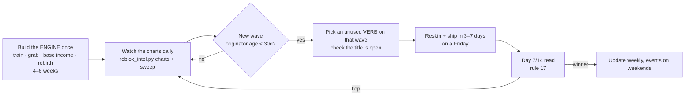

# Idea Judgement Rules

The living rulebook for judging a Roblox game idea. It is built from live data, and every rule cites the note that backs it. **Update this note whenever new data contradicts a rule.** Bump `updated` and log the change at the bottom.

**Success markers:** 1K+ live CCU means it worked. 10K+ means a hit. Always check an idea with `python3 tools/roblox_intel.py search "<title>"` before scoring it.

## TL;DR
- **The title verb is a skin on one shared engine:** train for speed or strength → grab an egg or pet → it earns on your base (offline too) → rebirth. 14 of 20 top movers run it. See [[Live Pattern Report 2026-10-31]].
- **Waves move faster than a 6-week build.** A game's 7-day peak lands around day 32, and its half-life is about 12 days. Clones that won were made 42–71 days after the wave's origin. See [[Growth Curves and Timing]].
- **So the winning play is an engine plus wave-riding:** build the engine once, then put a new verb on whatever wave is live and ship in days, not weeks. Clone studios do exactly this (the Crazay family: 8 of 13 games at 1K+).
- **Change the verb, keep the reward.** Swapping the noun or theme flops. Anime and seasons are skins, never hooks.

## The rules

### A. Existence and timing
1. **Search first.** If a near-identical title already exists and sits under 1K at 30+ days, it's **Graveyard**: don't build it unless you can name the cause and the fix. *Example: Ski For Eggs has 175 CCU at 43 days, which killed Sled For Eggs.* See [[Idea Ledger Round 1]].
2. **Wave age decides it.** Measure the age of the wave's originator. Clones still hit 100K+ between days 42 and 71. After about day 90 even good verb-swaps land at ~1–3K. *Example: Steal An Egg is 98 days old, and its newest For-Eggs copies sit at 175–1.8K.* See [[Growth Curves and Timing]].
3. **Copies decay in order.** On one wave, first movers got ~45K, middle copies 3–7K, late copies under 1K. Be one of the first 3 verb-swaps or skip it.
4. **Don't copy a title that chains two verbs.** Break and Steal an Egg has 92K; its six copies have a median of 70. See [[Live Pattern Report 2026-10-31]].
5. **Day-30 kill rule:** under 100 CCU at day 30, flat, with no updates, is dead. Under 1K but growing ×1.5+ a week with updates is still alive: My Anime Mine hit 1K on day 25 and 10K on day 50. See [[Growth Curves and Timing]].

### B. Title and fantasy
6. **Change the verb, keep the reward.** "[Verb] For Eggs" 45% at ≥1K vs "Steal a [Adj] Egg" 33% and "[Verb] an Egg" 17%. Noun swaps die: Ride a Dino has 22K, Ride a Fish 334, Ride a Dragon 925.
7. **Deception and stealth verbs over-index:** Fake an Egg 43K, Paint and Hide 17K, Hide to Steal Eggs 10K.
8. **Best first words: Steal and Build. Worst: Merge (0 of 24).** Hatch, catch, stack, pull, idle and draw are all around 10% or below.
9. **Keep titles to 2–4 words.** 10K rate: 7% at 2 words, 2% at 4+, 0 of 9 at 7+.
10. **Theme alone never carries a game.** Kaiju, dragon, slime, bubble, penguin and KPop demon hunters are all graveyards. The live winning themes are eggs, animals and food (Sell Fries 47K, Cook the Chicken 16K).
11. **Anime is a skin, not a hook.** Anime games reach 1K at the 24% baseline. It works only on a proven loop: Anime Dice 61K, +1 Anime Eyes 31K, My Anime Mine 14K. Anime merge, guess, draw and card games went 0 of 16, and copies of Anime Dice sit around 250–300.
12. **"+1" only works with a fresh body part or evolution fantasy:** +1 Venom 41K, +1 Spider Arm 28K at 11 days. Generic "+1 X per Y" sits at 11%.
13. **Season as a tag, not a theme.** 🎃 in the title adds about 4 points; Halloween as the theme reached 1K 14% of the time. For Christmas, choose verbs that still make sense after Jan 4 (sled, roll, slide).

### C. Algorithm fit (from [[Roblox Discovery Algorithm]])
14. **Score the 10-point test, and need 8+:** obvious from title plus one image · payoff within 30 s · a goal at minute 3 · a reason to return tomorrow · fills 20–60 min/day · better with a friend · a small repeatable purchase · visibly different from the top search results · works for 16+ while staying Mild · a variant drop every 1–2 weeks.
15. **The 16+ launch gate.** New games reach only age-checked 16+ players until 250 highly engaged players (100 from Nov 2026). Nothing babyish; set up ID verification, 2FA and the rating before launch.
16. **Ship by Friday.** 74% of CCU spikes fall Fri–Sun, the median spike is ×2.3, and 35% of spikes end below where they started.

### D. Reading early numbers (first 14 days)
17. **A winner looks like** ~360 CCU on day 7, ~2.7K on day 14, at least one day that doubles the day before, and a rising weekday low. **A flop looks like** 0–75 on day 7, flat, and no weekend lift. **A collapsing clone** has a ×3–9 weekend spike followed by a falling weekday low. See [[Growth Curves and Timing]].

## Strategy that follows from the rules

The engine is the asset. Each title is a cheap bet on a live wave, so a flop costs days, not months.

## Change log
- 2026-10-31: first version, built from [[Live Pattern Report 2026-10-31]] (1,336 games), [[Growth Curves and Timing]] (345 CCU histories), [[Idea Ledger Round 1]] (105 ideas), [[Roblox Discovery Algorithm]] (34 sources) and a manual spot-check of "for eggs" and "fake a" searches. It overturned the earlier snippet-based [[Simple Action Loops Scorecard]], demoting Hatch a Kaiju and correcting My Anime Mine from a flop to a hit.
- 2026-10-31: [[Idea Ledger Round 2 - Young Waves]] confirmed rules 4 and 6. Noun-swap and chained-title copies launched in the last 2 weeks sit at 12–186 CCU (Fake a Pet, Sell Popcorn, Ride and Steal a Pet).
