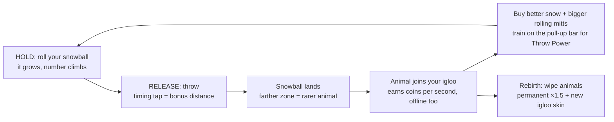

# Mutation Shortlist (2026-11-14)

Proven loop + **one headline change + one supporting change**, judged with [[Mutation Playbook]], [[Steam Mobile Loop Ports 2026-11]] and [[Idea Judgement Rules]]. All CCU figures are live from `tools/roblox_intel.py`; trends come from the RoWatcher history API (daily peaks), 2026-11-14.

## TL;DR
- **#1 Throw Snowballs For Animals.** This is the winter version of **Throw Food For Animals**, the fastest-rising game on Roblox (1.4K → **440K** from Oct 21 to Nov 14, still climbing). It folds in your snowball idea as the supporting mechanic: *hold to roll your snowball bigger, then throw*. The "throw" title is open on Roblox. Ship by about **Dec 4–11**.
- **#2 Spitball the Teacher.** Two live waves combined: the *throw* verb family (440K / 16K) and the *teacher* wave from Steam's **Worst Class Ever** (launched Nov 9, 44K peak; Roblox's Be a Teacher! went from 116 to 5.3K in 11 days). It has a red-light-green-light risk lever built in. **Time-critical:** ship within about 2 weeks.
- **#3 Sell Stolen Loot.** A port of Steam's **Probably Stolen** (750K sold in 5 days). The title is open, and the closest Roblox game has 647.
- **Dropped:** plain Roll a Snowball (Katamari-style ports are dead; early-Nov snowball launches got 29–35 CCU), Kick to Escape (its parent collapsed from 7K to 700), Shovel the Snow (6+ clones, all ≤1.1K), anime "+1 Domain Expansion" (copies of +1 Sukuna at 25–245).

## Scoring
| # | Title | Parent (live, trend) | Headline change | Supporting change | Closest existing | Playbook type | Expected | Rubric /10 |
|---|---|---|---|---|---|---|---|---|
| 1 | **Throw Snowballs For Animals** | Throw Food For Animals 440K, ×3.4 in 2 weeks | Season + reward: snowballs, winter animals | Roll-to-charge: hold to grow the snowball; size = distance + luck | Spooky reskin 3.6K and rising; no "throw snow" game | REWARD/SETTING + a physical-verb support | 2–10K, upside higher | 9 |
| 2 | **Spitball the Teacher** | Throw family + Worst Class Ever (Steam 44K) / Be a Teacher! 5.3K, rising | Verb: throw a spitball at the teacher | Risk lever: the teacher turns around (red light, green light) | Make the Teacher QUIT! 71; Class Clowns 5.7K | GRAFT of two live waves + RISK | 1–10K, short window | 8 |
| 3 | **Sell Stolen Loot** | Probably Stolen (Steam, 186K peak Nov 8) | Haggling becomes a loot crate rarity roll | Pawn-shop shelf earns offline | Own a Pawn Shop 647; Sell Pearls 2.2K | PORT + REWARD | 1–5K | 7 |
| 4 | Cut a Present | Cut a Rock 20K, **flat or falling** (26K → 20K) | Rock becomes a Christmas present (reveal) | Mystery gift rarity | Steal a Gift 4; [Gift] Pok Pok 6.4K | SETTING | 1–3K | 7 |
| 5 | Bonk the Horde | Megabonk (Steam, 1M sold) | Upgrade picks become a permanent +1 power | Base income from defeated monsters | Zombie Rush Survival 8.9K; a faithful port at 10 | PORT + GRAFT | 1–5K | 6 |
| — | ~~Roll a Snowball~~ | roll the world ~6K | — | — | Biggest Snowball 29 (33% likes), Sled Riders 35 | NOUN only | <1K | — |
| — | ~~Shovel the Snow~~ | Sweep The Moon 22K | — | — | 6+ clones, best is 1.1K | COPY | <1K | — |

## #1 Throw Snowballs For Animals: how it plays
**Pitch:** *Roll the biggest snowball you can, launch it across the frozen valley and see which winter animals come running.*

**Moment to moment (first 60 seconds)**
1. Spawn next to your igloo plot. A giant arrow points to the **snow field**.
2. **Hold click or tap:** your character pushes a snowball that visibly grows, with a size number ticking up (`1.2 m … 2.8 m`). That's the supporting change, and it's the clip-worthy part.
3. **Release:** the throw meter goes into a timing tap (the same timing mechanic Throw a Seed uses). Perfect timing adds +25% distance.
4. The snowball flies over zone signs (Frosty Meadow → Pine Ridge → Glacier → Aurora Peak) and lands. A **winter animal runs to it**, with a rarity banner (Penguin Common … Yeti Mythic, 1 in 50,000).
5. The animal walks to your igloo, where its coins/sec appears above its head. First payoff by about 20 seconds.

**Minute 3 goal:** the next zone sign is just out of reach. Buy *Packed Snow* (rolls faster) or train on the pull-up bar to reach Pine Ridge. That's the reason to keep going.

**Progression stats**
| Stat | Raised by | Effect |
|---|---|---|
| Snowball size | Rolling-mitt upgrades, snow type | More distance plus a **luck multiplier** (bigger ball = rarer animals) |
| Throw Power | Pull-up bar (Wood → Ice → Diamond), offline gains | Distance |
| Igloo slots | Coins | Holds more animals for more income |
| Rebirth | Wipe animals | Permanent income ×, cosmetic igloo, unlocks Aurora Peak |

**Risk or social lever** (rules say one is required): a **Snow Storm** every 8 minutes. Snowballs roll at double speed (an opportunity), but a **Yeti stomps through** and can scare one unguarded animal off a random igloo unless you're standing at home. This lever is optional for the MVP, but the data says games with one do about 10× better.

**Monetization:** a 2× Throw Power pass · a Lucky Snow potion (30 min) · Golden Mitts (auto-roll while AFK) · cosmetic snowball trails. No paid random items in the MVP, which avoids the policy work in [[Gacha and Spin Systems on Roblox]].

**Anime option:** each rare animal gets an anime-style **aura** on landing (from [[Anime VFX Fundamentals]]); Mythics trigger an impact frame. Anime stays a skin, as the data says it should.

**MVP (2–3 weeks on the shared engine):** 1 map with 4 zones, 12 animals across 5 rarities, roll + throw + timing tap, igloo income + offline, 3 upgrade lines, rebirth. **Ship Friday Dec 4 or Dec 11**, before winter break (about Dec 19–Jan 4).

**Why it should work, from the data**
- The parent is the strongest rising game on the platform, and platform-#1 parents stay open for about 3 months after their first 10K day (Throw Food reached 10K around Oct 23, so the window runs to about late January). See [[Mutation Playbook]].
- Themed reskins of this exact parent work: Throw Food For Spooky Animals went from 560 to 3.6K between Nov 11 and 14.
- The playbook's best predictor is one headline change plus one supporting change: 59% of those hit 10K vs 14% of single swaps. Roll-to-charge adds a **visible growing number** and a **clip the parent can't make** (a house-sized snowball), which are fun principles 1 and 3.
- The snowball lane on Roblox is empty right now: every snowball title is under 100 CCU.

**Biggest risks**
| Risk | Hedge |
|---|---|
| It reads as a noun swap; noun-only children median 1.6K | The roll-to-charge mechanic must be *in the thumbnail*: a giant snowball mid-throw. |
| The parent's own dev ships a winter update | Ship first; differentiate on the snowball mechanic. Check the parent's update log weekly. |
| Seasonal decay after Jan 4 | Snowballs and arctic animals still make sense in January and February. Plan a "Spring Thaw" world swap for Feb. |

## #2 Spitball the Teacher: how it plays
**Pitch:** *Hit the teacher with spitballs and don't get caught.*
1. You sit at a desk in a classroom with up to 12 players. The teacher writes on the board with her back turned.
2. **Hold** to load a spitball, **release** to throw. Hits earn **Chaos** (money) and a combo multiplier.
3. **Risk lever:** the teacher randomly **spins around** (a warning chalk squeak about 0.5 s before). Anyone mid-throw gets **detention**: sent to a hallway for 20 s and loses the combo. This is the red-light-green-light tension Worst Class Ever is built on.
4. Chaos buys **prank items** with a rarity roll (paper plane, water balloon, whoopee cushion … Mythic: stink bomb), and **classmate helpers** who sit at your desk and throw for you, earning offline.
5. Rebirth: "Next Grade": a new classroom, a stricter teacher, and multipliers.

**Timing:** the teacher wave is 5 days old on Steam and rising on Roblox. Per the playbook, small waves close in about 2 weeks after the parent's 10K day, so **ship by about Nov 27**, or skip it.

## #3 Sell Stolen Loot: how it plays
Loot crates come off a truck → **open** one to reveal an item with a rarity roll (from a golden toaster to a cursed painting) → put it on your **pawn-shop shelf**, where it sells to NPC customers for coins/sec (offline too) → upgrade the shelves, the truck size and the "appraiser" luck → rebirth into a bigger shop. Risk lever: a **police raid** every 10 minutes, so hide your hottest items in the back room. Avoid the "Spot the Fake" mechanic: it has 15 CCU.

## Next actions
- [ ] Owner picks #1 or #2. **#2 has to start this week or be dropped.**
- [ ] Re-check on Nov 21: Throw Food For Animals' trend, any new "throw snow" or "winter animals" titles, and the Be a Teacher! / Class Clowns trend. Re-run the searches in this note.
- [ ] Mock the thumbnail first (a giant snowball mid-throw with a yeti running), because the thumbnail is the ad.
- [ ] Log the outcome in the track record in [[Idea Judgement Rules]].
