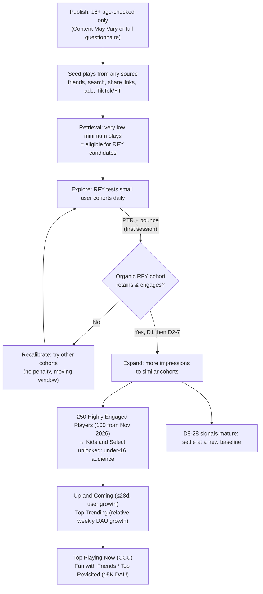

# Roblox Discovery Algorithm

How Roblox decides who sees a game, as of **2026-10-31**. Built from the Creator Hub docs (pages last updated 2026-10-30), DevForum staff announcements from 2024 to 2026, the live Charts API (the sort tooltip text is quoted word for word) and a live chart snapshot (`Data/charts-2026-10-31-0854.json`, taken on a Saturday during Halloween). Related notes: [[Simple Action Loops Scorecard]], [[Tier A - Roblox Velocity]].

## TL;DR
- **Home drives discovery.** Staff say more than 90% of traffic begins on Home. Its main row, **Recommended for You (RFY)**, works in two stages: *retrieval* (candidates chosen by engagement, retention and monetization) and *ranking* (personalized to each user). About 100 games reach each user's Home.
- **RFY ranks only on players who arrived organically from RFY.** Players who came from ads, search, friends, curation or social links do not count toward RFY ranking. The four most important signals are **play-through rate (PTR)**, **first-play bounce rate** (under 60 s and 61–180 s), **play days per user** and **playtime per user** (capped at 60 minutes per user per day). Each is measured over D1, D2–7 and D8–28. The second tier is co-play days, qualified sessions, spend days and Robux spent.
- **Signals are per-user averages, not totals**, so a small game with sticky players is not at a disadvantage. There is no penalty for a weak start: RFY re-tests games every day on a moving window. Retrieval needs only "a very low minimum number of plays from any source".
- **The Charts sorts follow simple public formulas.** *Up-and-Coming* = published within the last 28 days, sorted by user growth. *Top Trending* = largest relative DAU increase over the past week. *Top Playing Now* = CCU. *Fun with Friends* and *Top Revisited* need at least 5K daily users and are sorted by friend-group time share and week-later return rate.
- **Changes in 2025–2026:** QPTR was replaced by PTR plus bounce rate (June 2026). Signal windows grew from 7 to 28 days. Monetization weight went up (Aug 2026). Ads now sit inside RFY. Gameplay video plays on RFY tiles (+39% playtime). New games launch to **age-checked 16+ players only** until they pass 250 Highly Engaged Players (dropping to 100 in Nov 2026), which unlocks Kids and Select (under 16).
- **Title tags like [🎃] and [UPD] are not a ranking signal.** RFY ranks on behaviour after the impression. In the live data, tagged Up-and-Coming games actually have lower median CCU than untagged ones. A tag can only help through PTR, by making the tile look fresh to a human.

## 1. The surfaces and what ranks each one

| Surface | Personalized? | What ranks it | Evidence |
|---|---|---|---|
| **Recommended for You** (Home) | Yes, per user | Organic RFY cohort: PTR, bounce, play days, playtime, then co-play, qualified sessions, spend days, Robux | Discovery docs; DevForum 2026-06-15 |
| **Continue** (Home) | Yes | Your recently played games; first 2 slots fixed to your 2 most recent | DevForum 2025-01-31 (Dec 2025 update) |
| **Sponsored** (inside RFY since Mar 2026) | Ad auction | Bid × likelihood to play. Highly retentive games get cheaper delivery | Ads Manager docs; DevForum 2026-03-03, 2026-10-02 |
| **Standout Games** (was *Today's Picks*) | Curated, with personalized row position | Human curation of "novel" games. D1 and D7 are considered; 3 of 4 picks were small or mid-size games | DevForum 2026-03-09, 2025-10-13 |
| **Top Trending** (Charts) | No; device and country filters | "Largest relative increase in daily active users over the past week" | Live Charts API `infoText` |
| **Up-and-Coming** (Charts) | No; device and country filters | "Published within the last 28 days sorted by user growth" | Live Charts API |
| **Top Playing Now** (Charts) | No | "Sorted by the number of concurrent users" | Live Charts API; DevForum 2025-03-05 |
| **Fun with Friends** (Charts) | No; filters | At least 5,000 daily users (or top 10% DAU or top 30), sorted by "proportion of time spent as groups of friends" | Live Charts API |
| **Top Revisited** (Charts) | No; filters | Same eligibility, sorted by "proportion of users who come back after a week" | Live Charts API |
| **Trending Events** (Charts) | No | Active events started within 7 days, ranked by the game's DAU | Experience events docs |
| **Search** | Partly | Relevance to the query (titles and metadata, now semantic). Copycat or mismatched metadata is down-ranked | Discovery docs; DevForum 2024-12-09 |

> [!tip] Charts are *outputs*, not inputs
> All Charts sorts are computed from growth, CCU or retention statistics. You get onto them by winning RFY (and ads, social and search) traffic first. Charts traffic then adds to it. In 2024 Roblox said the Discover page drew "less than 5% of overall traffic" before its refresh.

## 2. Recommended for You in detail

**Pipeline:** retrieval (eligible games chosen by engagement, retention and monetization) → ranking (personalized) → about 100 games on each user's Home. The system "continuously explores by trying to introduce new games to new users", in a cycle Roblox calls *explore and expand*: after an update you may see a spike of RFY users (explore). If that cohort engages and spends, RFY keeps showing the game to similar cohorts (expand).

| Priority | Signal | Window | What it means for a one-action game |
|---|---|---|---|
| Most important | **Play-through rate (PTR)**: plays ÷ RFY impressions | first session | Decided entirely by the thumbnail, video and title |
| Most important | **First-play bounce rate** (negative signal) | <60 s, 61–180 s | The fun has to land within 60 seconds |
| Most important | **Play days per user** | D1, D2–7, D8–28 | You need a reason to come back tomorrow |
| Most important | **Playtime per user** (capped at 60 min/day) | D1, D2–7, D8–28 | Sessions longer than 60 minutes earn nothing extra |
| Important | Intentional co-play days (joins, invites, private or reserved servers) | D1, D2–7, D8–28 | Matchmade strangers do not count |
| Important | Qualified play sessions per user | D1, D2–7, D8–28 | Repeat meaningful sessions |
| Important | Spend days per user | D1, D2–7, D8–28 | Several small purchases on different days beat one big one |
| Important | Robux spent per user | D1, D2–7, D8–28 | Gained weight in Aug 2026 |

Rules that matter (all from Roblox staff or docs):
- **Organic cohort only.** If a user's first play came from an ad, their later behaviour never becomes an RFY signal, even if they return through Home. Ads therefore cannot "train" RFY. They only supply the "small number of people playing" that gets a game *considered*.
- **Relative competition.** Impressions also depend on how other games are doing: "if your signals go up 50% but competitors improve more, you might see minimal growth."
- **Lag.** "Changes to your recommendation signals usually show up in impression changes a few days later."
- **Seasonality.** Home traffic peaks on Saturday and is lower on weekdays. Summer and holidays are peaks too.
- **No genre bias.** Genre is "not an explicit ranking factor". Finite or story games are "not penalized" for low D8–28.
- **Dynamic weighting.** The weights are moving toward "dynamic and personalized" per user (Mar 2026). There is no single global formula.
- **Negative feedback.** Users' "Not interested" dismissals are being added as a signal (Mar 2026).
- **Hard eligibility.** A game must have a custom thumbnail (the default one is not eligible). It must not lead with Robux giveaways, have mismatched metadata, or be a near-duplicate of another game's title, thumbnail or place file. Roblox highlights whichever game *first added* the unique metadata, not whichever was created first. A Creator Dashboard banner shows reduced exposure and updates daily.

## 3. How a new game gets its first impressions

**Timeline from the live snapshot (2026-10-31):**
- **Up-and-Coming** (97 games): **87% were created less than 30 days ago** and the median age is 22 days. **No game was younger than 9 days.** By weeks since creation: week 1 (7–13 d) = 7 games, week 2 = 36, week 3 = 36, week 4 = 11, older = 7. The 13% "older" games most likely sat private or in beta before going public, since the sort counts from the *publish* date. 92 of 97 had at least 1K CCU, 30 had at least 10K, and the floor was 329 CCU.
- **Top Trending:** 48% are under 30 days old, the median age is 30 days, and the floor is 825 CCU. Old games appear here when an event spikes their DAU (*The Mimic*, 2,115 days old, with a 🎃 event).
- **DONT SPLASH** was released on Saturday 2026-10-17. It had **82.6K CCU and 113M visits at day 14**, and its 14-day average CCU was 52.3K (RoTrends). That makes it a day-one breakout, the kind seeded by YouTube/TikTok and then expanded by RFY.
- **+1 Spider Arm** was released on Monday 2026-10-19. It had **28.2K CCU at day 11**, but its 14-day average CCU was only 5.1K. Most of its growth came in week 2, which is the normal explore → expand ramp.
- **Throw Food For Animals** (42 days old, 129.5K CCU) has *graduated*: it has left Up-and-Coming and now sits in Top Playing Now. **Steal An Egg** (98 days, 1.2M CCU) is the end state.

> [!example] Typical breakout curve (inferred from the snapshot plus Roblox's mechanics)
> Days 0–3: seed traffic, PTR and bounce get measured. Days 3–10: D1 and D2–7 signals arrive and RFY expands if they hold. Days 9–28: the game becomes eligible to show up in Up-and-Coming once its growth outranks other new games. Days 28+: it falls off Up-and-Coming and survives on RFY plus Top Playing Now, or it fades. Allow **about 2 weeks** before judging a launch, but **48 hours** is enough to judge PTR and bounce.

> [!warning] Unverified
> The day ranges above come from one snapshot and two RoTrends pages, not from Roblox. The creation weekday of new games in Up-and-Coming and Top Trending skews slightly toward Friday to Monday (68 of 104 games, 65%, versus 57% if launch days were random). Creation date is not the same as public launch date, so this skew is weak evidence for weekend launches.

**Ways to seed the first plays (all allowed):** friends via the new early-tester invites (up to 10, Oct 2026). **Experience Betas**, which let a game be searchable and linkable but keep it *out of RFY* until you are ready, so a bad first version doesn't get tested on RFY cohorts. Share links (they also earn Audience Expansion rewards). Sponsored ads with the *Plays* objective ("initial traffic that can help your game get considered for RFY"; in Roblox's tests ads gave a median 14% incremental lift). Ads with the *Engagement* objective, which buy Highly Engaged Players toward the Kids and Select threshold. And Standout Games nomination: curation has promoted games on their first day.

## 4. Thumbnails, icons, video and titles

| Asset | Spec / rule | Algorithm role |
|---|---|---|
| Home thumbnail | 16:9, 1920×1080, under 3 MB. Keep the bottom clear (player count covers it) | Drives PTR. Required for RFY eligibility |
| **Thumbnail personalization** | 2–5 active thumbnails, chosen by a multi-armed bandit (not an A/B test). Reallocates hourly per user group. **+8.5% average QPTR at launch, +12% by Feb 2025**, up to +56%. Roblox is testing a switch from QPTR to PTR | Keep several active. Don't restart within 7 days. Refresh with each major update. Make the variants *different* (other characters, motivations) |
| Icon | 512×512, must read at 150×150 | Shown on many sorts. Default icon = bad |
| **Gameplay video** | Real current footage. No voice-over, lyrics, promo text or cinematic trailers. 3 uploads per month | Plays on RFY hover/scroll since 2026-07-29: **up to +39% playtime from RFY**. In Standout tests, +47% quality plays. Does not change rank directly |
| Title / description | Accurate and consistent. Keywords in the description; the first sentence shows in search | Used for search relevance and copycat detection. "Excessively decorative" titles hurt recognition (2020 PSA) |

**Do title tags ([🎃], [UPD], [NEW]) help?**
- **Not as a ranking input.** Every RFY signal is behaviour *after* discovery, and Roblox lists no title-freshness signal. No Roblox source says tags help.
- **They are near-universal**: bracket tags appear in 72% of Up-and-Coming, 80% of Top Trending, 66% of Top Playing Now and 63% of Top Revisited titles. 🎃 alone is in 31–38% of each sort on Halloween.
- **No visible rank benefit.** The top 20 of Up-and-Coming are tagged *less* often (70%) than the rest (73%). Top Playing Now's top 20 is 55% tagged versus 69% for the rest. Median CCU in Up-and-Coming is 5.3K for tagged games and **9.2K for untagged**. DONT SPLASH has no tag. *Steal An Egg*, at 1.2M CCU, has no tag.
- **The only plausible path is PTR.** A returning or browsing human reads "[UPD]" as "something new". RFY then rewards the *resulting* clicks only if those players stay. Treat tags as cheap and optional. Test them through thumbnail and title changes and watch PTR, rather than expecting them to move rank. A tag that misrepresents the game (e.g. [UPD] with no update) risks the "mismatched metadata" down-rank.
- **Truncation:** tiles cut long titles. Put the 2–3 word hook first and any tag after or before it, but keep the core noun visible (e.g. "+1 Spider Arm🕷️"). 77 of 97 Up-and-Coming titles have 3 or fewer core words once tags are removed.

> [!warning] Unverified
> Truncation length depends on device and tile size and Roblox does not document it. Check your tile on phone Home before you lock in a title.

## 5. 2024–2026 changes that affect reach

| Date | Change | Source |
|---|---|---|
| 2024-04 | 16:9 thumbnails on Home; Today's Picks curated sort pilot | DevForum 2024-03-13, 2024-04-03 |
| 2024-05 → 11 | New Charts: Top Trending, Up-and-Coming, Top Revisited, Fun with Friends; device and country filters | DevForum 2024-05-02 |
| 2024-07 | QPTR (filters out accidental clicks) replaces conversion rate; similar-experience benchmarks | DevForum 2024-07-18 |
| 2024-11 | Thumbnail personalization goes live | DevForum 2024-11-13 |
| 2024-12 | Copycat, giveaway and mismatched-metadata games de-prioritized on Home and Charts and down-ranked in search | DevForum 2024-12-09 |
| 2025-03 | RFY signals published (7-day window) + Home Recommendations dashboard; Top Playing Now | DevForum 2025-03-31, 2025-03-05 |
| 2025-07-24 | **Creator Rewards**: 5 R$ per Active Spender (spent at least $9.99 in the last 60 days) who plays your game 10+ min and it is one of their first 3 games that day; 35% revenue share for new or reactivated users you bring in (needs 100+ DAU for 60 days) | Creator Rewards docs |
| 2025-09-30 | Unrated games become unplayable; content maturity questionnaire mandatory | DevForum 2025-08-25 |
| 2025-11 | RFY genre-diversity experiments | DevForum 2025-11-13 |
| 2025-12 | Experience Betas; reserved servers count as co-play | DevForum 2025-12-11, 2025-03-31 |
| 2026-03 | Today's Picks → **Standout Games**; Deep PTR signal; ads blended into RFY; "Not interested" signal | DevForum 2026-03-09, 2026-03-03 |
| 2026-04 / 05 | Age checks to publish; **Roblox Kids (5–8) and Select (9–15)** launched; under-16 reach requires evaluation | DevForum 2026-09-11 |
| 2026-06-15 | **RFY v2**: windows go from 7 to 28 days (D1/D2–7/D8–28); QPTR removed; PTR and bounce added; relative priority published | DevForum 2026-06-15 |
| 2026-07-29 | Gameplay video autoplays on RFY tiles | DevForum 2026-03-09 (Jul update) |
| 2026-08-20 | RFY weights long-term **monetization** alongside retention; games strong in both "may receive broader distribution" | DevForum 2026-08-06 |
| 2026-10-12 | Measurement pipeline change: impressions up, PTR slightly down for every game, so don't panic | DevForum 2026-10-12 |
| 2026-10 → 11 | One-question publish to 16+; Highly Engaged Player threshold drops from 250 to **100** next month; Highly Engaged Player count updates hourly | DevForum 2026-10-12 |
| Late 2026 (roadmap) | Deceptive-copy takedowns; game passes surfaced on Home; relaxed Kids and Select requirements | Creator Roadmap Fall 2026 |

**Maturity and age effects on reach:**
- A brand-new public game reaches **only age-checked 16+ players** until it has **250 unique plays from Highly Engaged Players in 60 days**. These are players with real account age, play history and *platform* spend in the last 60 days. Separately, publishing for all ages requires a 1,000 R$ refundable fee *or* a Plus/Premium subscription held for 2+ months. Expedited review costs 50,000 R$ (refundable). To stay eligible, a game needs **25** Highly Engaged Players per 60 days.
- To reach under-16 players, the creator needs ID verification (or facial age estimation if under 18) plus 2FA, and the game must have a full questionnaire with a **Minimal, Mild or Moderate** rating. Kids accounts (ages 5–8) see only Minimal and Mild.
- A game whose *primary theme* is a sensitive issue is 16+ and is **not recommended** unless the user is age-verified.
- For a simple kid-appeal game, **under-16 reach is gated behind 16+ traction.** Your first RFY cohorts are older players, so the first session has to satisfy a 16+ player too. A game that breaks out can pass the gate "in just a few hours" now that counts update hourly.

## 6. Metric targets

**Roblox publishes no absolute thresholds.** It deliberately withholds weights and thresholds (Mar 2026). What it gives you:
- **Benchmarks** at the P50 and P90 of *similar games* (or P10 and P50 where lower is better, e.g. bounce rate). They need about 50 similar games, otherwise genre benchmarks are used. Benchmarks **do not affect ranking**. Practical target: **be at or above P50 on all four top signals, and near P90 on one of them.**
- **Playtime ceiling:** 60 min per user per day, so the useful aim is about 20–60 min/day for an incremental-style game.
- **10-minute line:** Creator Rewards pays only for Active Spender sessions of 10+ min. Roblox's analytics guide warns that if average playtime is near or below 10 minutes, many players won't qualify.
- **Bounce windows:** under 60 s and 61–180 s. Treat **the first 3 minutes** as the critical window.
- **Curation (Standout Games)** looks at D1 and D7 retention, with no numbers given.

> [!warning] Unverified — community rules of thumb, not Roblox figures
> "Aim for 20–25% D1" is a widely repeated DevForum heuristic. RoWatcher's genre ranges: obby D1 25–35% / D7 10–15%; tycoon or incremental D1 20–28% / D7 12–18%; shooter D1 22–30% / D7 12–16%; roleplay D1 15–22% with D30 8–15%. A third-party ratio test: D7/D1 above 0.5 and D30/D7 above 0.4. Use these only until your own similar-game benchmarks appear.

## 7. Update cadence, events and weekends

- **Updates trigger an *explore* spike** ("you might see a spike in new users from recommendations (explore) after a content update"). Roblox also re-classifies content quality "with every update". An update is a re-roll of RFY testing *and* of the quality banner.
- **Live recency:** 93% of Up-and-Coming games and 85% of Top Trending games show an update within 1 day, and **100% of both within 7 days**. Top Revisited: 70% within 1 day, 93% within 7.

  > [!warning] Unverified
  > The API's `updated` field changes on metadata edits too. RoTrends shows DONT SPLASH last updated on Oct 19, while the API shows 1 day ago. The snapshot was also taken on a Saturday during Halloween. "Updated within 7 days" is the safe reading; "daily" is probably title or thumbnail churn.
- **Roblox's own cadence guidance:** content drops every 2 weeks to 1 month, with each drop taking under 3 weeks of effort. Use variants of existing systems (pets, maps, items). Limited-time content and season passes stretch each drop.
- **Weekends:** Home traffic peaks on Saturday. Ship by Friday so the Saturday explore cohort sees the new thumbnail, video and content. This matches the 7-day minimum between thumbnail-personalization restarts.
- **Experience Events:** up to 5 event thumbnails. *Notify Me* sends stream and push notifications. Update announcements are limited to 60 characters, once every 3 days. Active events less than 7 days old can chart in *Trending Events*. Curated Live Events need submission at least 7 days ahead, and the "best events run for 7–30 days."
- **Holidays work through DAU, not tags.** Old games entering Top Trending on Halloween (*The Mimic*, *Violence District*) got there through a relative DAU spike from event content.

## How to judge an idea against the algorithm

Score each test **Yes = 1**. **8+ = strong algorithm fit; 6–7 = fixable; ≤5 = the algorithm will not carry it.**

| # | Test (yes/no) | Signal it predicts |
|---|---|---|
| 1 | Can a stranger tell what they will *do* from a 2–3 word title plus one 16:9 image, with no reading? | PTR |
| 2 | Does the first satisfying payoff (a number going up, a reaction, a ragdoll) happen within **30 seconds**, with no tutorial wall? | Bounce under 60 s |
| 3 | Is there still a visible goal at minute 3 (next upgrade, next zone)? | Bounce 61–180 s |
| 4 | Is there a concrete reason to return tomorrow (offline income, daily reward, timed restock, unfinished collection)? | Play days D1/D2–7 |
| 5 | Can an engaged player fill **20–60 min/day** without running out of content in week 1? | Playtime; Creator Rewards 10-min line |
| 6 | Is it more fun when you join or invite a friend (not just matchmade strangers)? | Co-play days; Fun with Friends |
| 7 | Is there a natural low-friction purchase that players can repeat on different days (boost, pet, gamepass)? | Spend days / Robux (weighted more since Aug 2026) |
| 8 | Is it visibly *different* from the top 5 search results for its own keywords (title, thumbnail, place file)? | Avoids copycat de-prioritization |
| 9 | Does it satisfy an age-checked **16+** first cohort while staying Minimal/Mild for Kids and Select? | Passes the Highly Engaged Player gate |
| 10 | Can you ship a meaningful variant drop every **1–2 weeks** using existing systems (new egg, arm, map)? | Explore spikes; 7-day update recency |

## Checklist
- [ ] Launch in **Experience Beta** first. Leave beta only when D1 and playtime beat your target. Never let RFY test a broken build.
- [ ] Before going public: custom 512×512 icon; **3–5 different** 1920×1080 thumbnails (personalization on); a real gameplay video showing the core loop in the first seconds.
- [ ] Complete the **full** maturity questionnaire (not just the one-question 16+ path). Aim for Minimal/Mild. Verify ID or age; enable 2FA; pay the 1,000 R$ refundable fee or hold Plus/Premium for 2+ months.
- [ ] Seed 1–3 days of traffic (share links, TikTok/Shorts clips, small *Plays* ad). Consider an *Engagement* ad to reach 100–250 Highly Engaged Players.
- [ ] Watch Analytics → Acquisition → **Home Recommendations** daily: PTR, bounce, play days and playtime against P50/P90. Expect impressions to lag signal changes by a few days.
- [ ] Ship each update by **Friday**. Refresh thumbnails with each update. Don't touch personalization for 7 days after.
- [ ] Post an Experience Event for each drop. Send an update notification (≤60 chars, once per 3 days).
- [ ] Keep the title stable. Put the hook noun first. Add an optional tag such as [🎃] only when the content is real.

## Common Mistakes
- **Thinking ads or Charts "boost the algorithm".** Ad-acquired players are excluded from RFY signals, and RFY impressions *dip* after ads or features because those users count as already acquired. That is not a penalty.
- **Optimizing clicks over sessions.** A clickbait thumbnail raises impressions → plays, but then raises bounce rate, and bounce is a top-tier negative signal. It also risks the mismatched-metadata down-rank.
- **Copying a hit's title or thumbnail.** Near-duplicates are de-prioritized on Home and Charts and down-ranked in search. Roblox favours whoever first added the unique metadata. Join a trend with your own spin.
- **Judging a launch on day 2's CCU.** Up-and-Coming had no games under 9 days old. +1 Spider Arm's 14-day average CCU was 5.1K against 28K at day 11.
- **Reading the Oct 12, 2026 PTR drop as a performance problem.** It was a measurement change applied to every game.
- **Restarting thumbnail tests daily, or keeping one "winner".** The bandit needs about 7 days and several active arms.
- **Expecting [UPD] or emoji tags to rank you.** They are not a signal. The live data shows no rank benefit.
- **Building only for kids.** The first cohort is 16+ until the Highly Engaged Player gate opens.

## Sources
1. Discovery (Creator Hub docs, updated 2026-10-30) — https://create.roblox.com/docs/discovery
2. Discovery FAQ — https://create.roblox.com/docs/discovery-faq
3. Thumbnails (personalization, video rules) — https://create.roblox.com/docs/production/publishing/thumbnails
4. Icons — https://create.roblox.com/docs/production/publishing/experience-icons
5. Experience events and updates — https://create.roblox.com/docs/production/promotion/experience-events
6. Content updates (cadence) — https://create.roblox.com/docs/production/game-design/content-updates
7. Creator Rewards — https://create.roblox.com/docs/creator-rewards
8. Ads Manager (objectives) — https://create.roblox.com/docs/production/promotion/ads-manager
9. Roblox Kids and Select — https://create.roblox.com/docs/production/publishing/kids-and-select
10. Publish games and places (fees) — https://create.roblox.com/docs/production/publishing/publish-games-and-places
11. Content maturity and compliance — https://create.roblox.com/docs/production/promotion/content-maturity
12. Get started with analytics (D1/D7, 10-min note) — https://create.roblox.com/docs/production/analytics/get-started
13. Analytics Benchmarks API (P10/P50/P90) — https://create.roblox.com/docs/cloud/guides/analytics/benchmarks
14. RFY Algorithm Improvements That Better Value Long-Term Retention (2026-06-15) — https://devforum.roblox.com/t/4684575
15. Testing More RFY Algorithm Signals (2026-04-10) — https://devforum.roblox.com/t/4568033
16. Boost Your Discovery by Building Games People Want to Play (2026-08-06) — https://devforum.roblox.com/t/4779042
17. How we are improving Home this year (2026-03-09, with Mar–Jul updates) — https://devforum.roblox.com/t/4502571
18. Continuing to improve RFY (2025-11-13) — https://devforum.roblox.com/t/4067565
19. Boost Your Discovery with the Improved RFY Algorithm (2025-03-31; "over 90% of traffic") — https://devforum.roblox.com/t/3587441
20. Testing an Enhanced Discover Page (2024-05-02) — https://devforum.roblox.com/t/2954676
21. Introducing Top Playing Now (2025-03-05) — https://devforum.roblox.com/t/3529809
22. Reducing exposure of low quality content (2024-12-09) — https://devforum.roblox.com/t/3299107
23. Improved Discovery Measurement (2026-10-12) — https://devforum.roblox.com/t/4930122
24. Personalize your thumbnails (2024-11-13) — https://devforum.roblox.com/t/3257233
25. 5 Tips for Thumbnail Personalization (2025-02-13) — https://devforum.roblox.com/t/3471689
26. QPTR and Similar Experience Benchmarks (2024-07-18) — https://devforum.roblox.com/t/3075185
27. Sponsored Experiences within RFY (2025-09-16, updated 2026-10-23) — https://devforum.roblox.com/t/3938575
28. Roblox Curation: Today's Picks criteria (2025-10-13) — https://devforum.roblox.com/t/4005089
29. Kids and Select Global Launch (2026-06-16) — https://devforum.roblox.com/t/4685717
30. A Simpler Path to Publish (2026-10-12) — https://devforum.roblox.com/t/4930524
31. Unrated Experiences (2025-08-25) — https://devforum.roblox.com/t/3899317
32. Experience Betas (2025-12-11) and Ads Manager RDC Recap (2026-10-02) — https://devforum.roblox.com/t/4144485 · https://devforum.roblox.com/t/4909790
33. PSA: Best Practices for Game Metadata (2020) and Creator Roadmap Fall 2026 — https://devforum.roblox.com/t/764558 · https://devforum.roblox.com/t/4880208
34. Live data: Charts API (`apis.roblox.com/explore-api/v1/get-sorts`) via `tools/roblox_intel.py charts`, snapshot `Data/charts-2026-10-31-0854.json`; RoTrends game pages https://rotrends.com/game/10771421858 and https://rotrends.com/game/10771997908; RoWatcher genre retention article (unverified) https://rowatcher.com/news/retention-benchmarks-by-roblox-genre-what-good-actually-looks-like
