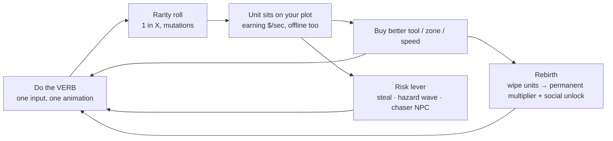

# Simple Action Loops Scorecard

## TL;DR
- **The proven loop right now:** `[VERB] a [THING] → rarity roll → it earns $/sec on your plot (offline too) → better tool → one risk lever (steal / hazard / chaser) → rebirth`. "Steal An Egg" is #1 on Roblox at roughly 745K–986K CCU (Oct 14–27, 2026).
- **The rising fantasies for ages 8–14** (Christmas 2026): hatching sea monsters and kaiju, squishies, mild mascot horror, and a demon-hunting idol. Anime is **flat for 8–14** as a headline theme but works as a *visual style*.
- **#1 pick: Hatch a Kaiju.** It's the proven egg/plot loop wearing the season's rising hatch-a-monster toy fantasy, it has no IP risk if the kaiju are original, and the anime VFX research in this vault transfers directly.
- **Runners-up:** Squish a Squishy (cheapest to build) and Fool the Teacher (a hot Steam port with a closing window).
- **Avoid:** brainrot, fishing, farming, paint-and-hide, cleaning games, and a plain "Steal ___ Egg" clone. Dozens exist and most peak under 1K CCU.
- **Every number is a range from search snippets.** The trackers were blocked; see [[#Data caveats]].

## The brief (assumed)
Platform Roblox · ages 8–14 · solo dev (AI-assisted code + Blender) · R6 blocky · 4–6 week build · live and stable by **Dec 12–15, 2026** to catch winter break (about Dec 19–Jan 4) · anime optional. See [[Owner Decisions]].

## Step 1: the loop template every breakout shares
From 25 games in [[Tier B - Action Loop Mechanics]] and the velocity data in [[Tier A - Roblox Velocity]]:

| Rule | Why |
|---|---|
| Verb-first title of 3–4 words that doubles as the tutorial | The thumbnail plus the title explain the whole game. |
| The thing you collect is the money printer | 8 of the top 15 use plot income. |
| Helpers or offline income | Every login pays out. |
| Rarity on every action | This is the variable reward, and what Robux sales hang on (luck potions, dice, skips). |
| **One risk or social lever** | Games without one peaked about 10× lower. *My Anime Mine* lacks it and peaked at **745 CCU**. |
| Rebirth unlocks social status or trading | Long-term goal. |
| Weekly events and content | Keeps the game on the charts. |

## Step 2: clusters

**By loop**
| Loop | Status | Examples (CCU, date) |
|---|---|---|
| Steal / hatch → plot income | **Rising, #1** | Steal An Egg (745K–986K, Oct 2026); Break and Steal an Egg (~130K 7-day average, about 1.3M peak on Oct 18); Steal Animal Egg (107K, Oct 10) |
| Ride / collect pets | Rising | Ride A Pet (+1,753% WoW in Sept; ~48–90K now) |
| Roll / gacha units → place for income | Rising | Anime Dice (+322% WoW; 57K average, 93K peak on Oct 18) |
| Obby hazard | New riser | DONT SPLASH (63–80K at about 8 days old) |
| Grow / farm | Proven, flat | Grow a Garden 2 (~500K, flat) |
| +1 every second, brainrot, dig/mine | Fading | Escape Tsunami, Kick a Lucky Block, Dig to Earth's Core |

**By fantasy** (from [[Tier C+E - Kid Culture]])
| Fantasy | Source types | Runway |
|---|---|---|
| Demon-hunting K-pop idol | 4 | 3–6 months, but licensed IP |
| Squishies | 3 | 2–5 months (peaks at Christmas) |
| Mild mascot horror | 3+ | 6+ months, a stable genre |
| Superhero | 3 | Evergreen, but very crowded |
| Catch and train creatures | 3 | Evergreen |
| **Hatching sea monster / kaiju** | 2 (both Toy Insider Hot 20) | **Still rising**, with a 3–6 month tail after Christmas unboxing |
| Anime (as headline) | ~1 | Flat for 8–14, rising for 13+ |

**The winning pattern:** the #1 proven loop (steal/hatch → plot income) plus a rising fantasy that *is literally about hatching* (the hatching megalodon and kaiju toys).

## Step 3: scorecard
Each score is 1–5, where higher is better. Saturation and IP risk are inverted, so 5 means wide open or safe.

| # | Title | Loop line | Velocity | Cross-source | Runway | Saturation (inv) | Solo feasibility | IP / sentiment (inv) | **Total /30** |
|---|---|---|---|---|---|---|---|---|---|
| 1 | **Hatch a Kaiju** | steal egg → hatch kaiju (rarity) → kaiju earns on plot → bigger nest/tools → kaiju *rampage* night wrecks rival plots → rebirth | 5 | 4 | 4 | 3 | 4 | 4 | **24** |
| 2 | **Squish a Squishy** | squeeze → squishy pops out (rarity, mutations) → display shelf earns → better hands → night thieves → rebirth | 3 | 3 | 3 | 4 | 5 | 4 | **22** |
| 3 | **Fool the Teacher** | blend in with NPC students → prank → points → buy pranks/disguises → bolder pranks → next grade | 5 | 2 | 2 | 5 | 3 | 5 | **22** |
| 4 | **Blast the Pixels** | colour shooters → clear pixel art → more shooters → bigger art | 3 | 1 | 4 | 5 | 4 | 5 | 22* |
| 5 | **Ride a Kaiju** | variant of #1 using the Ride A Pet loop: ride → reach rarer eggs → hatch → earn | 4 | 3 | 4 | 3 | 3 | 4 | 21 |
| 6 | **Appraise Weird Stuff** | appraise → flip for profit → upgrade shop/scanner → rarer goods | 4 | 1 | 3 | 5 | 4 | 4 | 21 |
| 7 | **Escape the Mascot** | grab loot → mild mascot chases → bank on plot → speed/hide upgrades → rebirth | 3 | 3 | 4 | 2 | 4 | 4 | 20 |
| 8 | **Bonk the Horde** | auto-attack → XP → upgrades → screen-clearing build → prestige | 2 | 2 | 4 | 5 | 2 | 5 | 20 |
| 9 | **Roll Anime Heroes** | roll → anime unit → place for income → luck → traits (Anime Dice-like) | 4 | 2 | 3 | 2 | 4 | 4 | 19 |
| 10 | **Slay Demon Idols** | generic idol demon-hunter, light combat → souls → gear → bosses | 4 | 4 | 3 | 4 | 2 | 2 | 19 |
| 11 | **Train a Ninja** | train → ninja crew trains offline → stats → new dojo → rebirth | 2 | 1 | 4 | 2 | 4 | 5 | 18 |
| 12 | **Mine Anime Crew** | *My Anime Mine* plus the missing risk lever | 1 | 1 | 3 | 4 | 4 | 4 | 17 |
| — | Wildcards: Shake a Tree, Pop a Bubble, Smash a Piñata, Launch a Rocket, Hatch a Dragon Egg | template fits, but no evidence yet | 1 | 1 | ? | 5 | 4–5 | 5 | ~16+ |

\* **Blast the Pixels carries a red flag.** Mobile puzzle ports underperform on Roblox: the best Block Blast port peaked at **318 CCU**. Treat its total as inflated.

**Skip list**
- **Steal a Brainrot / brainrot anything:** saturated; there's an active Tung Tung Tung Sahur trademark lawsuit; and AI-looking art triggers the "that's so AI" insult.
- **Fishing:** Fish It fell from about 270K to about 90K.
- **Farming:** Grow a Garden is levelling off.
- **Paint-and-hide, cleaning, needle-in-a-haystack:** 4+ clones each at 60K+.
- **Plain "Steal ___ Egg" clone:** dozens exist, mostly under 1K peak.
- **Anything licensed:** KPop Demon Hunters, NeeDoh, Pokémon, Godzilla, Marvel.

## Step 4: recommendation, Hatch a Kaiju
**Pitch:** steal glowing kaiju eggs from the volcano nest, hatch them on your island and let them earn while you sleep. At night your kaiju rampage, so defend your island or stomp someone else's.

**Why it wins**
- **Proven loop:** it rides the #1 loop on Roblox today, with one new verb added (*hatch*) the way Break and Steal an Egg added *break*. That was the only clone that broke 100K.
- **Rising fantasy:** hatching monsters is a Toy Insider Hot 20 theme pitched as the holiday "it" toy. Kids unbox these toys on Dec 25, right as winter break peaks on Roblox.
- **Risk lever built in:** the rampage night covers stealing and defense, which is exactly what My Anime Mine was missing.
- **Fits your art plan:** R6 players, chunky low-poly kaiju, and anime-style VFX for hatches and rampages (see [[Anime VFX Fundamentals]] and [[Impact Frames and Screen Effects]]). Hand-made art avoids the "AI slop" backlash.
- **Anime as a skin:** kaiju with anime auras, Ultraman-style tokusatsu framing and battlegrounds-style rampage impact frames. That keeps the anime identity without betting on anime as the headline theme.

**MVP scope (4–6 weeks)**
1. One island plot per player, one conveyor or volcano nest of eggs, and a steal-and-carry mechanic.
2. Hatch with a rarity roll across 5 tiers (Common → Mythic) and 1 mutation, 10–12 kaiju meshes in total.
3. $/sec plot income with an offline cap.
4. Upgrades: carry speed, nest slots, egg luck.
5. Rampage night every 10 minutes: kaiju roam, and players can lock or defend.
6. Rebirth: wipe for ×1.5 income plus a cosmetic island skin.
7. Monetization: a luck potion, a 2× income game pass, and cosmetic eggs. Any paid random egg must follow [[Gacha and Spin Systems on Roblox]] (paid random items policy, PolicyService).

**3 biggest risks and hedges**
| Risk | Hedge |
|---|---|
| The egg wave peaks before Dec 12 | Keep the theme as a **swappable skin over the loop**: the same code ships as Hatch a Dragon or Hatch a Squishy in a day. Watch Steal An Egg's 7-day average weekly. |
| Kaiju or egg clones appear while you build | Do a Roblox search for "kaiju", "hatch" and "megalodon" before day 1 and again weekly. Your edge is the rampage night and the anime VFX polish, so lead with them in the thumbnail. |
| IP drift (Godzilla, Ultraman, the megalodon toy brands) | Use original kaiju names and silhouettes, and keep "kaiju" generic. Run a quick IP check in [[Commissioning and Briefing Artists]]. |

**Backup plans**
- **Squish a Squishy:** if you want the absolute cheapest build, with simple props and peak interest at Christmas.
- **Fool the Teacher:** only if you can ship in about 3 weeks, before the Nov 9 Steam launch gets cloned.

## Next actions
- [ ] Owner picks: Hatch a Kaiju / Squish a Squishy / Fool the Teacher / something else.
- [ ] Saturation check: search Roblox for each title's keywords and count games with a peak above 1K (the research couldn't reach Roblox search).
- [ ] Allow rowatcher.com, rotrends.com and knowyourmeme.com in the cloud environment's network settings, then re-verify the top numbers.
- [ ] Mock a thumbnail and icon for the top 2 before writing code; the thumbnail is the first ad.

## Data caveats
- Every tracker page (RoWatcher, RoTrends, Know Your Meme, mobilegamer.biz) was blocked from this session, so **every number comes from search-result snippets**.
- Trackers disagree by up to 10×, and Steal An Egg's all-time peak reads 2.2M, 2.6M or 14.3M depending on the page. Trust 7-day averages over peaks.
- No October weekly digest after Oct 4 was found.
- 1M+ peaks for Ride A Pet and Break and Steal are likely single-day event spikes.
- RoTrends is being retired, so its snapshots may be stale. Profitable.app revenue figures are modeled estimates.
- Clone counts are a **lower bound**, because Roblox search wasn't reachable.
- The scores are judgement calls based on the evidence below and are labelled as such.

## Evidence log
Full logs: [[Tier A - Roblox Velocity]] · [[Tier B - Action Loop Mechanics]] · [[Tier D - Steam Mobile Cross-Platform]] · [[Tier C+E - Kid Culture]]

| Claim | Type | Date | Metric | Link |
|---|---|---|---|---|
| Steal An Egg is #1 on Roblox | A | Oct 14–27, 2026 | 745K–986K CCU; daily high 1.7M on Oct 18 | <https://profitable.app/roblox/games/steal-an-egg> · <https://rowatcher.com/games/10563114921/steal-an-egg> |
| Break and Steal an Egg: the clone with an extra verb | A | Oct 18, 2026 | ~130K 7-day average; ~1.3M peak (one page says 30K) | <https://www.rotrends.com/game/10765288803/Break-and-Steal-an-Egg> · <https://rowatcher.com/news/roblox-week-in-numbers-2026-w40> |
| Ride A Pet rising | A | Sep 14–20, 2026 | +1,753% WoW | <https://rowatcher.com/news/roblox-week-in-numbers-2026-w38> |
| Anime Dice rising | A | Sep–Oct 2026 | +322% WoW; 57K average; 93K peak | <https://bloxodes.com/stats/reports/roblox-september-2026> |
| My Anime Mine flopped | A/B | ~Sep 11, 2026 | 745 CCU peak | <https://allthings.how/?p=266398> |
| Hatching megalodon / kaiju toys are the holiday fad | E | Oct 2026 | Toy Insider Hot 20 | <https://bestreviews.com/articles/holiday/christmas/the-toy-insider-hot-20-toys-2026> · <https://www.abc27.com/national/this-hatching-megalodon-toy-is-the-next-holiday-fad-and-it-launched-today/amp/> |
| Squishies craze | C/E | Aug–Oct 2026 | Hot 20; press explainer in Aug | <https://abc30.com/post/most-popular-toys-2026-see-years-hottest-toy-options-kids-where-find/19878590/> · <https://www.kmuw.org/the-range/2026-08-21/people-think-they-need-it-squishies-are-the-latest-in-a-long-line-of-toy-crazes> |
| Mascot horror is the top horror search | C | Oct 2026 | Frightgeist #1 | <https://hauntedattractionnetwork.com/google-frightgeist-2026-trending-halloween-costumes/> |
| Worst Class Ever is the #1 Next Fest demo | D | Oct 19–26, 2026 | #1 most-played demo | <https://www.invenglobal.com/articles/27767/steam-next-fest-top-50-most-played-demos-revealed-worst-class-ever-takes-1st-place> |
| Probably Stolen is #2 at Next Fest and launched | D | Oct 28, 2026 | 22–40K demo peak | <https://www.gematsu.com/2026/09/probably-stolen-launches-october-28> |
| Pixel Flow is a mobile mega-hit | D | H1 2026 | ~$200M in year one | <https://appmagic.rocks/research/casual-report-H12026> |
| Puzzle ports flop on Roblox | A/D | 2026 | Blast a Block peaked at 318 | <https://rowatcher.com/games/9642011381/blast-a-block> |
| "That's so AI" is the Gen Alpha insult | C | Sep 2026 | Press coverage | <https://languagelog.ldc.upenn.edu/nll/?p=74272> |

## Related
- [[Core Loop Comparison Matrix]] · [[Hybrid Loops for Anime Games]] · [[Simulator and Clicker Loop]] · [[Obby, Tower and Viral Social Loops]] · [[Owner Decisions]]
